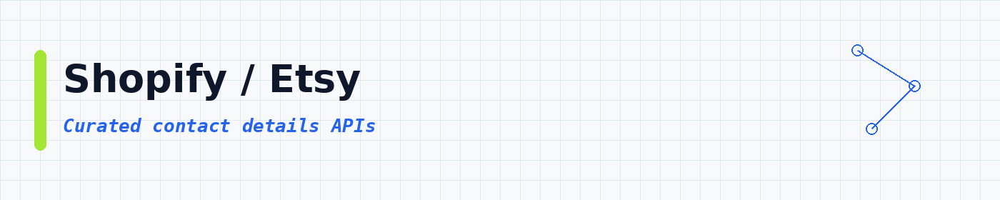
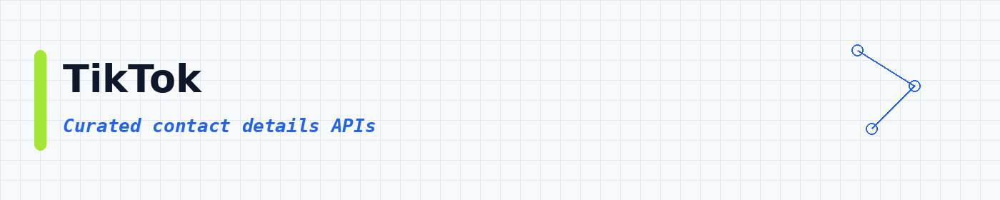
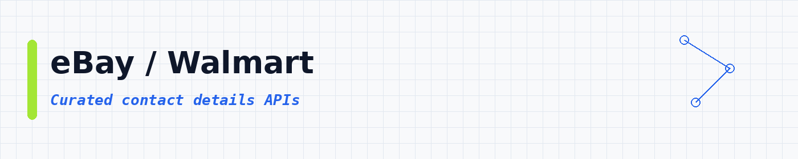

# Contact Details APIs: Find Emails, Phone Numbers and Public Contact Info

<p align="center">
 
</p>

<p align="center">
 
 
 
</p>

<p align="center">
 <a href="#top-10-most-popular">Top 10</a> ·
 <a href="#table-of-contents">Categories</a> ·
 <a href="#how-to-use">How to use</a> ·
 <a href="#faq">FAQ</a>
</p>

**A big, tidy list of contact details APIs** for emails, phone numbers, social contacts and public website contact pages. **21,788 APIs**, sorted by real users so the useful ones show up first.

---

## Collection statistics

| Metric | Count |
|--------|-------|
| **Contact Details APIs** | **21,788** |
| **Categories** | **18** |
| **Last updated** | 2026-11-02 |

---

## What is a contact details API?

A contact details API is a tool you call to find how to reach a person or business. Things like email, phone, social links and contact-page fields. You give it a domain, name or profile. It gives you clean rows you can save as CSV or JSON.

People also call this an email finder, a phone scraper or a contact info API. Same idea: gather public contact fields without hunting page by page.

---

## What can you build?

These **21,788 ready-to-use contact details APIs** help you pull reach-out data into your own apps. You can:

- Find business emails from a domain or company name
- Pull phone numbers from maps and directories
- Scrape contact pages for public forms and addresses
- Verify emails before you import them
- Attach social profile links to a lead row
- Enrich spreadsheets with missing contact fields
- Export clean CSV or JSON for outreach tools


Pick an API below, open it, try a small run, then export the results.

---

## Star this repository

If this list helped you, a star helps other people find it too.

---

## Table of contents

- [Email / Phone](#email-phone) : **8,827**
- [Other / General](#other-general) : **2,561**
- [Real Estate](#real-estate) : **2,280**
- [Google / Maps](#google-maps) : **1,950**
- [Jobs / Recruiting](#jobs-recruiting) : **1,133**
- [Company / B2B](#company-b2b) : **916**
- [LinkedIn](#linkedin) : **882**
- [SEO / SERP](#seo-serp) : **828**
- [AI / Agents / MCP](#ai-agents-mcp) : **621**
- [Reviews / Brand](#reviews-brand) : **414**
- [Instagram](#instagram) : **387**
- [Shopify / Etsy](#shopify-etsy) : **263**
- [Facebook / Meta](#facebook-meta) : **230**
- [TikTok](#tiktok) : **176**
- [Amazon](#amazon) : **110**
- [News / Content](#news-content) : **91**
- [X / Twitter](#x-twitter) : **74**
- [eBay / Walmart](#ebay-walmart) : **45**

---

## Top 10 most popular

| API | What it does | Users | Rating | Price |
|-----|-------------|-------|--------|-------|
| [Google Maps Scraper](https://apify.com/compass/crawler-google-places?fpr=data) | Extract data from thousands of Google Maps locations and businesses, including reviews, reviewer details, images, contact info, including f… | 678.3K | 4.71 | Pay per event |
| [Google Maps Extractor](https://apify.com/compass/google-maps-extractor?fpr=data) | Extract data from hundreds of places fast. Scrape Google Maps by keyword, category, location, URLs & other filters. Get addresses, contact… | 105.4K | 4.86 | Pay per event |
| [📩📍 Google Maps Email Extractor](https://apify.com/lukaskrivka/google-maps-with-contact-details?fpr=data) | Extract Google Maps contact details. Scrape websites of Google Maps places for contact details and get email addresses, website, location,… | 93.9K | 4.64 | Pay per event |
| [LinkedIn Profile Scraper + Email (No Cookies)](https://apify.com/harvestapi/linkedin-profile-scraper?fpr=data) | Extract detailed information from LinkedIn profiles in bulk, including complete work experience, education history, skills and more. No coo… | 91.6K | 4.64 | Pay per event |
| [Facebook Pages Scraper](https://apify.com/apify/facebook-pages-scraper?fpr=data) | Extract basic data from multiple Facebook Pages or Profiles. Extract Facebook page details, website, email, address, messenger, likes, foll… | 73.4K | 4.67 | Pay per event |
| [Contact Details Scraper](https://apify.com/vdrmota/contact-info-scraper?fpr=data) | Email extractor and lead scraper to extract and download emails, phone numbers, Facebook, Twitter, LinkedIn, Instagram, Threads, Snapchat,… | 66.4K | 4.23 | Pay per event |
| [✨Mass Linkedin Profile Scraper with Email 📧 (No Cookies)](https://apify.com/dev_fusion/Linkedin-Profile-Scraper?fpr=data) | 🚀 Extract full LinkedIn profile insights: verified email 📧, phone number 📞, work history, education, and more... | 63.8K | 2.99 | Pay per event |
| [✨Leads Finder - $1.5/1k leads with Emails [Apollo Alternative]](https://apify.com/code_crafter/leads-finder?fpr=data) | ✅ Affordable alternative to ZoomInfo, Lusha & Apollo. ✅ Get Business email, 📞Mobile Number, Personal email, LinkedIn profiles, company deta… | 49.7K | 3.44 | Pay per event |
| [Facebook Ads Library Scraper](https://apify.com/apify/facebook-ads-scraper?fpr=data) | Extract advertising data from Facebook, Instagram, WhatsApp, Threads. Get ads, publishers, prices, reach estimates, impressions, links, ima… | 49.3K | 3.99 | Pay per event |
| [LinkedIn Company Employees Scraper (No Cookies)](https://apify.com/harvestapi/linkedin-company-employees?fpr=data) | Extract all LinkedIn Company employees with filters and detailed profile information, including complete work experience, and more. No cook… | 41.9K | 4.02 | Pay per event |

---

## Email / Phone

<a id="email-phone"></a>

<p align="center"></p>

**8,827 APIs in this category** | [View all →](lists/email-phone.md)

| API | What it does | Users | Rating | Price |
|-----|-------------|-------|--------|-------|
| [Skip Trace](https://apify.com/one-api/skip-trace?fpr=data) | Locate hard-to-find individuals with our powerful skip trace/tracing API. TruePeopleSearch, Fastpeoplesearch, Lead Finder, Truthfinder, Spo… | 21.0K | 4.32 | Pay per event |
| [Email Verifier by Million Verifier - $1/1k emails](https://apify.com/account56/email-verifier?fpr=data) | ✅ #1 Email Verification Service ✅ Only pay for valid and invalid emails ✅ No charge for catch all emails ✅ Easily verify emails from apollo… | 18.4K | 4.46 | Pay per event |
| [Tripadvisor Scraper](https://apify.com/maxcopell/tripadvisor?fpr=data) | This unofficial Tripadvisor API is a data extraction tool able to get data on hotels, restaurants, things to do, vacation rentals, attracti… | 15.3K | 4.93 | Pay per event |
| [Yelp Scraper](https://apify.com/tri_angle/yelp-scraper?fpr=data) | Scrape Yelp businesses by search term and city, or from Yelp URLs. Get contact details, rating, opening hours, and photos for each business… | 7.3K | 2.70 | Pay per event |
| [TruePeopleSearch Scraper: People, Phone & Address Lookup](https://apify.com/axlymxp/truepeoplesearch-scraper?fpr=data) | Scrape TruePeopleSearch (US public records) by name, phone, address or email: full name, age, current + previous addresses, phone numbers (… | 7.2K | n/a | Pay per event |
| [Deep Email, Phone, & Social Media Scraper Search](https://apify.com/peterasorensen/snacci?fpr=data) | A powerful tool that searches emails, phone numbers, and social media profiles from any website. It intelligently navigates, prioritizing p… | 5.3K | 4.86 | Pay per event |
| [Telegram Phone Number Lookup](https://apify.com/akula.marketing/Telegram-Get-Phone-Info?fpr=data) | Look up Telegram accounts by phone number. Get username, profile photo, premium status, and account details for lead verification and OSINT. | 4.6K | 4.94 | Pay per event |
| [Whatsapp Profiles Scraper](https://apify.com/inutil_labs/wscrp-free?fpr=data) | Scrape the Whatsapp network and fetch profile info of any user, including: Profile picture, About status, or check if it's a Whatsapp for B… | 4.4K | 5.00 | Free |
| [ThatsThem Scraper \| Skip Trace by Name, Phone, Address & Email](https://apify.com/memo23/skip-trace-people-finder?fpr=data) | Look up a US name, phone, address or email on ThatsThem: one public-records row per match with address history, relatives and aliases. Phon… | 4.1K | n/a | Pay per event |
| [WhatsApp Number Validator](https://apify.com/devscrapper/whatsapp-number-validator?fpr=data) | Instantly verify if a phone number is active on WhatsApp. Fast, secure, and reliable validation service. | 4.1K | 5.00 | Pay per event |
| [Send Email](https://apify.com/apify/send-mail?fpr=data) | Send a custom email to one or more recipients. This API is useful for notifications and reporting. It can be invoked directly from code or… | 3.8K | 4.99 | Free |
| [Email OSINT Lookup: Find Accounts, Breaches & Identity](https://apify.com/s-r/apifyosintemail?fpr=data) | Email OSINT for investigators, fraud and security teams: check which of 133 platforms an address is registered on, get the name and profile… | 3.4K | 4.31 | Pay per event |
| [Decision makers Email finder📧 $1/1K Emails, Super cheap.](https://apify.com/snipercoder/decision-maker-email-finder?fpr=data) | \|Input: Domain\| \|Output: Name, Email, Title, Company, etc of Decision makers.\| Perfect for Lead Generation, Email campaigns, Data Enric… | 3.2K | 3.96 | Pay per event |
| [Extract Contact Details from Any Website: Email, Phone, Social](https://apify.com/creative_tablecloth/extract-email-phone-social-media-from-any-website?fpr=data) | Discover our powerful scraper that effortlessly extracts emails, phone numbers, and social media links from any website. Ideal for marketer… | 3.2K | 2.47 | Pay per event |
| [Apollo People Leads Scraper](https://apify.com/coladeu/apollo-people-leads-scraper?fpr=data) | This API can scrape structured people data from Apollo.io. This scraper do NOT provide email addresses or telephone numbers. It does not re… | 2.9K | n/a | Pay per event |
| [Telegram Channel Scraper](https://apify.com/danielmilevski9/telegram-channel-scraper?fpr=data) | Telegram channel Scraper for getting public messages without login, phone number, or Telegram app. In the message supported forward and tel… | 2.8K | 3.00 | Free |
| [Email Finder & Verifier: B2B Email Lookup API](https://apify.com/clearpath/email-finder-api?fpr=data) | Find verified business emails using first name, last name, and company domain. Tests common patterns and validates with SMTP checks. Upload… | 2.7K | 3.84 | Pay per event |
| [Email Address Validator / Verifier ($4 for 1000 emails)](https://apify.com/overpowered/verify-email?fpr=data) | Cheap & Accurate Email Address Validator, Checker, Verifier. Only $4 for 1000 validations. CHEAPEST on the market. | 2.5K | 4.60 | Pay per event |
| [Extract Emails, Socials and Contacts from Any Website](https://apify.com/logical_scrapers/extract-email-from-any-website?fpr=data) | Extract emails from websites in bulk. Website email scraper and email extractor: extract email from website pages, plus social links and ph… | 2.5K | 5.00 | Pay per event |
| [Website Email & Phone Finder](https://apify.com/caprolok/website-email-phone-finder?fpr=data) | Accelerate your outreach by using our Contact Details Scraper to quickly gather emails from any domain, enhancing your marketing strategies… | 2.4K | 4.18 | Pay per event |
| [WhatsApp Number Lookup: Profile, Leaks, Telegram, Bulk](https://apify.com/eduair94/whatsapp-data-lookup?fpr=data) | Verify any WhatsApp number worldwide. Returns profile picture (real pics for normal users, not just businesses), about/status, business fla… | 2.4K | 4.95 | Pay per event |
| [Email Verifier & Validator \| Bulk Email Verification](https://apify.com/michael.g/email-verifier-validator?fpr=data) | Bulk email verifier and email validator for email list verification. Verify email addresses, detect invalid emails, check deliverability, a… | 2.4K | 4.74 | Pay per event |
| [Content Checker](https://apify.com/jakubbalada/content-checker?fpr=data) | Monitor a website or web page for content changes. Automatically saves before and after screenshots and sends an email notification when co… | 2.2K | 4.89 | Free |
| [Naver Product Detail Scraper](https://apify.com/delicious_zebu/naver-product-detail-scraper?fpr=data) | Scrape complete product data from any Naver SmartStore or Brand Store URL: price, discount, per-SKU options & stock, images, reviews, deliv… | 2.1K | 5.00 | Pay per event |
| [Email Finder (100% accurate)](https://apify.com/overpowered/email-finder?fpr=data) | Find 100% valid prospect email by inputing name, surname and domain | 2.1K | 4.66 | Pay per event |
| [Dark Web Scraper](https://apify.com/epctex/darkweb-scraper?fpr=data) | Extract publicly exposed data, including crypto wallets, API keys, emails, phone numbers, and more from publicly accessible Tor (.onion) si… | 1.9K | 5.00 | Pay per event |
| [Website Email Scraper: All Contacts](https://apify.com/thenetaji/website-email-scraper?fpr=data) | The API crawls a website and returns one evidence-rich record per URL supplied: emails, phone numbers, social profiles, and addresses, each… | 1.9K | 4.86 | Pay per event |
| [Email Domain Scraper: Extract Emails From Websites by Domain](https://apify.com/s-r/free-email-domain-scraper?fpr=data) | Enter up to 10 company domains or website URLs and get the email addresses published for each one: one row per address with its domain, rea… | 1.9K | 5.00 | Pay per event |
| [Leads Scraper - ✅ Up to 10k with EMAILS ✅ similar to Apollo](https://apify.com/unlimitedleadtestinbox/unlimited-leads-scraper---up-to-10k-with-emails?fpr=data) | Scrape Up to 10K leads per run with emails. Similar to Apollo. Using Unlimited leads database | 1.9K | 3.38 | Free |
| [Yandex Maps Places Scraper](https://apify.com/m_mamaev/yandex-maps-places-scraper?fpr=data) | Extract structured data from thousands of Yandex Maps locations and businesses, including phone numbers, emails, websites, reviews, images,… | 1.7K | 4.24 | Pay per event |
| [Extended GPT Scraper](https://apify.com/drobnikj/extended-gpt-scraper?fpr=data) | Extract data from any website and feed it into GPT via the OpenAI API. Use ChatGPT to proofread content, analyze sentiment, summarize revie… | 1.6K | 4.84 | Free |
| [Whatsapp Number Validator (Pay Per Result)](https://apify.com/vtrdev/whatsapp-number-validator?fpr=data) | Quickly verify WhatsApp presence for phone numbers. Enjoy accurate, bulk validation with pay-per-result pricing. Validate up to 19.200 numb… | 1.4K | 4.18 | Pay per event |
| [Snapchat Email Scraper](https://apify.com/easyapi/snapchat-email-scraper?fpr=data) | 🚀 Effortlessly scrape email addresses from Snapchat profiles! 👻 Find Snapchat users matching your keywords and specific email domains. Perf… | 1.3K | 1.00 | Pay per event |
| [Email check, verify, validate](https://apify.com/anchor/email-check-verify-validate?fpr=data) | Email Check, verify and validate in seconds: Unlimited | 1.3K | 5.00 | Pay per event |
| [Apollo Companies Leads Scraper](https://apify.com/coladeu/apollo-organizations-scraper?fpr=data) | This API can scrape structured companies data from Apollo.io, including emails and phone numbers. It does not require Apollo account cookie… | 1.3K | 1.00 | Pay per event |
| [Telegram Profile](https://apify.com/truefetch/telegram-profile?fpr=data) | Telegram profile scraper for resolving up to 1,000 usernames, @handles, t.me URLs, accessible invites, or phone numbers into 41-field spars… | 1.3K | 4.87 | Pay per event |
| [Website Email & Contact Scraper](https://apify.com/maximedupre/website-emails-scraper?fpr=data) | Find public contact emails on websites from URLs or company details. Get one unique, normalized email per row with its source page, plus ph… | 1.3K | 5.00 | Pay per event |
| [WhatsApp Number Validator (Single and Bulk)](https://apify.com/api_factory/whatsapp-number-validator-single-and-bulk?fpr=data) | 📞 WhatsApp: +447984004914 📧 E-mail: contact@apifactory.pro Instantly check and validate WhatsApp phone numbers programmatically. Verify act… | 1.3K | 3.27 | Pay per event |
| [Email Verifier & Deliverability Checker](https://apify.com/yasir-on-apify/email-verifier-deliverability-checker?fpr=data) | Verify single emails or bulk email lists with deliverability checks, quality scores, and disposable, catch-all and role account detection.… | 1.3K | 5.00 | Pay per event |
| [Avvo Scraper with Mails \| US Lawyer Directory](https://apify.com/fatihtahta/avvo-scraper?fpr=data) | Get verified US attorney profiles from Avvo.com including names, contacts, firms, ratings, practice areas, and locations. Build legal direc… | 1.3K | 5.00 | Pay per event |


[View all 8,827 in this section →](lists/email-phone.md)

## Other / General

<a id="other-general"></a>

<p align="center"></p>

**2,561 APIs in this category** | [View all →](lists/other-general.md)

| API | What it does | Users | Rating | Price |
|-----|-------------|-------|--------|-------|
| [Telegram Group and Channel Member Adder](https://apify.com/bhansalisoft/telegram-channel-member-adder?fpr=data) | Telegram Group and Channel Member Adder: Scrap Telegram Groups/Channel- Scrap hidden member from chat history and member list and then add… | 7.2K | 3.43 | Pay per event |
| [Telegram Messages Scraper](https://apify.com/curious_coder/telegram-scraper?fpr=data) | Scrape messages from any telegram group / channel / chats | 7.2K | 2.01 | Free |
| [Telegram Scraper](https://apify.com/tri_angle/telegram-scraper?fpr=data) | Scrape public Telegram channels: the profile, follower count, and bio, plus every message with its date, views, and links. Limit it to the… | 5.0K | 2.81 | Pay per event |
| [Telegram Scraper: Group, Channel Member Scraper](https://apify.com/bhansalisoft/telegram-group-member-scraper?fpr=data) | Telegram scraper for extracting available members from groups and channels. Get User IDs, usernames, names and access hashes with no Telegr… | 3.2K | 5.00 | Pay per event |
| [Telegram Username Checker](https://apify.com/akula.marketing/Telegram-Get-Username-Info?fpr=data) | Verify Telegram usernames in bulk. Check existence, user vs channel type, subscriber count, title, bio, and profile photo. | 1.8K | 5.00 | Pay per event |
| [Telegram Media Downloader 📥](https://apify.com/easyapi/telegram-media-downloader?fpr=data) | A powerful Telegram media downloader that extracts videos, photos, and other media content from Telegram posts. Simply input the post URLs… | 1.6K | 4.69 | Pay per event |
| [Telegram Member Scraper](https://apify.com/agentx/telegram-member-scraper?fpr=data) | Telegram member scraper for public groups, returning 23-field profiles from the visible participant list and optional message-author discov… | 1.5K | 4.80 | Pay per event |
| [Telegram Group and Channel Member Extractor Without Login](https://apify.com/clothefobia/telegram-group-and-channel-member-extractor?fpr=data) | Telegram Group and Channel Member Extractor -Extract member From any telegram group/channel Without Telegram Login | 1.2K | 3.00 | Pay per event |
| [Telegram Channel & Profile Scraper](https://apify.com/automation-lab/telegram-scraper?fpr=data) | Scrape Telegram public channels and profiles: channel metadata, messages, views, reactions, and media URLs. No API key or login needed. | 1.1K | 5.00 | Pay per event |
| [Telegram Scraper](https://apify.com/dainty_screw/telegram-scraper?fpr=data) | Seamlessly extract public messages from any Telegram public channel and gain valuable insights. Perfect for researchers, marketers, and dat… | 1.1K | 4.61 | Pay per event |
| [Watson: Username Finder](https://apify.com/lofomachines/watson?fpr=data) | Fast, Reliable, username discovery: alternative to Sherlock. Hunt for accounts by username across +700 sources. | 1.1K | 4.67 | Pay per event |
| [Telegram Channel Message](https://apify.com/truefetch/telegram-channel-message?fpr=data) | Telegram channel scraper for dependable post-history exports, returning 55 structured fields plus optional stored media. Capture text, send… | 1.0K | 3.11 | Pay per event |
| [Telegram Username](https://apify.com/xtools/telegram-username?fpr=data) | Bulk Telegram username availability checker. Verify thousands of usernames instantly: returns Available, Taken, Auctioned, or Sold. Feature… | 997 | 5.00 | Pay per event |
| [Telegram Channels Scraper](https://apify.com/pamnard/telegram-channels-scraper?fpr=data) | Scrapes channels data from Telegram | 917 | 1.00 | Free |
| [🔍🚗 Mobile.de Scraper (PPR)](https://apify.com/3x1t/mobile-de-scraper-ppr?fpr=data) | Effortlessly scrape car data from Germany's largest vehicle marketplace, Mobile.de. Get access to millions of entries of cars, motorbikes,… | 867 | 4.00 | Pay per event |
| [🔍🚗 Mobile.de Scraper](https://apify.com/3x1t/mobile-de-scraper?fpr=data) | Effortlessly scrape car data from Germany's largest vehicle marketplace, Mobile.de. Get access to millions of entries of cars, motorbikes,… | 856 | 5.00 | Free |
| [Polymarket + Kalshi Arbitrage Finder](https://apify.com/congism/polymarket-kalshi-arb-finder?fpr=data) | Scans both Polymarket and Kalshi for matching binary prediction markets and identifies price discrepancies where buying YES on one platform… | 851 | n/a | Pay per event |
| [Social Profile Finder \| Username Search API](https://apify.com/xtech/social-media-finder-pro?fpr=data) | Check usernames across 400+ supported websites and collect public profile links. Choose selected sites for a focused search or run broader… | 829 | 2.03 | Pay per event |
| [Telegram Group Member](https://apify.com/truefetch/telegram-group-member?fpr=data) | Telegram group members export for public communities, returning 23-field profiles from the visible participant list and optional message-au… | 792 | 5.00 | Pay per event |
| [Telegram Profile Photo Scraper](https://apify.com/akula.marketing/Telegram-Get-Username-Photos?fpr=data) | Fetch Telegram profile photo history and user metadata by username. Returns IDs, names, status, premium flags, and signed photo URLs. | 753 | 5.00 | Pay per event |
| [Face Finder🕵️](https://apify.com/api402/face-finder?fpr=data) | An advanced reverse image search tool for faces across the internet. Discover where an image appears online, find social media profiles, an… | 698 | 3.45 | Pay per event |
| [Residential Proxy Probe](https://apify.com/jancurn/residential-proxy-probe?fpr=data) | Find residential proxy sessions on Proxy with target IP addresses geo-located in specific postal codes or DMAs. | 682 | n/a | Free |
| [FlashScore Scraper Live](https://apify.com/statanow/flashscore-scraper-live?fpr=data) | Scrape FlashScore live scores, fixtures, results, odds, and match events across 16 sports. In historical mode, enrich each match with up to… | 623 | 5.00 | Pay per event |
| [Telegram Group Scraper](https://apify.com/data_dino/telegram-group-scraper?fpr=data) | Scrape all members from public Telegram groups or channels with blazing speed: over 1,000 members per minute. | 609 | n/a | Free |
| [Telegram Scraper \| Telegram Message Scraper](https://apify.com/bhansalisoft/telegram-group-channel-message-scraper?fpr=data) | This Telegram Scraper tool Scrape Telegram group and channel messages, chat history and available user information with a Telegram scraper.… | 519 | 1.00 | Pay per event |
| [Copart Public Search Scraper](https://apify.com/parseforge/copart-public-search-scraper?fpr=data) | Scrapes vehicle listings from Copart public search URLs and single lot pages. Returns each lot as a flat row with optional VIN enrichment f… | 515 | 5.00 | Pay per event |
| [Website Tech Stack Scanner \| Website Technology Detector](https://apify.com/misterkhan/website-tech-stack-scanner?fpr=data) | Scan any website to detect 7,000+ technologies, from CMSs, analytics, and marketing pixels to JS frameworks, CDNs, and hosting. Use it for… | 511 | 5.00 | Pay per event |
| [Shopee Shop Scraper](https://apify.com/xtracto/shopee-shop-scraper?fpr=data) | Extract product listings from a Shopee shop by username, shop ID, or shop URL. Optionally enrich each product with full detail data (varian… | 504 | n/a | Pay per event |
| [Mercadolibre Product Scraper](https://apify.com/saswave/mercadolibre-product-scraper?fpr=data) | $0.8 / 1000 results, no proxies needed. Fast and reliable scraper for MercadoLibre product pages and search results. Support all domains. P… | 441 | 2.71 | Pay per event |
| [Telegram](https://apify.com/canadesk/telegram?fpr=data) | Collect public Telegram channel profiles and messages, including text, timestamps, views, media links, replies and polls. | 430 | 4.71 | Pay per event |
| [Telegram Group or Channel Adder Using Telegram UserName](https://apify.com/bhansalisoft/telegram-group-or-channel-adder-using-telegram-username?fpr=data) | Telegram Group or Channel Adder Using Member Json Data- Add member into telegram group or channel by input json file as per scrap from Tele… | 395 | n/a | Pay per event |
| [Telegram Chat Scraper](https://apify.com/agentx/telegram-chat-scraper?fpr=data) | Telegram chat scraper for public channels, groups, and forums, returning 55 structured message fields with optional stored media. Export te… | 376 | 5.00 | Pay per event |
| [Scraper Api](https://apify.com/zfcsoftware/scraper-api?fpr=data) | This api allows you to scrape sites such as websites with rate limits, websites with protection such as Cloudflare. It is cheap and fast. I… | 346 | 1.00 | Pay per event |
| [Social Media Finder: Social Analyzer \| Username 900+ Sites](https://apify.com/anshumanatrey/social-analyzer?fpr=data) | Find someone's public profiles from a username, or a list of them, across all 999 sites the scanner knows, every run. Paste a handle, an @h… | 344 | n/a | Pay per event |
| [Pinterest Image Downloader](https://apify.com/easyapi/pinterest-image-downloader?fpr=data) | Easily download high-quality images from Pinterest. With batch downloading capabilities and comprehensive data retrieval, you can enrich yo… | 340 | 5.00 | Pay per event |
| [Telegram Groups Scraper](https://apify.com/i-scraper/telegram-groups-scraper?fpr=data) | ⚡️ Telegram Groups Scraper: Extract messages from public & private Telegram groups. | 340 | n/a | Pay per event |
| [Telegram Channels Scraper](https://apify.com/i-scraper/telegram-channels-scraper?fpr=data) | ⚡️ Telegram Channels Scraper: Extract posts from public Telegram channels. | 332 | 5.00 | Pay per event |
| [Yelp Business Scraper](https://apify.com/beatanalytics/yelp-business-scraper?fpr=data) | Extract 25+ fields from any Yelp business: ratings, hours, photos, address, categories, and attributes. Search by query and location or loo… | 323 | n/a | Pay per event |
| [Journalist Request Finder: HARO Alternative for Digital PR](https://apify.com/fayoussef/journalist-request-finder?fpr=data) | Find live journalist source requests in one feed, pulled from SourceBottle call-outs and #journorequest posts on Bluesky and Mastodon. Filt… | 299 | n/a | Pay per event |
| [Coles Scraper: Prices & Stock by Store, Specials, Catalog](https://apify.com/clearpath/coles-scraper?fpr=data) | Coles Australia prices and stock for every store. Search, paste any Coles link, or scrape half-price and multibuy specials and the full cat… | 286 | n/a | Pay per event |


[View all 2,561 in this section →](lists/other-general.md)

## Real Estate

<a id="real-estate"></a>

<p align="center"></p>

**2,280 APIs in this category** | [View all →](lists/real-estate.md)

| API | What it does | Users | Rating | Price |
|-----|-------------|-------|--------|-------|
| [People Skip Trace: Phone, Email & Address Lookup](https://apify.com/nice_dev/people-skip-trace-scraper?fpr=data) | Skip trace US people by name, address, phone or email: every phone number with line type and carrier, emails, age, past addresses, relative… | 14.4K | n/a | Pay per event |
| [UAE Dubai Property Leads Unit Number Finder](https://apify.com/dhrumil/uae-dubai-property-leads-unit-number-finder?fpr=data) | Find property owner details along with Unit Number for any property in UAE listed on propertyfinder, bayut or dubizzle. Integrate lead info… | 5.2K | 1.51 | Pay per event |
| [Dubai Property Unit Finder](https://apify.com/dhrumil/dubai-property-unit-finder?fpr=data) | Find property unit number along with owner details for any property in Dubai listed on propertyfinder, bayut or dubizzle. Integrate lead in… | 3.7K | 1.18 | Pay per event |
| [Idealista Scraper: Real Estate for Spain Italy Portugal France](https://apify.com/igolaizola/idealista-scraper?fpr=data) | Extract real estate data from Spain, Italy, Portugal, and France on idealista.com, including pricing, property features, and contact inform… | 2.7K | 3.76 | Pay per event |
| [Dubai Unit Number & Owner Finder (Bayut + PropertyFinder)](https://apify.com/gauravsaran/dubai-property-unit-finder?fpr=data) | Want faster deals and better leads? Instantly get owner details and unit numbers from any UAE property listing on Bayut AND PropertyFinder.… | 1.6K | 1.64 | Pay per event |
| [Propertyfinder Scraper](https://apify.com/dhrumil/propertyfinder-scraper?fpr=data) | Scrape Propertyfinder.ae to crawl millions of sale/rent real estate properties from UAE Our real estate scraper also lets you monitor speci… | 1.5K | 3.74 | Pay per event |
| [Idealista Scraper API 🏠 Any Search URL, No Result Cap & France](https://apify.com/dz_omar/idealista-scraper-api?fpr=data) | Scrape Idealista property listings from Spain, Portugal, Italy and France. Paste any Idealista URL: property page, search, drawn map area,… | 1.4K | 4.92 | Pay per event |
| [Propwire Scraper: US Property & Owner Data](https://apify.com/solidcode/propwire-com-scraper?fpr=data) | [💰 $0.75 / 1K] Extract US property and owner data from Propwire.com: owner names and mailing addresses, equity and value estimates, mortgag… | 1.3K | n/a | Pay per event |
| [UAE Dubai Property Owner Finder](https://apify.com/dhrumil/uae-dubai-property-owner-finder?fpr=data) | Find property owner details along with the help Unit Number and building name for any property in Dubai, UAE.Integrate lead information wit… | 1.3K | 1.78 | Free |
| [Dubai Property Owner Contact & Unit Number Finder](https://apify.com/webcrawlerr/dubai-property-crawler?fpr=data) | Extract comprehensive Dubai property data with 100% accuracy. Get verified owner contact details, unit numbers, permit info, and complete p… | 1.0K | n/a | Pay per event |
| [Zillow Agents Leads [Download over 1M of Agents]](https://apify.com/memo23/zillow-agents-leads-scraper-ppe?fpr=data) | The only Zillow agents scraper with its own 1,300,000+ agent database: instant, uncapped (beats the 250-per-search limit), 98% with a direc… | 1.0K | 5.00 | Pay per event |
| [Dubai Unit Number & Owner Details Finder (PropertyFinder Only)](https://apify.com/gauravsaran/dubai-unit-number-owner-details-finder-propertyfinder-only?fpr=data) | Want faster deals and better leads? Instantly get owner details and unit numbers from any PropertyFinder UAE listing in 3: 6s. The fastest… | 989 | 1.78 | Pay per event |
| [Idealista Scraper💰$0.65+/1K Spain Italy Portugal France Emails](https://apify.com/memo23/idealista-scraper?fpr=data) | From $0.65/1K 💰 Idealista for Spain, Italy, Portugal & France. Paste any search URL, or scrape a whole country in one run: 52 ES / 107 IT /… | 974 | 5.00 | Pay per event |
| [Airbnb Email Scraper](https://apify.com/louisdeconinck/airbnb-email-scraper?fpr=data) | The only Airbnb scraper that finds host email addresses! This API searches Airbnb listings to discover host email addresses along with deta… | 886 | 2.07 | Free |
| [Redfin Search Scraper](https://apify.com/tri_angle/redfin-search?fpr=data) | Scrape every home on a Redfin map search, whether for sale, for rent, or recently sold. Each comes with its price, size, address, and listi… | 806 | 5.00 | Pay per event |
| [Zillow Details Scraper: Zillow Property Details, Agent Data](https://apify.com/afanasenko/zillow-property-agent-data-scraper?fpr=data) | Zillow search scraper for real estate listings, agent leads and contacts: listing agent email and phone, emails, phones, price history, Zes… | 802 | 4.94 | Pay per event |
| [$0.8/1K💙 Immobiliare.it Scraper \| Italy Real Estate API](https://apify.com/azzouzana/immobiliare-it-listing-page-scraper-by-search-url?fpr=data) | From $0.8/1K 🔥 #1 Scrape Immobiliare & instantly extract detailed property listings: titles, descriptions, photos, prices, energy ratings,… | 723 | 5.00 | Pay per event |
| [Realtor.com [$1.5💰] [Download All Agents] [No 3K Limit]](https://apify.com/memo23/realtor-search-cheerio?fpr=data) | 💰$1.50 per 1,000 results. Effortlessly scrape real estate data from Realtor.com, including property listings AND agent profiles. Extract pr… | 712 | 5.00 | Pay per event |
| [Zillow Agents \| Search \| Detail pages \| with Email Scraper](https://apify.com/memo23/apify-zillow-agents-cheerio?fpr=data) | Unlock the power of Zillow with automated agent profile scraping: gather key insights and data on real estate agents effortlessly. | 661 | 5.00 | Pay per event |
| [Airbnb Pro Host · Business Emails by City](https://apify.com/corent1robert/airbnb-professional-host-scraper?fpr=data) | Search any city worldwide for Airbnb professional hosts. Business emails, phones, and company names where disclosed (best in EU/EEA). Compa… | 597 | 4.21 | Pay per event |
| [LoopNet US + UK + Realla [$1.5💰] Commercial Property Scraper](https://apify.com/memo23/loopnet-scraper-ppe?fpr=data) | 💰 $1.50 per 1,000 results, scrape commercial property from LoopNet (US) AND LoopNet UK / Realla (UK) in one API: the only scraper bundling… | 548 | 5.00 | Pay per event |
| [TruePeopleSearch: People Search Scraper](https://apify.com/memo23/truepeoplesearch-people-search-scraper?fpr=data) | Scrape US people from TruePeopleSearch by name, phone or address. Each row: full phone numbers, emails, current + past addresses with geo,… | 544 | 5.00 | Pay per event |
| [Crexi.com \| intelligence \| Search \| Detail \| Agent (/w EMAILS)](https://apify.com/memo23/apify-crexi?fpr=data) | Unlock Crexi's commercial real estate network. Extract property listings and broker profiles for market insights, deal-making, and investme… | 505 | 5.00 | Pay per event |
| [Zillow Scrape: Address/URL/ZPID](https://apify.com/one-api/zillow-scrape-address-url-zpid?fpr=data) | Get Zestimates from the property address/zpid/url. Each row gets scraped in less than 1 second ! | 503 | 1.00 | Pay per event |
| [Zillow Agents Finder](https://apify.com/jupri/zillow-agents?fpr=data) | 💫 Scrape Zillow.com Agents & Lenders | 501 | 3.29 | Free |
| [ZAP Imóveis Scraper \| Fast & Reliable](https://apify.com/fatihtahta/zap-imoveis-scraper?fpr=data) | Extract structured Brazil property listings from ZAP Imoveis with pricing, locations, seller details, media assets, and contact data. Built… | 491 | 5.00 | Pay per event |
| [Realtor.com Agents by Zip Code](https://apify.com/scraped/realtor-com-agents-by-zip-code?fpr=data) | Pull details for Realtor.com agents including email, cell, number of sales, and more. | 479 | 4.37 | Pay per event |
| [Skip Trace Property Owner: Phone, Email & Address Finder](https://apify.com/khadinakbar/skip-trace-property-owner?fpr=data) | Turn US property addresses into owner contact rows: owner name, phone numbers, emails, mailing address and relatives from public records an… | 447 | n/a | Pay per event |
| [Booking.com Hotel Scraper: Prices, Room Rates & Reviews](https://apify.com/rl1987/booking-api-scraper?fpr=data) | Scrape Booking.com hotel prices, room rates and availability via the mobile API. Full per-room rate table with itemised taxes and fees, fam… | 424 | n/a | Pay per event |
| [LoopNet Search By Urls & Keywords \| Details \| Agents \| Contacts](https://apify.com/memo23/apify-loopnet-search-cheerio?fpr=data) | Unlock valuable commercial property data from LoopNet. Extract detailed listings and agents insights for smarter real estate decisions. | 409 | 4.97 | Pay per event |
| [Redfin Detail Scraper](https://apify.com/tri_angle/redfin-detail?fpr=data) | Scrape full Redfin property pages from URLs, plain addresses, or Redfin Search Scraper results. Get the list price, Redfin Estimate, compar… | 400 | 4.65 | Pay per event |
| [Zillow Search Scraper ($1.50/1000 results)](https://apify.com/api-ninja/zillow-search-scraper?fpr=data) | Your ultimate Zillow scraping tool. The API extracts comprehensive property data from Zillow search results, including prices, addresses, a… | 400 | 4.97 | Pay per event |
| [ZILLOW \| Bypass Limit of 500 \| Search \|Agent \| with Email](https://apify.com/memo23/zillow-cheerio-scraper?fpr=data) | Unleash the full power of Zillow data: no limits, no restrictions. Comprehensive scraping for any search URL, delivering complete property… | 390 | 4.99 | Pay per event |
| [Yad2 Real Estate: Israel Property Listings](https://apify.com/swerve/yad2-scraper?fpr=data) | Scrape Yad2.co.il real estate listings across 127+ Israeli cities. Get prices, rooms, area, amenities, photos, descriptions, and agent cont… | 362 | 3.00 | Pay per event |
| [Zillow Search by Address Scraper](https://apify.com/axesso_data/zillow-search-by-address-scraper?fpr=data) | The Zillow Search by Address Scraper retrieves real-time property data by address from Zillow, providing accurate details including propert… | 359 | 4.00 | Pay per event |
| [Real Estate AU: Listings, Prices, Agents & History](https://apify.com/abotapi/realestate-au-scraper?fpr=data) | Extract detailed Australian real estate property listings with 30+ structured fields, including price, description, indoor and outdoor feat… | 354 | 4.81 | Pay per event |
| [Spitogatos Scraper: Greece Real Estate Listings & Agent Phones](https://apify.com/fayoussef/spitogatos-scraper?fpr=data) | Scrape Greece real estate listings from Spitogatos.gr, the country's largest property portal. Homes, land and commercial property for sale… | 337 | 5.00 | Pay per event |
| [Fotocasa Scraper: Real Estate data for Spain](https://apify.com/igolaizola/fotocasa-scraper?fpr=data) | Extract detailed real estate listings from fotocasa.es across Spain: pricing, property features, location, agency contacts, and multimedia.… | 336 | 5.00 | Pay per event |
| [Realestate.com.au Scraper ❤️ Sold, Rent & Buy Listings](https://apify.com/azzouzana/real-estate-au-scraper-pro?fpr=data) | From $0.9/1K 💰 Scrape Australia's Realestate.com.au! Bypass 2K limit & Extract comprehensive property data: including addresses, prices, be… | 331 | 5.00 | Pay per event |
| [Realestate [com.au & co.nz] $0.9💰 Search By URLs and Keywords](https://apify.com/memo23/realestate-au-listings?fpr=data) | 💰 Only $0.9💰 Realestate.com.au listings from official services APIs. Input: buy/rent/sold list URLs or direct property pages. Output: one r… | 316 | 5.00 | Pay per event |


[View all 2,280 in this section →](lists/real-estate.md)

## Google / Maps

<a id="google-maps"></a>

<p align="center"></p>

**1,950 APIs in this category** | [View all →](lists/google-maps.md)

| API | What it does | Users | Rating | Price |
|-----|-------------|-------|--------|-------|
| [Google Maps Scraper](https://apify.com/compass/crawler-google-places?fpr=data) | Extract data from thousands of Google Maps locations and businesses, including reviews, reviewer details, images, contact info, including f… | 678.3K | 4.71 | Pay per event |
| [Google Maps Extractor](https://apify.com/compass/google-maps-extractor?fpr=data) | Extract data from hundreds of places fast. Scrape Google Maps by keyword, category, location, URLs & other filters. Get addresses, contact… | 105.4K | 4.86 | Pay per event |
| [📩📍 Google Maps Email Extractor](https://apify.com/lukaskrivka/google-maps-with-contact-details?fpr=data) | Extract Google Maps contact details. Scrape websites of Google Maps places for contact details and get email addresses, website, location,… | 93.9K | 4.64 | Pay per event |
| [Google Maps Scraper $1/1k places 📍 with emails 📧](https://apify.com/microworlds/crawler-google-places?fpr=data) | Extract data from thousands of Google Maps locations and businesses, including reviews, reviewer details, images, contact info, including f… | 17.8K | 4.26 | Pay per event |
| [Leads Scraper ✅ $1/1k with EMAILS ✅ Apollo \| LinkedIn Profile](https://apify.com/peakydev/leads-scraper-ppe?fpr=data) | ✅ - Cheap ways to Extract leads with verified ☎️ Mobile ✅ Work & Personal Emails. Similar to Apollo, ZoomInfo, Lusha, LinkedIn \| Google Ma… | 17.8K | 3.98 | Pay per event |
| [Google Maps Scraper \| $0.25/1K Results 💰](https://apify.com/scraperlink/google-maps-scraper?fpr=data) | 🔥 $0.25/1K results🔥 **CHEAPEST** Google Maps Scraper on: 10× cheaper than competitors. Proxies & platform costs included. Results in second… | 5.5K | 4.97 | Pay per event |
| [Youtube Channel Email Scraper](https://apify.com/dataovercoffee/Youtube-Channel-Business-Email-Scraper?fpr=data) | 🚀🔒 Extract real YouTube channel emails at scale with logged-in accounts & CAPTCHA solving: No BS, Real Emails ✉️✨ | 5.2K | 4.40 | Pay per event |
| [Linkedin Email Scraper](https://apify.com/bhansalisoft/linkedin-email-scraper?fpr=data) | Linkedin Email Scraper- Scrap Emails from linkedin specific profile using google search engine | 3.7K | 3.04 | Pay per event |
| [PhoneInfoga: Phone Number OSINT Scanner](https://apify.com/datacach/phoneinfoga-phone-number-osint-scanner?fpr=data) | Reverse phone lookup powered by PhoneInfoga. Detects carrier, country, line type and OSINT footprints for any international number. Integra… | 3.5K | n/a | Pay per event |
| [20+ Million Business Leads With Emails (From Google Maps)](https://apify.com/xmiso_scrapers/millions-us-businesses-leads-with-emails-from-google-maps?fpr=data) | Don't have time to scrape google maps? Looking for affordable B2B data apollo.io alternative? Get recent leads from continuously updated da… | 3.3K | 4.75 | Pay per event |
| [All in one Social media Email Scraper](https://apify.com/bhansalisoft/all-in-one-social-media-email-scraper?fpr=data) | All in One Social Email Extractor: Software can Extract Email from All Social Network Profile Linkedin Email Extractor Facebook Email Extra… | 3.1K | 3.80 | Pay per event |
| [Google Maps Scraper](https://apify.com/poidata/google-maps-scraper?fpr=data) | 🔥 $0.40/1K results 🔥 Get 📧 emails, 📞 phones, 🌐 websites, 📱 social profiles, addresses, ratings, reviews, hours & more. Find businesses by k… | 3.1K | 4.34 | Pay per event |
| [Google Maps Scraper](https://apify.com/boztek-ltd/google-maps-scraper?fpr=data) | Extract data from thousands of Google Maps locations and businesses, including reviews, reviewer details, images, contact info, including f… | 2.9K | 4.39 | Pay per event |
| [Youtube Email Scraper](https://apify.com/bhansalisoft/youtube-email-scraper?fpr=data) | Youtube Email Scraper- Scrap Emails from Youtube specific profile using google search engine | 2.6K | 4.51 | Pay per event |
| [📩 Google Maps Email Extractor](https://apify.com/poidata/google-maps-email-extractor?fpr=data) | Quickly collect all business details, including emails, phone numbers, and social media links from Google Maps listings and their websites.… | 2.5K | 1.89 | Pay per event |
| [Keyword Search Volume Finder: Ahrefs Alternative](https://apify.com/khadinakbar/dataforseo-keyword-research?fpr=data) | Get keyword ideas or Google search volumes for your seed phrases, with CPC, competition, keyword difficulty, intent and a 12-month trend pe… | 2.3K | n/a | Pay per event |
| [Google Maps Business Leads Scraper (Email, Phone...)](https://apify.com/lurkapi/google-maps-business-leads-scraper?fpr=data) | Scrape business listings from Google Maps and enrich with emails, phones, and social profiles from each company website. Lead generation in… | 2.1K | 4.85 | Pay per event |
| [Enrich Google Maps Dataset with Contacts](https://apify.com/compass/enrich-google-maps-dataset-with-contacts?fpr=data) | Enrich Google Maps Dataset with Contacts. Scrape websites of Google Maps places for contact details and get email addresses, website, locat… | 1.9K | 3.13 | Free |
| [Google Maps Scraper: Most Comprehensive](https://apify.com/kaix/google-maps-places-scraper?fpr=data) | 🔥 ~$0.06/1K places + FREE contact details (email, phone, and more..) 🔥 Scrape businesses and locations with 76+ fields per place including… | 1.8K | 4.34 | Pay per event |
| [Bulk Email Verifier: Gmail, Outlook & Business Validation](https://apify.com/andrew_babo/email-verifier-bulk-validator?fpr=data) | Verify email lists at scale. Get honest valid/invalid verdicts for Gmail, Google Workspace, Microsoft 365, Outlook and business domains. No… | 1.8K | n/a | Free |
| [Google Maps Scraper: Business Leads, Emails & Reviews](https://apify.com/andrew_babo/google-maps-scraper?fpr=data) | Scrape Google Maps business data at scale: names, addresses, phones, websites, emails, opening hours, ratings and reviews. HTTP-first engin… | 1.7K | n/a | Free |
| [Easy Bulk Email Validator: Verify Emails From $1/1000 Rows](https://apify.com/xmiso_scrapers/easy-bulk-email-validator---verify-emails-from-1-7-1000-rows?fpr=data) | Super easy real time email validator using MillionVerifier api. Check if your emails scraped from apollo.io or google maps are worth your e… | 1.7K | 3.00 | Pay per event |
| [Facebook Email Scraper](https://apify.com/perfectscrape/facebook-email-scraper?fpr=data) | Extract emails from Facebook fast and effortlessly! Search by keywords, scrape unlimited Google pages, and filter by domains like Gmail, Ya… | 1.7K | n/a | Free |
| [TikTok Email Scraper](https://apify.com/bhansalisoft/tiktok-email-scraper?fpr=data) | TikTok Email Scraper- Scrap Emails from TikTok specific profile using google search engine | 1.6K | 4.97 | Pay per event |
| [Google Maps Email Extractor](https://apify.com/leadsbrary/google-maps-email-extractor?fpr=data) | Search Google Maps by keyword and instantly collect email addresses for each business. Get name, address, phone, website, rating, reviews,… | 1.6K | 4.04 | Pay per event |
| [Google Maps Places Extractor](https://apify.com/enckay/google-maps-places-extractor?fpr=data) | Extract Places and businesses from Google Maps. Scrap phone numbers, emails, website, business hours, address and gps, Google Place ID. Use… | 1.6K | n/a | Pay per event |
| [Youtube Instant Email Scraper](https://apify.com/endspec/youtube-instant-email-scraper?fpr=data) | [Instant response] [Passes most reCAPTCHA] Extract YouTube email addresses from channel ID or handle. | 1.5K | 1.00 | Pay per event |
| [YouTube Channel Email Scraper](https://apify.com/lurkapi/youtube-channel-email-scraper?fpr=data) | Extract business emails, contact info, and social media links from YouTube channel About pages. Supports @handles, channel URLs, and channe… | 1.4K | 5.00 | Pay per event |
| [Google Maps Business Scraper & Lead Generator](https://apify.com/ittechinnovators/google-maps-business-scraper-lead-generator?fpr=data) | Extract targeted business listings from Google Maps by keyword and location. Collect phone numbers, addresses, ratings, reviews, claimed st… | 1.4K | 5.00 | Pay per event |
| [Website Contact Finder: Emails, Phones & Socials for Leads](https://apify.com/automation-lab/website-contact-finder?fpr=data) | Turn company websites from Google Maps, directories, CRMs, or spreadsheets into outreach-ready contact signals. Extract public emails, phon… | 1.3K | n/a | Pay per event |
| [Google Maps Email Scraper](https://apify.com/perfectscrape/google-maps-scraper-with-email?fpr=data) | A powerful and efficient tool that scrapes business information and emails from Google Maps. It allows users to search for businesses by ke… | 1.3K | 1.68 | Free |
| [Youtube Email Bulk Scraper](https://apify.com/exporter24/youtube-email-bulk-scraper?fpr=data) | Extract the email address of given youtube channel from public data. | 1.3K | 5.00 | Pay per event |
| [Google Maps Scraper: Find Businesses Without Websites](https://apify.com/code-node-tools/google-maps-businesses-without-websites?fpr=data) | Find local businesses without websites on Google Maps. Perfect for lead generation, web agencies, and digital marketing. Extract contact in… | 1.2K | 1.88 | Pay per event |
| [Social Media Email Scraper 2026](https://apify.com/creatorlens/social-media-email-scraper-2026?fpr=data) | Find Social Media Email (Youtube、TikTok、Twitter、Instagram、Linkedin) from Private Database and realtime social network search (NOT ONLY find… | 1.2K | 1.41 | Pay per event |
| [Google Maps Scraper \| 💰$2.5 per 1,000 results](https://apify.com/solidcode/google-maps-scraper-2-5-per-1-000-results?fpr=data) | [💰 $2.5 / 1K] Scrape Google Maps search results at scale. Extract business names, addresses, phone numbers, websites, ratings, reviews coun… | 1.2K | 4.82 | Pay per event |
| [Crunchbase Scraper: Unlimited Data No API Pricing 100% Success](https://apify.com/davidsharadbhatt/crunchbase-company-scraper?fpr=data) | Extract unlimited Crunchbase data without expensive API pricing. Get funding rounds, investors, revenue, employees & contact info. 130+ fie… | 1.1K | 4.82 | Pay per event |
| [Google Maps No-Website Leads Scraper: Prospects by Radius](https://apify.com/blackfalcondata/google-maps-no-website-leads-scraper?fpr=data) | Find local businesses with NO website on Google Maps (google.com/maps): name · category · address · phone · rating · reviews & a 0: 100 lea… | 1.1K | 3.72 | Pay per event |
| [YouTube Email Extractor 📩📍 - Fast & cheap 💬⭐](https://apify.com/scrapestorm/youtube-email-extractor---fast-cheap?fpr=data) | 🔍 Extract emails from YouTube quickly! 🚀✨ Search by keywords, email domains, and scrape unlimited emails 📧💻. Filter by domains like Gmail,… | 1.0K | 2.54 | Pay per event |
| [Google Maps Scraper: Leads, Emails, Phones & Reviews](https://apify.com/santamaria-automations/google-maps-scraper?fpr=data) | Scrape Google Maps places with 30+ fields: name, address, phone, website, rating, reviews, hours, GPS. Optional add-ons find emails, social… | 981 | 5.00 | Pay per event |
| [YouTube Channel Videos & Stats Scraper](https://apify.com/lurkapi/youtube-channel-videos-stats-scraper?fpr=data) | Scrape all videos from YouTube channels. Get titles, views, duration, publish dates, thumbnails, and optional enriched stats (likes, commen… | 971 | n/a | Pay per event |


[View all 1,950 in this section →](lists/google-maps.md)

## Jobs / Recruiting

<a id="jobs-recruiting"></a>

<p align="center"></p>

**1,133 APIs in this category** | [View all →](lists/jobs-recruiting.md)

| API | What it does | Users | Rating | Price |
|-----|-------------|-------|--------|-------|
| [Naukri Job Scraper \| India & Gulf Jobs](https://apify.com/muhammetakkurtt/naukri-job-scraper?fpr=data) | Naukri Job Scraper extracts job postings from Naukri.com (India) and NaukriGulf.com (Gulf). Scrape job title, company, salary, experience,… | 21.8K | 4.42 | Pay per event |
| [Naukri Job Scraper 💰 Just $0.27/1k: Salary, Skills & Detail](https://apify.com/blackfalcondata/naukri-jobs-feed?fpr=data) | Naukri Job Scraper for naukri.com: India's largest job board (500K+ listings). Salary, walk-in contacts, skills, company profiles, full des… | 5.9K | 5.00 | Pay per event |
| [Naukri Job Scraper: India + Gulf · Emails & 41 Fields](https://apify.com/memo23/naukri-scraper?fpr=data) | $0.80/1K jobs: or pay only for what changed: incremental mode bills just the new and updated postings. Naukri + NaukriGulf in one run, so y… | 5.1K | 4.73 | Pay per event |
| [All Jobs Scraper (39 Sites)](https://apify.com/agentx/all-jobs-scraper?fpr=data) | All Jobs Scraper is a job scraper API for 42 platforms that returns 41 unified job, salary, company, application, and public contact fields… | 3.2K | 3.69 | Pay per event |
| [Wellfound Startup Job Scraper: Equity Ranges & Job Alerts](https://apify.com/blackfalcondata/wellfound-scraper?fpr=data) | Scrape wellfound.com startup jobs with salary and equity ranges, location, remote status, experience level, and company name and size. Comp… | 2.5K | 5.00 | Pay per event |
| [Upwork Job Scraper: Job Alerts with Client Intel](https://apify.com/blackfalcondata/upwork-scraper?fpr=data) | Scrape Upwork jobs with full client intel: country, total spent, payment-verified, rating, reviews, exact applicant count. 14 filters, incr… | 2.1K | 5.00 | Pay per event |
| [StepStone Job Scraper [Only $1💰] Keyword/URL Search + Emails](https://apify.com/memo23/stepstone-search-cheerio-ppr?fpr=data) | 💰 $1/1,000 results. StepStone job scraper: keyword & listing search on StepStone Germany, Austria & Belgium, or drop in any job link for on… | 1.8K | 5.00 | Pay per event |
| [Bulk Email Finder](https://apify.com/icypeas_official/bulk-email-finder?fpr=data) | Bulk email finder powered by Icypeas API. Upload a list of prospects (up to 5000) with their name and company domain to find their professi… | 1.8K | 1.00 | Pay per event |
| [🔥 Indeed Jobs Scraper API/Keyword or URL/No Login · Emails](https://apify.com/memo23/apify-indeed-cheerio-ppr?fpr=data) | Indeed jobs + company-leads scraper: search by keyword or URL. Returns salaries, GPS, full descriptions, the resolved external/ATS apply UR… | 1.3K | 4.51 | Pay per event |
| [Wellfound Jobs Scraper: Fast & cheap](https://apify.com/clearpath/wellfound-api-ppe?fpr=data) | Extract startup job listings from Wellfound (formerly AngelList) as structured JSON, CSV, or Excel. Get job titles, salaries, equity, compa… | 1.1K | n/a | Pay per event |
| [Attorney Contact List & Lawyer Directory Data: Justia](https://apify.com/jungle_synthesizer/justia-scraper?fpr=data) | Build an attorney contact list or law firm database from Justia.com. Extract names, contact details, practice areas, education, bar admissi… | 1.1K | n/a | Pay per event |
| [Job Search](https://apify.com/truefetch/job-search?fpr=data) | Job Search is a job search API for 42 sources that returns 41 normalized job, salary, company, application, and public contact fields. One… | 1.0K | 5.00 | Pay per event |
| [Naukrigulf Job Scraper: Gulf Job Board](https://apify.com/blackfalcondata/naukrigulf-scraper?fpr=data) | Scrape naukrigulf.com: 13 markets across the Gulf and wider MENA, from UAE and Saudi Arabia to Egypt and Lebanon. Title, company, location… | 971 | 5.00 | Pay per event |
| [Bayt Job Scraper: MENA Jobs with Salary & Skills](https://apify.com/blackfalcondata/bayt-scraper?fpr=data) | Scrape bayt.com: the leading Middle East job board across UAE · Saudi Arabia · Qatar · Egypt & 9 more countries · 60+ structured fields · n… | 928 | 5.00 | Pay per event |
| [Instahyre Jobs Scraper: India Tech Jobs & Hiring Monitor](https://apify.com/getascraper/instahyre-jobs-scraper?fpr=data) | Search and monitor Instahyre public India tech jobs by function, skill, location, company size, and job type. Optional enrichment adds desc… | 833 | n/a | Pay per event |
| [CutShort Jobs Scraper: India Tech Jobs & Salaries](https://apify.com/getascraper/cutshort-scraper?fpr=data) | Collect public CutShort tech job listings in India with displayed and internal salary ranges, skills, role and remote data, optional compan… | 610 | n/a | Pay per event |
| [Wellfound (AngelList) Startup Jobs Scraper Comp, Equity & Email](https://apify.com/memo23/wellfound-jobs-scraper?fpr=data) | Wellfound (AngelList) jobs scraper: paste a /role/ search URL or a keyword and get thousands of startup jobs with the FULL description on e… | 604 | 5.00 | Pay per event |
| [Remote Jobs Aggregator: RemoteOK + 6 Boards · Emails](https://apify.com/memo23/remote-jobs-aggregator?fpr=data) | One run = 2,000: 3,000 unique live remote jobs from 7 boards: RemoteOK full-depth, WeWorkRemotely, Remotive, Himalayas, Jobicy, Arbeitnow,… | 578 | 5.00 | Pay per event |
| [🔥 Indeed Jobs Scraper Salary/60 Countries/No Login (/w EMAILS)](https://apify.com/memo23/apify-indeed-cheerio?fpr=data) | $0.90/1K Keyword or URL, Salary, 60 Countries, No Login, bypassing the 25-per-page limit. Get parsed salary (min/max + currency), company r… | 568 | 4.99 | Pay per event |
| [StepStone Job Scraper [💰$0.70]: Full Descriptions, DE/AT/BE](https://apify.com/blackfalcondata/stepstone-de-scraper?fpr=data) | 💰 $0.70 per 1,000 jobs from StepStone Germany, Austria & Belgium, all-in. Search by keyword or job URL: full job description, salary and sk… | 552 | 5.00 | Pay per event |
| [Xing Scraper: Jobs, Companies, Profiles & Contact Emails](https://apify.com/memo23/xing-scraper?fpr=data) | Xing scraper: jobs, companies & profiles in one API at $1.19 / 1,000 results. Paste any xing.com URL (search, /jobs/{slug}, /pages/{slug},… | 546 | 5.00 | Pay per event |
| [Email Lead Finder Pro](https://apify.com/bhansalisoft/email-and-contact-lead-finder-pro?fpr=data) | Email and Contact Lead Finder Pro - Find Emails and Contact Number with all detail from any Job Title and Location and Industrial Keyword. | 527 | 1.00 | Pay per event |
| [ZipRecruiter Jobs Scraper: URL or Keywords, Emails](https://apify.com/memo23/apify-ziprecruiter-scraper?fpr=data) | Scrape public ZipRecruiter job listings in the US, Canada, the UK and Ireland: title, company, salary, benefits, workplace type and apply l… | 468 | 2.72 | Pay per event |
| [Leboncoin Scraper \| Classified Ads, Prices and Sellers](https://apify.com/silentflow/leboncoin-scraper-ppr?fpr=data) | Leboncoin scraper for France's largest classifieds site. Extract titles, prices, cities, categories, photos and seller phone numbers from r… | 466 | 5.00 | Pay per event |
| [Glassdoor Jobs Scraper](https://apify.com/agentx/glassdoor-jobs-scraper?fpr=data) | Glassdoor Jobs Scraper is a Glassdoor jobs scraper for 23 countries that returns 41 structured job, salary, employer, rating, application,… | 464 | 5.00 | Pay per event |
| [StepStone.de Jobs Scraper: Contacts, Benefits & Filters](https://apify.com/santamaria-automations/stepstone-de-scraper?fpr=data) | Extract jobs from StepStone.de: title, company, location, description, requirements, benefits, salary when stated and contact details. Filt… | 454 | 5.00 | Pay per event |
| [Hiring.Cafe Scraper 💰 $1.15/1K: 2.8M AI Jobs, 46 ATS](https://apify.com/blackfalcondata/hiringcafe-scraper?fpr=data) | Scrape Hiring.Cafe (hiring.cafe): AI-enriched job aggregator with 2.8M+ listings from 46 ATS platforms. Extract structured salary and compa… | 451 | 5.00 | Pay per event |
| [Avito.ru Scraper: Classifieds, Prices, Sellers & Contacts](https://apify.com/abotapi/avito-ru-scraper?fpr=data) | Scrape Avito.ru classifieds across real estate, cars, jobs, services and more. Extract 42 fields including prices, addresses, GPS, photos,… | 427 | 5.00 | Pay per event |
| [GulfTalent Job Scraper: Salaries, Emails & 40+ Fields](https://apify.com/blackfalcondata/gulftalent-scraper?fpr=data) | 💰 $0.7/1K: scrape gulftalent.com, the largest Gulf and Middle East job board, across all six markets (UAE, Saudi Arabia, Qatar, Kuwait, Bah… | 410 | 5.00 | Pay per event |
| [Reed.co.uk Jobs Scraper: UK Salaries & Details](https://apify.com/scrapersdelight/reed-jobs-scraper?fpr=data) | From $0.50 per 1,000 jobs: full details included, one flat per-job price. Scrape Reed.co.uk UK jobs by keyword, location, salary band, cont… | 408 | n/a | Pay per event |
| [RocketReach Scraper](https://apify.com/lexis-solutions/rocketreach-pr-226?fpr=data) | Scrape professional contact data from RocketReach.com: including names, emails, phone numbers, company info, and social profiles. Ideal for… | 388 | 3.30 | Pay per event |
| [Indeed Job Listing](https://apify.com/truefetch/indeed-job-listing?fpr=data) | Indeed Job Listing is an Indeed job listings API for 62 countries that returns 41 normalized job, salary, company, application, and public… | 379 | 5.00 | Pay per event |
| [Indeed Jobs Scraper](https://apify.com/agentx/indeed-jobs-scraper?fpr=data) | Indeed Jobs Scraper is an Indeed jobs scraper for 62 countries that returns 41 structured job, salary, company, application, and public con… | 356 | 5.00 | Pay per event |
| [Decision Maker Name & Email Extractor](https://apify.com/dominic-quaiser/decision-maker-name-email-extractor?fpr=data) | An API that crawls a website to identify key decision‑maker names and job titles, then uses NER‑powered matching to extract and pair their… | 332 | 1.00 | Pay per event |
| [Zoominfo People Profile Scraper](https://apify.com/pratikdani/zoominfo-people-profile-scraper?fpr=data) | This API scrapes Zoominfo people profiles, extracting valuable contact information like email addresses, phone numbers, job titles, and com… | 313 | n/a | Pay per event |
| [Workable Jobs Scraper](https://apify.com/novus/workable-jobs-scraper?fpr=data) | The jobs web scraper is a powerful tool for developers looking to integrate and enrich their platforms with real-time job data. Export job… | 307 | 1.00 | Free |
| [Upwork Job Finder](https://apify.com/nahom.network/upwork-job-finder?fpr=data) | Scrapes job listings from Upwork based on a search query. Returns job title, link, description, type, experience level, and duration. Usefu… | 291 | 4.92 | Pay per event |
| [Y Combinator Scraper with Founders & Emails](https://apify.com/fatihtahta/y-combinator-directory-scraper?fpr=data) | Scrape the Y Combinator directory and get rich company profiles with socials, founder details + emails, hiring status/job links, and news m… | 291 | 3.44 | Pay per event |
| [Multi Site Remote Job Finder](https://apify.com/sync-network/multi-site-remote-job-finder?fpr=data) | Scrape remote job listings from Remote OK, Remotive, We Work Remotely, and Jobspresso. Filter by keywords, salary, and location. Extracts j… | 287 | 3.00 | Pay per event |
| [Career Site ATS Jobs API: Greenhouse, Lever, Workday, 116 ATS](https://apify.com/memo23/career-site-ats-jobs-api?fpr=data) | Live jobs from any company across 116 ATS platforms: Greenhouse, Lever, Ashby, Workday, iCIMS, Taleo, SuccessFactors, Dayforce, Paycom & mo… | 286 | 5.00 | Pay per event |


[View all 1,133 in this section →](lists/jobs-recruiting.md)

## Company / B2B

<a id="company-b2b"></a>

<p align="center"></p>

**916 APIs in this category** | [View all →](lists/company-b2b.md)

| API | What it does | Users | Rating | Price |
|-----|-------------|-------|--------|-------|
| [Zoominfo Scraper](https://apify.com/ecomscrape/zoominfo-company-scraper?fpr=data) | Zoominfo Scraper extracts detailed company data from Zoominfo, providing structured formats like JSON for reports, spreadsheets,.. It suppo… | 738 | 1.97 | Free |
| [LEI Scraper: GLEIF Legal Entity & Company Registry Data](https://apify.com/logiover/gleif-lei-company-registry-scraper?fpr=data) | Bulk-extract the global Legal Entity Identifier registry: 3.4 million legal entities with legal name, legal and headquarters address, juris… | 590 | n/a | Pay per event |
| [Clutch.co Search Results Scraper ( Pay Per Results)](https://apify.com/gopalakrishnan/clutch-companies-scraper?fpr=data) | This APIs swiftly scrapes Clutch.co search results for lead generation. Get essential company data: names, URLs, ratings: for $2/1000 resul… | 467 | 3.95 | Pay per event |
| [Bulk company domain finder](https://apify.com/unlimitedleadtestinbox/domainapify?fpr=data) | Find company domain url from company name with our company domain finder with bulk or individual search. | 426 | 1.00 | Pay per event |
| [Dun & Bradstreet Business Directory Scraper](https://apify.com/mscraper/dun-bradstreet-business-directory-scraper?fpr=data) | Extract company information such as name, sales revenue, address, and URL from the DNB directory. Get an overview of the number of companie… | 395 | n/a | Pay per event |
| [Brazil Company Registry Data & CNPJ Lookup: Receita Federal](https://apify.com/jungle_synthesizer/brazil-cnpj-receita-federal-crawler?fpr=data) | Business registry data for Brazilian companies (CNPJ) from Receita Federal's open registry. Company registry lookup by state, CNAE industry… | 337 | 5.00 | Pay per event |
| [Company Data Enrichment: Firmographics, Revenue & HQ](https://apify.com/foxlabs/company-enrichment?fpr=data) | Enrich a list of company names or domains with clean firmographics: website, industry, HQ, employee count, revenue range, founded year, own… | 320 | 5.00 | Pay per event |
| [Handelsregister API](https://apify.com/radeance/handelsregister-api?fpr=data) | Access valuable key company data from the German Commercial Register in realtime from Handelsregister.de: shareholders, executives, address… | 266 | 5.00 | Pay per event |
| [Indian Company Data: CIN, Directors & Financials](https://apify.com/foxlabs/indian-company-data?fpr=data) | Look up any Indian company by CIN and get directors, financials, balance sheet, paid-up capital, charges & registry details as clean JSON.… | 203 | n/a | Pay per event |
| [G2 Search Scraper \| Fast & Reliable](https://apify.com/fatihtahta/g2-scraper?fpr=data) | Fast G2 search scraper. Paste any G2 search URL and get clean, deduped product/company data. Ideal for enrichment & market research. | 196 | 1.20 | Pay per event |
| [Bulk Company Name to Domain Finder: Website, Logo & Match](https://apify.com/haketa/bulk-company-domain?fpr=data) | Turn a list of company names into their website domains in bulk. For each company get the domain, resolved name, logo, favicon and alternat… | 176 | 5.00 | Pay per event |
| [Pappers / Sirene Scraper: 26M French Companies SIREN/SIRET](https://apify.com/dltik/pappers-sirene-scraper?fpr=data) | Search 26M+ French companies from the official Sirene database. Get SIREN, SIRET, legal name, address, dirigeants, NAF code, finances, GPS… | 176 | n/a | Pay per event |
| [Companies House UK Scraper](https://apify.com/lexis-solutions/companies-house-uk-scraper?fpr=data) | Scrape company info from UK Companies House. Extract company registration number, address, status, incorporation date, URL, and more. | 169 | 4.64 | Pay per event |
| [Europages B2B Scraper](https://apify.com/codebyte/europages-b2b-scraper?fpr=data) | Europages B2B lead finder. Extract business leads and company information from Europages: Europe's largest B2B platform. Find potential bus… | 158 | n/a | Pay per event |
| [Company Enrichment: Website Metadata](https://apify.com/vivid_astronaut/company-enrichment?fpr=data) | Extract source-backed website metadata candidates for one company domain, with provenance and explicit attribution. | 152 | n/a | Pay per event |
| [Northdata Company Scraper](https://apify.com/silentflow/northdata-scraper?fpr=data) | Scrape Northdata.com for European company profiles. Pull registry, officers, address, foundingDate, industry, status, events and corporate… | 141 | n/a | Pay per event |
| [Company House Scraper](https://apify.com/dhrumil/company-house-scraper?fpr=data) | Easily extract publicly available business data from UK Companies House, including company registration numbers, names, addresses, incorpor… | 124 | 5.00 | Pay per event |
| [Spain Company Directory Scraper: Registro Mercantil](https://apify.com/regdata/spain-company-directory-scraper?fpr=data) | Scrape company data from Spain's official OpenData Registradores directory. Get NIF, officers, CNAE codes, legal form, address, and status… | 104 | 5.00 | Pay per event |
| [Handelsregister Scraper](https://apify.com/dominic-quaiser/handelsregister-scraper?fpr=data) | Leistungsstarker API zur Identifikation von Firmen und Entscheidungsträgern aus dem deutschen Handelsregister. Zugriff auf Geschäftsführer,… | 103 | n/a | Pay per event |
| [UK Companies House Scraper](https://apify.com/parseforge/uk-companies-house-scraper?fpr=data) | Scrapes UK Companies House for company profiles and officer details. Returns company number, name, status, address, and more as flat rows.… | 102 | n/a | Pay per event |
| [CNPJ Enricher: Brazilian Company Data Lookup](https://apify.com/viralanalyzer/cnpj-enricher?fpr=data) | Enrich Brazilian company data using CNPJ tax ID. | 101 | 5.00 | Pay per event |
| [Company Domain Finder](https://apify.com/automation-lab/company-domain-finder?fpr=data) | 🔎 Find likely official website domains for company names in bulk. Includes confidence scores, source snippets, citations, and alternatives. | 92 | 1.00 | Pay per event |
| [Import Export Leads Finder](https://apify.com/akash9078/import-export-leads-finder?fpr=data) | Discover high-quality import-export leads for your international business expansion. Filter global B2B companies by country to target the r… | 92 | n/a | Pay per event |
| [SIRET Company Enricher](https://apify.com/silentflow/siret-enricher-ppr?fpr=data) | Enrichissez vos leads B2B français: paiement au résultat ! SIRET, SIREN, nom ou domaine → dirigeant, chiffre d'affaires, résultat net. Sour… | 78 | n/a | Pay per event |
| [North Data Scraper: EU Company Data, Officers & Financials](https://apify.com/memo23/northdata-scraper?fpr=data) | Turn any company name into structured European registry data. North Data scraper pulls register number, registrar, LEI, address, officers w… | 76 | n/a | Pay per event |
| [FDA Warning Letter Scraper: Remediation Intel](https://apify.com/belcaidsaad/fda-warning-letters?fpr=data) | Scrape FDA warning letters with recipient names, titles, company addresses, violation types, and remediation urgency scoring. Two-stage pip… | 73 | n/a | Free |
| [Owler Scraper: Company Data, Revenue, Competitors & Funding](https://apify.com/foxlabs/owler-intelligence?fpr=data) | Scrape Owler company data as clean JSON: revenue, employees, industry, HQ, competitors with proximity scores, funding & M&A. Affordable, no… | 73 | 5.00 | Pay per event |
| [Pappers.fr Company Scraper: French B2B Lists by NAF & SIREN](https://apify.com/epicscrapers/pappers-scraper?fpr=data) | Export French companies from Pappers.fr by NAF code, département, postcode, headcount, revenue or creation date: SIREN, head office address… | 73 | 2.98 | Pay per event |
| [Company Domain Finder](https://apify.com/wildorigins/company-domain-finder?fpr=data) | 🏷️ From $0.60 / 1K \| Turn a list of company names into official websites and social profiles, with a confidence score, the signals that fi… | 66 | n/a | Pay per event |
| [🇩🇪 DEHawk: German Company Data Scraper (Handelsregister)](https://apify.com/inexhaustible_glass/dehawk?fpr=data) | Scrape German companies from Northdata.de / Handelsregister. Extract name, HRB number, legal form (GmbH/AG/SE), founding date, LEI code, ad… | 57 | 5.00 | Pay per event |
| [Company Firmographic Enricher](https://apify.com/mambalabs/company-firmographic-enricher?fpr=data) | Domain to structured company firmographics: employee band, industry, HQ, founded year, revenue estimate, logo, and description from schema.… | 50 | n/a | Pay per event |
| [LLC Scraper](https://apify.com/duwizer/llc-scraper?fpr=data) | LLC Scraper extracts detailed company info from U.S. business registries by name and jurisdiction. Returns status, address, parsed componen… | 42 | n/a | Pay per event |
| [Social Media Finder by Name: Profiles Across 3000+ Sites](https://apify.com/ntriqpro/social-media-finder-by-name?fpr=data) | Enter a person's name and get their public social media profiles. The name becomes ranked username candidates, each checked against 3000+ s… | 42 | n/a | Pay per event |
| [Angi (Angie's List) Company Links Scraper](https://apify.com/babak/angi-angie-s-list-company-links-scraper?fpr=data) | Need to gather URLs, Addresses, and Company Names from Angi (Angie's List) really fast? Use our Angi (Angie's List) Company Links Scraper t… | 41 | n/a | Free |
| [North Data Scraper \| 2$/1k](https://apify.com/trev0n/northdata-scraper?fpr=data) | Company registry data for 26 European countries: register number and court, LEI, EU ID, status, address, industry codes, officers with role… | 40 | n/a | Pay per event |
| [Company Website & Domain Finder: $0.50/1K](https://apify.com/scrapesignal_labs/company-website-domain-finder?fpr=data) | Turn company names into likely official websites and domains. Export ranked candidates, confidence scores, search evidence, titles, descrip… | 39 | n/a | Pay per event |
| [France Company KYC: SIREN, Officers & Financials \| $4/1K](https://apify.com/bovi/companies-france?fpr=data) | Verify French counterparties in one call: SIREN/SIRET identity, active status, officers (dirigeants), revenue & net income: straight from o… | 39 | n/a | Pay per event |
| [Netherlands Company Registry Scraper: KVK Handelsregister](https://apify.com/dltik/netherlands-kvk-company-scraper?fpr=data) | Search Netherlands companies by name and get identity + legal status (active, liquidation, insolvency, struck off) from the official KVK Ha… | 37 | n/a | Pay per event |
| [MCA India: Company Master Data & Director Lookup (CIN)](https://apify.com/thirdwatch/mca-india-scraper?fpr=data) | Look up Indian companies by CIN on the Ministry of Corporate Affairs registry. Returns company master data, directors (with DIN), registere… | 36 | n/a | Pay per event |
| [Clearbit Company](https://apify.com/tomba-io/clearbit-company?fpr=data) | Enrich company information using the Tomba API. | 34 | n/a | Pay per event |


[View all 916 in this section →](lists/company-b2b.md)

## LinkedIn

<a id="linkedin"></a>

<p align="center"></p>

**882 APIs in this category** | [View all →](lists/linkedin.md)

| API | What it does | Users | Rating | Price |
|-----|-------------|-------|--------|-------|
| [LinkedIn Profile Scraper + Email (No Cookies)](https://apify.com/harvestapi/linkedin-profile-scraper?fpr=data) | Extract detailed information from LinkedIn profiles in bulk, including complete work experience, education history, skills and more. No coo… | 91.6K | 4.64 | Pay per event |
| [Contact Details Scraper](https://apify.com/vdrmota/contact-info-scraper?fpr=data) | Email extractor and lead scraper to extract and download emails, phone numbers, Facebook, Twitter, LinkedIn, Instagram, Threads, Snapchat,… | 66.4K | 4.23 | Pay per event |
| [✨Mass Linkedin Profile Scraper with Email 📧 (No Cookies)](https://apify.com/dev_fusion/Linkedin-Profile-Scraper?fpr=data) | 🚀 Extract full LinkedIn profile insights: verified email 📧, phone number 📞, work history, education, and more... | 63.8K | 2.99 | Pay per event |
| [✨Leads Finder - $1.5/1k leads with Emails [Apollo Alternative]](https://apify.com/code_crafter/leads-finder?fpr=data) | ✅ Affordable alternative to ZoomInfo, Lusha & Apollo. ✅ Get Business email, 📞Mobile Number, Personal email, LinkedIn profiles, company deta… | 49.7K | 3.44 | Pay per event |
| [LinkedIn Company Employees Scraper (No Cookies)](https://apify.com/harvestapi/linkedin-company-employees?fpr=data) | Extract all LinkedIn Company employees with filters and detailed profile information, including complete work experience, and more. No cook… | 41.9K | 4.02 | Pay per event |
| [LinkedIn Company Details Scraper (No Cookies)](https://apify.com/harvestapi/linkedin-company?fpr=data) | Extract detailed information from LinkedIn Companies such as company name, address, phone numbers, website, employee count, and more. Find… | 31.2K | 4.86 | Pay per event |
| [Profile Details Scraper for LinkedIn + EMAIL (No Cookies)](https://apify.com/apimaestro/linkedin-profile-detail?fpr=data) | Scrape comprehensive LinkedIn profile data including work experience, education history, certifications, and location details. Get structur… | 30.3K | 4.71 | Pay per event |
| [🍏 Leads Finder: Email 📧 + Mobile Number 📞​](https://apify.com/microworlds/leads-finder?fpr=data) | ✅ Cheap alternative to Apollo, ZoomInfo & Lusha. ✅ Get business emails, LinkedIn profiles, company details etc.. With verified email 📧 and… | 23.2K | 2.85 | Pay per event |
| [🎉Leads Scraper ✅ $1/1k Leads ✅ 50K/Run With EMAILS✅Like Apollo](https://apify.com/pipelinelabs/lead-scraper-apollo-zoominfo-lusha-ppe?fpr=data) | $1/1k Leads: Scrape Up to 50K leads per run with Emails, LinkedIn URL, Phone Numbers, & More! Similar to Apollo, ZoomInfo, Lusha. 250+ Mill… | 17.9K | 2.82 | Pay per event |
| [Advanced LinkedIn Job Search API](https://apify.com/fantastic-jobs/advanced-linkedin-job-search-api?fpr=data) | Access our real-time LinkedIn Jobs database with over 10 million new jobs per month. With detailed company data, recruiter data, and AI enr… | 16.6K | 2.95 | Pay per event |
| [💎 Leads Scraper $1/1K With EMAILS \| 300M base \| Like Apollo](https://apify.com/x_guru/Leads-Scraper-apollo-zoominfo?fpr=data) | Extract up to 100K leads per run with Emails, LinkedIn URLs, Phone Numbers & More! Similar to Apollo, ZoomInfo, Lusha. 300M+ Verified Datab… | 13.6K | 1.98 | Pay per event |
| [Profile Details Batch Scraper for LinkedIn + EMAIL (No Cookies)](https://apify.com/apimaestro/linkedin-profile-batch-scraper-no-cookies-required?fpr=data) | (no cookies need) Extract In Bulk comprehensive LinkedIn profile data including work experience, education history, certifications, and loc… | 12.2K | 4.38 | Pay per event |
| [🎉 Leads Scraper ✅ $0.8/1k Leads ✅ 250M+ Database ✅ Like Apollo](https://apify.com/pipelinelabs/lead-scraper-apollo-zoominfo-lusha?fpr=data) | Find Leads With Emails, LinkedIn URL, Phone Numbers, & More! Similar to Apollo, ZoomInfo, Lusha. 250+ Million Verified Database! | 10.3K | 3.74 | Pay per event |
| [LinkedIn Profile Scraper for cheap lead enrichment ✅](https://apify.com/anchor/linkedin-profile-enrichment?fpr=data) | Extract LIVE LinkedIn profile data from LinkedIn URLs. Works with people and companies. Upload a CSV of LinkedIn URLs or use the API. Autom… | 10.2K | 4.86 | Pay per event |
| [Career Site Job Listing API](https://apify.com/fantastic-jobs/career-site-job-listing-api?fpr=data) | The perfect Job Posting API for high-quality real jobs! Direct postings from over 275k+ company career sites across 58 ATS platforms like:… | 9.1K | 4.11 | Pay per event |
| [Social Media Finder](https://apify.com/tri_angle/social-media-finder?fpr=data) | Search for public social media profiles related to given names or nicknames. Find profile handles and URLs across 13 popular social media p… | 9.1K | 4.57 | Pay per event |
| [Email ✉️ & Phone ☎️ Extractor](https://apify.com/anchor/email-phone-extractor?fpr=data) | Extract emails, phone numbers, and other contact information like Twitter, LinkedIn, Instagram... from websites you provide. Best for lead… | 8.3K | 3.94 | Pay per event |
| [Bulk Email Verifier & Validator: BounceVerify $0.89/1k](https://apify.com/bounceverify/bounceverify-email-verifier?fpr=data) | Bulk email verifier & validator with SMTP validation, catch-all detection, and disposable filtering. The best ZeroBounce & NeverBounce alte… | 6.3K | 4.84 | Pay per event |
| [Linkedin Profile Scraper with Email & Company Data (No Cookie)](https://apify.com/datadoping/linkedin-profile-scraper?fpr=data) | For just $3 per 1,000 profiles, LinkedIn Profile with Email & Company Data and get complete lead information, including verified emails, us… | 5.6K | 3.45 | Pay per event |
| [LinkedIn Company URL: Mass Profile Finder](https://apify.com/anchor/LinkedIn-company-url-finder?fpr=data) | Search for LinkedIn company pages based on a company name. Upload a CSV list of company names, and get their LinkedIn company URLs via API… | 5.4K | 4.84 | Pay per event |
| [LinkedIn Email Finder ⚡ Find Emails for LinkedIn Profiles](https://apify.com/vulnv/linkedin-email-finder?fpr=data) | LinkedIn email finder: paste profile URLs, get business email addresses back. Bulk lookups, JSON or CSV export, pay per email found. Works… | 5.4K | 5.00 | Pay per event |
| [Leads ✅ Finder \| Similar to Apollo LinkedIn Leads Generator](https://apify.com/braveleads/leads-finder-linkedin-apollo-leads-generator?fpr=data) | --Maximum Result issue fixed---. Get premium leads similar to apollo, linkedin, zoominfo. ✅ Work emails, Phone numbers and more | 5.3K | 4.47 | Pay per event |
| [🎉 Leads Finder ✅ $1.50/1k with Emails ✅ Apollo Alternative](https://apify.com/pipelinelabs/leads-finder-with-emails-apollo-lusha-zoominfo?fpr=data) | Find verified B2B leads with emails, LinkedIn URLs & phone numbers. 250M+ contact database with 100% email coverage. Apollo, Zoominfo & Lus… | 5.0K | 3.92 | Pay per event |
| [B2B 🟢 Leads Finder [NO COOKIES] - like apollo, linkedIn](https://apify.com/olympus/b2b-leads-finder?fpr=data) | ✅ Extract premium leads from your favorite b2b platform ✅ Work & Personal Emails ✅ 📞 Phone | 4.9K | 4.59 | Pay per event |
| [Bulk Linkedin Email Finder⚡ $0.8/1K Emails, Super Cheap.](https://apify.com/snipercoder/bulk-linkedin-email-finder?fpr=data) | \|Input: linkedIn\| \|Output: Name, Email, Title, Company, etc. In Bulk\| Perfect for Email campaigns, Data Enrichment, Linkedin/Linkedin s… | 4.7K | 4.79 | Pay per event |
| [Email & Phone Finder ✅ Apollo \| LinkedIn \| b2b \| leads](https://apify.com/peakydev/leads-scraper?fpr=data) | Upload a CSV or Excel file and get back the email address and phone number for every person we can match. Only matches are returned and cha… | 4.2K | 4.38 | Pay per event |
| [Linkedin Employees Scraper](https://apify.com/caprolok/linkedin-employees-scraper?fpr=data) | Effortlessly gather LinkedIn URLs and names of employees in bulk. Ideal for HR and recruitment, this tool quickly provides essential contac… | 4.2K | 1.05 | Pay per event |
| [LinkedIn People URL: Mass Profile Finder](https://apify.com/anchor/LinkedIn-people-finder?fpr=data) | Search for LinkedIn pages of people based on their names. Upload a CSV of person names, and get their LinkedIn URLs via API or manual expor… | 4.2K | 4.79 | Pay per event |
| [Profile Full Sections Scraper for LinkedIn + EMAIL \| No Cookies](https://apify.com/apimaestro/linkedin-profile-full-sections-scraper?fpr=data) | Scrape complete LinkedIn profile data including work experience, education history, certifications, and location details. Get structured in… | 3.9K | 5.00 | Pay per event |
| [Linkedin people search scraper](https://apify.com/curious_coder/linkedin-people-search-scraper?fpr=data) | Scrape search results from linkedin people search. Perform search on linkedin and pass the resulting url from address bar to this API to sc… | 3.1K | 4.66 | Free |
| [Profile Search Scraper for LinkedIn + EMAIL (No Cookies)](https://apify.com/apimaestro/linkedin-profile-search-scraper?fpr=data) | Find and extract detailed LinkedIn profile data by name, location, and job title. Get professional information, contact details, current po… | 3.0K | 4.94 | Pay per event |
| [B2B Leads Finder & Scraper: Emails, Phones, Apollo Alternative](https://apify.com/b2bsearch/b2b-leads-finder?fpr=data) | B2B leads finder and scraper, an Apollo alternative: every lead has a live email (work at the current company or personal), the LinkedIn pr… | 3.0K | 5.00 | Pay per event |
| [⭐ Leads Scraper $1.7/1000 with REAL Emails ✅ like Apollo](https://apify.com/amr-mando/lead-finder?fpr=data) | Emails & Linkedin & Description and way more... ✅ Like Apollo, Zoominfo, Lusha, Crunchbase | 2.7K | 3.74 | Pay per event |
| [🔥 Leads Finder ✅ $1/1k with EMAILS ✅ Apollo \| LinkedIn Profile](https://apify.com/boneswill/leads-generator?fpr=data) | ✅ Affordable alternative ✅ to Apollo, ZoomInfo, Lusha & LinkedIn. Extract leads with verified 📞 Mobile Number, verified ✅ Business & Person… | 2.6K | 4.65 | Pay per event |
| [LinkedIn Profile Extractor & Enricher (No Login Required) ✅](https://apify.com/unseenuser/LinkedIn-Profile?fpr=data) | Extract complete LinkedIn profile data: experience, education, skills, certifications, location, headline. No login, no cookies. Built for… | 2.5K | 5.00 | Pay per event |
| [LinkedIn Profile Search & Email to Name: No Cookies](https://apify.com/andrew_babo/linkedin-profile-search?fpr=data) | Reverse-look up a work email to the right person: full name, job title, current company: or search LinkedIn people by keyword, company, loc… | 2.3K | n/a | Free |
| [LinkedIn Email Finder: Verified Emails at Scale](https://apify.com/blitzapi/linkedin-email-finder?fpr=data) | Find verified professional emails at scale from LinkedIn profiles with >99% deliverability. Safe, no cookies required, and pay only for ver… | 2.3K | 3.42 | Pay per event |
| [LinkedIn Company Profile Scraper](https://apify.com/pratikdani/linkedin-company-profile-scraper?fpr=data) | This LinkedIn company extractor program enables you to gather comprehensive information on multiple companies in bulk. It provides details… | 2.0K | 1.00 | Pay per event |
| [Mobile / Phone Number Finder: $4 / 100 Mobiles](https://apify.com/code_crafter/mobile-finder?fpr=data) | 🔍 Find mobile number 📞 instantly for any LinkedIn profile. | 1.9K | 4.48 | Pay per event |
| [Linkedin data scraper ( EVERY-THING )](https://apify.com/muhammad_usama/linkedin-data-scraper-every-thing?fpr=data) | This API can scrape anything from linkedin. Anything includes Person Data, Company Data, Person Posts, Company Posts, Search Jobs, Search P… | 1.9K | 2.15 | Pay per event |


[View all 882 in this section →](lists/linkedin.md)

## SEO / SERP

<a id="seo-serp"></a>

<p align="center"></p>

**828 APIs in this category** | [View all →](lists/seo-serp.md)

| API | What it does | Users | Rating | Price |
|-----|-------------|-------|--------|-------|
| [Booking Scraper](https://apify.com/voyager/booking-scraper?fpr=data) | Scrape Booking with this hotels scraper and get data about accommodation on Booking.com. You can crawl by keywords or URLs for hotel prices… | 10.3K | 4.54 | Pay per event |
| [Reddit Scraper: Lead Finder, Brand Monitor, Mentions & Alerts](https://apify.com/harshmaur/reddit-scraper-pro?fpr=data) | Find leads and track brand mentions on Reddit. Monitor buying-intent phrases like "is there a tool", competitor names and keywords, flag re… | 3.9K | 4.88 | Pay per event |
| [Shopee Search & Category Scraper: Cheapest](https://apify.com/xtracto/shopee-search?fpr=data) | Search Shopee products by keyword, category URL, or any Shopee listing URL. Optionally enrich each result with full product detail (price v… | 3.8K | 5.00 | Pay per event |
| [Telegram Keyword Search Scraper](https://apify.com/lofomachines/telegram-keyword-search-scraper?fpr=data) | The most versatile Telegram scraper. Search message by keyword across all public channels, or scrape any channel's full history by username… | 2.4K | 5.00 | Pay per event |
| [Semrush Scraper](https://apify.com/radeance/semrush-scraper?fpr=data) | Access Semrush Domain Authority (DA), Desktop / Mobile Traffic, Keyword Difficulty, Backlink profiles, trending sites & competitor insights… | 1.8K | 4.99 | Pay per event |
| [Fiverr Scraper: Gigs, Sellers, Packages & Pricing](https://apify.com/memo23/fiverr-scraper?fpr=data) | Scrape Fiverr gigs, sellers, packages, reviews and pricing: search by keyword or category, or paste gig / seller URLs. One row per gig: tit… | 430 | 4.86 | Pay per event |
| [Tinder Profile Scraper: Cheap & Fast 📸🔍✨](https://apify.com/contactminerlabs/tinder-profile-scraper---cheap-fast?fpr=data) | 🔍 Scrape Tinder Profiles Instantly Enter a keyword & extract highly relevant Tinder profiles, including username, profile name & profile UR… | 343 | 4.27 | Pay per event |
| [Lighthouse Website Auditor](https://apify.com/constant_quadruped/lighthouse-auditor?fpr=data) | Run Google Lighthouse audits on any URL. Get performance, accessibility, SEO, and best practices scores with Core Web Vitals (LCP, FCP, TBT… | 291 | n/a | Free |
| [Telegram Groups Search Scraper](https://apify.com/powerai/telegram-groups-search-scraper?fpr=data) | Search and rank Telegram groups by keyword. Get member counts, rankings, language, avatars, and Telegram links with automatic pagination. 📊 | 288 | 5.00 | Pay per event |
| [Xianyu (Goofish) Listings Scraper](https://apify.com/piotrv1001/xianyu-goofish-listings-scraper?fpr=data) | Xianyu (Goofish) Listings Scraper extracts second-hand product listings from Alibaba's goofish.com: titles, prices, cities, seller info, im… | 205 | n/a | Pay per event |
| [Telegram Channel Scraper and Telegram Keyword Search](https://apify.com/george.the.developer/telegram-channel-scraper?fpr=data) | Telegram channel scraper for public channels. Extract Telegram messages, media links, view counts and channel metadata from public web prev… | 201 | n/a | Pay per event |
| [Business Websites Ranker](https://apify.com/panjan/old-website-finder?fpr=data) | This APIs helps you discover underperforming local businesses based on their website quality and online presence. Using Google Places data,… | 191 | 5.00 | Free |
| [Sitemap Detector](https://apify.com/coder_zoro/sitemap-detector?fpr=data) | Find sitemap URLs fast with our free Sitemap Finder tool. Instantly detect sitemaps from any website for SEO audits, indexing checks, and c… | 182 | 5.00 | Pay per event |
| [Companies House Scraper: UK Companies, Directors & PSCs](https://apify.com/scrapesage/companies-house-scraper?fpr=data) | Scrape the UK Companies House register: company profiles, directors, PSCs (beneficial owners), SIC codes, addresses, accounts dates, filing… | 171 | n/a | Pay per event |
| [Telegram Channel Scraper](https://apify.com/maximedupre/telegram-channels-scraper?fpr=data) | Find public Telegram channels by keyword or enrich known @handles and t.me links. Export titles, usernames, descriptions, member counts, vi… | 159 | 1.00 | Pay per event |
| [Avito Scraper: Russia Classifieds & Prices (avito.ru)](https://apify.com/logiover/avito-ru-scraper?fpr=data) | Scrape Avito.ru search results without login or API key: price, parameters, seller name & rating, address, GPS coordinates, metro, photos a… | 153 | n/a | Pay per event |
| [Home Depot Product Scraper](https://apify.com/sian.agency/home-depot-product-scraper?fpr=data) | Scrape Home Depot products: price, ratings, images, specs & store inventory. Keyword or category search, full detail enrichment, clean JSON… | 153 | n/a | Pay per event |
| [Company Website Finder by Keyword: B2B URL Finder](https://apify.com/rp_openpro.ai/b2b-url-finder?fpr=data) | Find company websites by keyword. Industry + city → clean, deduplicated business domains. Filters socials and directories. $0.002/URL. | 141 | n/a | Pay per event |
| [Lowe's Product Scraper](https://apify.com/sian.agency/lowes-product-scraper?fpr=data) | Scrape Lowe's products: price, ratings, reviews, images, specs & store availability. Keyword or category search, full detail enrichment, cl… | 134 | n/a | Pay per event |
| [Telegram Channel Search Scraper (topic, subscribers, no login)](https://apify.com/datahamster/telegram-channels-search?fpr=data) | Telegram channel search by topic keyword: every public channel as one row with subscriber count, title, description, last post and photo. T… | 128 | n/a | Pay per event |
| [Telegram Keyword Search Scraper: Messages by Keyword](https://apify.com/parseforge/telegram-keyword-search-scraper?fpr=data) | Search public Telegram channels by keyword. Get every matching message with views, reactions, media and channel stats. Export CSV, Excel, J… | 116 | n/a | Pay per event |
| [Google Autocomplete Scraper: Suggestions](https://apify.com/scrape.badger/google-autocomplete-scraper?fpr=data) | Scrape Google's autocomplete / suggestions endpoint at scale. Returns up to 10 suggestions per seed, enriched with Knowledge Graph entity_n… | 115 | n/a | Pay per event |
| [Building Permits Scraper: Contractor & Construction Leads](https://apify.com/intelscrape/building-permit-scraper?fpr=data) | Multi-city building permits from city/county open-data APIs. cities[] + keyword. Contractor names, addresses, work type. Pairs with Skip Tr… | 113 | 1.00 | Pay per event |
| [OnlyFans Finder](https://apify.com/trev0n/onlyfans-finder?fpr=data) | Discover OnlyFans creators by keyword, niche, location, or category. Filter by price, likes range, and sort order. Or look up specific user… | 108 | n/a | Pay per event |
| [Reddit Problem Finder](https://apify.com/james.logantech/reddit-problem-finder?fpr=data) | Reddit Problem Finder is a powerful scraper that scans Reddit for posts where users are discussing problems. By searching for specific keyw… | 96 | n/a | Free |
| [Telegram Keyword Search Scraper](https://apify.com/khadinakbar/telegram-keyword-search-scraper?fpr=data) | Search public Telegram channels, groups and messages by keyword for community discovery and brand monitoring. Returns type, title, username… | 95 | n/a | Pay per event |
| [Naver Cafe, Naver Blog & Naver News Scraper \| 네이버 카페·블로그·뉴스](https://apify.com/zen-studio/naver-blog-cafe-scraper?fpr=data) | Extract Naver Cafe posts, Naver Blog posts and Naver News articles by keyword: full text, author, date, images and comment threads. Point i… | 94 | n/a | Pay per event |
| [PageSpeed Insights: Core Web Vitals & Real User Metrics](https://apify.com/alizarin_refrigerator-owner/pagespeed-insights?fpr=data) | PageSpeed Insights API uses Google's PageSpeed Insights API to get: Real-World Field Data from Chrome UX Report (CrUX) Lab Data from Lighth… | 92 | n/a | Pay per event |
| [GrabFood Restaurant Scraper: Menus, Ratings & Delivery Data](https://apify.com/abotapi/grabfood-restaurants-scraper?fpr=data) | Scrape GrabFood restaurants across Southeast Asia, including SG, MY, TH, VN, PH, ID, KH, and MM. Search by keyword or URL and extract 45+ f… | 90 | n/a | Pay per event |
| [Expired Domain Finder with SEO Metrics](https://apify.com/constant_quadruped/expired-domain-finder?fpr=data) | Find expired and expiring domains enriched with WHOIS data, backlink counts, domain authority, and Wayback Machine history. Quality scored… | 88 | n/a | Free |
| [Handelsregister.de [$8💰] German Company Registry](https://apify.com/memo23/handelsregister-scraper?fpr=data) | Scrape the official German company register (handelsregister.de): register number, court, status, legal form, registered address, officers… | 87 | 5.00 | Pay per event |
| [Scrape Alibaba Products By Keywords](https://apify.com/shareze001/scrape-alibaba-products-by-keywords?fpr=data) | Obtain a list of Alibaba products through keywords. The search URL can either be assembled manually or copied directly from the browser’s a… | 83 | 5.00 | Pay per event |
| [UI/UX Auditor](https://apify.com/lenient_grove/ai-ux-auditor-apify?fpr=data) | 🚀 Ultimate AI based UI/UX Auditor for Website: Comprehensive analysis covering UX/UI, performance, accessibility, SEO, mobile, conversion &… | 83 | 1.90 | Pay per event |
| [Telegram Channels Search Scraper](https://apify.com/easyapi/telegram-channels-search-scraper?fpr=data) | Search Telegram channels, groups, and bots by keyword. Get titles, descriptions, subscriber counts, languages, and profile links. 🔍 | 80 | n/a | Pay per event |
| [Image Metadata Analyzer & Privacy Stripper](https://apify.com/perryay/image-metadata-analyzer?fpr=data) | Extract EXIF (GPS, camera, exposure), IPTC (copyright, keywords), XMP (rights, creator) metadata from images. Privacy mode strips all metad… | 76 | n/a | Pay per event |
| [semrush keyworlds scraper](https://apify.com/marceli/semrush-keyworlds-scraper?fpr=data) | Keyword Insight Pro is a powerful data enrichment tool designed to enhance your keyword research process. By seamlessly scraping data from… | 70 | n/a | Free |
| [Leroy Merlin Product Scraper](https://apify.com/sian.agency/leroy-merlin-product-scraper?fpr=data) | Scrape Leroy Merlin (leroymerlin.fr) products: price in EUR, ratings, images, EAN & seller data. Keyword or category search, full detail en… | 68 | n/a | Pay per event |
| [Telegram Channel Messages Scraper](https://apify.com/maximedupre/telegram-channel-messages-scraper?fpr=data) | Get public Telegram channel messages with text, dates, views, reactions, links, media, and channel details. Filter by date, keyword, or vie… | 65 | n/a | Pay per event |
| [Best Damn PageSpeed Insights Audit](https://apify.com/josh99smith/pagespeed-insights-audit?fpr=data) | Audit hundreds of URLs with Google's official PageSpeed Insights API: Lighthouse performance, SEO and accessibility scores plus LCP, INP an… | 60 | n/a | Pay per event |
| [Monocle: The Monitor 🧐](https://apify.com/cyberfly/ListingMonitor?fpr=data) | Monitor ANYTHING 24/7. Content and listings. Compare results. Get mobile alerts. Trigger actions. Filter using keywords or custom condition… | 57 | n/a | Free |


[View all 828 in this section →](lists/seo-serp.md)

## AI / Agents / MCP

<a id="ai-agents-mcp"></a>

<p align="center"></p>

**621 APIs in this category** | [View all →](lists/ai-agents-mcp.md)

| API | What it does | Users | Rating | Price |
|-----|-------------|-------|--------|-------|
| [Dubai Unit Number & Owner Details Finder (Bayut Only)](https://apify.com/gauravsaran/bayut-unit-number?fpr=data) | Want faster deals and better leads? Instantly get owner details and unit numbers from any Bayut listing in the UAE in 4: 9s. The fastest AP… | 436 | 1.00 | Pay per event |
| [Whop Content Rewards Scraper \| Clipping Campaign Finder](https://apify.com/tactful_anvil/whop-content-rewards-scraper?fpr=data) | Scrape every Whop Content Rewards campaign: reward per 1K views, budget left, plus daily burn rate, days of budget left and payout per crea… | 280 | n/a | Pay per event |
| [US Business Entity Search: Bulk Multi-State KYB Registry API](https://apify.com/pink_comic/us-business-entity-search?fpr=data) | Bulk US business entity search: 16 no-key SOS registries + optional CA. KYB/merchant/vendor checks: status, agents, officers, addresses. $0… | 232 | n/a | Pay per event |
| [Cian.ru Циан Scraper: Russia Real Estate / Недвижимость России](https://apify.com/igolaizola/cian-ru-scraper?fpr=data) | Extract cian.ru listings: apartments, houses, new buildings, commercial. Get price, address, rooms, area, photos, geo, agent for market res… | 222 | n/a | Pay per event |
| [Pige Immo FR: 20 Portals, Address + Price Tracking](https://apify.com/dltik/pige-immo-fr-scraper?fpr=data) | Scrape 20 French real estate portals in one run: Leboncoin, SeLoger, PAP, iad, Orpi, Century 21, Foncia, Capifrance, SAFTI and more. Resolv… | 197 | 5.00 | Pay per event |
| [LLM Dataset Processor](https://apify.com/dusan.vystrcil/llm-dataset-processor?fpr=data) | Allows you to process output of other APIs or stored dataset with single LLM prompt. It's useful if you need to enrich data, summarize cont… | 158 | n/a | Free |
| [Sunbiz Florida Business Scraper](https://apify.com/parseforge/sunbiz-florida-business-scraper?fpr=data) | Scrape Florida business entity data from the Division of Corporations (search.sunbiz.org). Supports all 9 search types including entity nam… | 132 | n/a | Pay per event |
| [Sofascore Scraper](https://apify.com/scrapesmith/sofascore-scraper?fpr=data) | Scrape Sofascore for live scores, fixtures, match stats, lineups, incidents, odds, standings, teams and players. 110+ fields with 9 enrichm… | 126 | 3.00 | Pay per event |
| [Photo Location Finder](https://apify.com/seemuapps/image-to-location?fpr=data) | Identify the real-world location of any photo using AI: extract coordinates, country, city, landmarks, and reasoning from a single image. | 111 | n/a | Pay per event |
| [Telegram Member Adder: Native MCP Server 🚀](https://apify.com/opportunity-biz/apify-telegram-smart-member-adder?fpr=data) | Grow your Telegram channel on autopilot. Copy members from groups safely with smart delays, multi-account rotation and filters. 🧠 Native MC… | 106 | n/a | Pay per event |
| [GMGN Wallet Holdings Scraper](https://apify.com/muhammetakkurtt/gmgn-wallet-holdings-scraper?fpr=data) | GMGN.ai Wallet Holdings Scraper: Track crypto portfolios across Ethereum, BSC, Base, Solana, Tron. Analyze token values, PnL metrics, and t… | 102 | 5.00 | Pay per event |
| [🔥 Trip.com Hotels Scraper: Prices & Reviews](https://apify.com/bebity/trip-com-hotels-scraper?fpr=data) | 🚀 Scrape Trip.com hotels by city name or search URL: prices, star ratings, guest scores, reviews, rooms, facilities, photos, addresses. Dee… | 94 | n/a | Free |
| [GMGN Token Holders Scraper](https://apify.com/muhammetakkurtt/gmgn-token-holders-scraper?fpr=data) | Scrape the top 100 token holders for any token address on Ethereum, Solana, BSC, Base, and Tron with this GMGN.ai scraper. Analyze whale wa… | 91 | 5.00 | Pay per event |
| [Uk Planning Applications](https://apify.com/devon_gtme/uk-planning-applications-planit?fpr=data) | Extract UK planning applications from 381 planning authorities across England, Scotland, Wales and Northern Ireland. Site addresses, decisi… | 89 | n/a | Pay per event |
| [Sunbiz Florida Business Leads: New LLC Daily Filing Scraper](https://apify.com/pink_comic/sunbiz-florida-business-leads?fpr=data) | Sunbiz Florida business leads from the official daily LLC and corporation filing feed. Export new Florida business leads with names, office… | 86 | n/a | Pay per event |
| [Google Lens Search: Reverse Image Finder & OCR](https://apify.com/getascraper/google-lens-visual-search?fpr=data) | Reverse image search via Google Lens. Get visual matches, exact matches, AI image descriptions, related links, and OCR text with bounding b… | 85 | n/a | Pay per event |
| [Saas Enrichment](https://apify.com/fiery_dream/saas-enrichment?fpr=data) | Free alternative to Crunchbase, PitchBook, and ZoomInfo. AI-powered company enrichment using 15+ free public data sources. | 80 | n/a | Pay per event |
| [Pinecone GPT Chatbot](https://apify.com/tri_angle/pinecone-gpt-chatbot?fpr=data) | Pinecone GPT Chatbot combines OpenAI's GPT models with Pinecone's database to generate insightful responses. Its interactive chatbot interf… | 77 | 4.73 | Free |
| [Texas Business Entity Search: Bulk LLC Lookup & SOS API](https://apify.com/pink_comic/texas-business-leads?fpr=data) | Texas business entity search and LLC/corporation lookup using official Comptroller records. Get SOS status, right-to-transact evidence, off… | 72 | n/a | Pay per event |
| [Florida Sunbiz Business Scraper](https://apify.com/solidcode/sunbiz-scraper?fpr=data) | [💰 $7.0 / 1K] Extract Florida business-entity records from the Division of Corporations (Sunbiz): entity name, status, document number, fil… | 71 | n/a | Pay per event |
| [ImportYeti Bill of Lading Scraper: No Login, $1.4/1k](https://apify.com/fortuitous_pirate/bill-of-lading-scraper?fpr=data) | ImportYeti scraper: US customs bills of lading for bulk lists of importers, suppliers, HS codes or addresses. Shipper, consignee, cargo, we… | 71 | n/a | Pay per event |
| [Secretary of State Business Search: KYB, Officers, Agents](https://apify.com/seibs.co/business-registry-intel?fpr=data) | Unifies US Secretary-of-State business registries into one normalized entity schema: status, type, formation date, registered agent, office… | 71 | n/a | Pay per event |
| [Crypto Best Wallets Scraper](https://apify.com/piotrv1001/crypto-best-wallets-scraper?fpr=data) | Analyze and keep tabs on crypto wallet activity across various chains using data from gmgn.ai. Gain insights into insider and whale address… | 68 | n/a | Pay per event |
| [HTTP Request Runner: Single or Bulk API Calls with curl Import](https://apify.com/getascraper/http-request-runner?fpr=data) | Send one API call or thousands per run. Paste curl commands, fill URL templates from your rows, follow pagination, retry safely and extract… | 65 | n/a | Pay per event |
| [Florida Sunbiz Business Entity Scraper](https://apify.com/copious_atoll/fl-sunbiz-scraper?fpr=data) | Scrape Florida business entities from Sunbiz.org. Extract LLC, corporation, and partnership data including officers, registered agents, fil… | 60 | n/a | Pay per event |
| [Multi-State Corporate & Business Entity Registry (CO, CT, OR)](https://apify.com/scrapebench/socrata-multi-state-corporate-business-entity-registry?fpr=data) | Daily-delta business entity formations & registrations, normalized to one schema: entity ID, name, status, address, registered agent, forma… | 60 | n/a | Pay per event |
| [Secretary of State Business Entity Search: KYB, 50 + DC](https://apify.com/clearpath/us-business-entity-search?fpr=data) | KYB company lookup across the official business registries of all 50 states and DC. Returns the full entity record, not the search-result r… | 58 | n/a | Pay per event |
| [Financial News Sentiment Analyzer](https://apify.com/scionic_dev/financial-news-sentiment?fpr=data) | Multi-source financial sentiment analysis using VADER ($0.02/article) or LLM ($0.05/article) engines. Scrapes Yahoo, Google News, and SEC E… | 56 | 5.00 | Pay per event |
| [OpenOSINT Username Recon: Cross-Platform Account Finder](https://apify.com/complete_analogy/openosint-username-recon?fpr=data) | Search 400+ sites for a username and find where accounts exist. OSINT, fraud checks, brand protection: AI-agent ready via MCP. | 54 | n/a | Pay per event |
| [Trivago Hotel Scraper: Compare Prices & AI Deal Finder](https://apify.com/buseta/trivago-scraper?fpr=data) | Scrape Trivago hotel listings with prices from multiple booking sites (Booking.com, Hotels.com, Expedia, Agoda). AI finds the best deals, c… | 53 | n/a | Pay per event |
| [Florida New Business Leads (Sunbiz)](https://apify.com/great_pistachio/florida-business-leads?fpr=data) | Get fresh Florida business filings daily: LLC/Corp registrations with officer names, addresses, registered agents, and filing details. Sour… | 51 | n/a | Pay per event |
| [Company Domain](https://apify.com/meetwithyash/company-domain?fpr=data) | Find any company's official website and social media profiles instantly. AI-powered search and verification for accurate results. Perfect f… | 48 | n/a | Pay per event |
| [Kaufland Listings Scraper](https://apify.com/piotrv1001/kaufland-listings-scraper?fpr=data) | The Kaufland Listings Scraper extracts product listings and full PDPs from Kaufland.de/.cz/.sk/.pl/.at, capturing titles, prices, UVP, EAN,… | 46 | n/a | Pay per event |
| [Lovable Sites Scraper: Find & Enrich lovable.app Apps](https://apify.com/makework36/lovable-sites-scraper?fpr=data) | Discover sites built with Lovable.dev. Enumerates *.lovable.app subdomains from public sources (CT logs, RapidDNS, hackertarget) and enrich… | 46 | n/a | Pay per event |
| [Hsn Code Finder India](https://apify.com/akash9078/hsn-code-finder-india?fpr=data) | Search HSN (Harmonized System of Nomenclature) codes for Indian products using AI-powered semantic search. Simply describe your product and… | 44 | n/a | Pay per event |
| [IP Info Tracker What is my IP](https://apify.com/mrahil/ip-info-tracker-what-is-my-ip?fpr=data) | This API fetches detailed IP information from the custom rahilapis.vercel.app API endpoint. It retrieves and formats a comprehensive set of… | 42 | n/a | Pay per event |
| [Skill Curator](https://apify.com/ai_crew_solutions/skill-curator-v3?fpr=data) | Search 117,000+ Claude Code Skills and get quality-scored recommendations. Each result is enriched with live GitHub metadata and scored acr… | 40 | 3.16 | Pay per event |
| [Program Finder Intel: AI-Ranked Programs by Niche](https://apify.com/marielise.dev/affiliate-program-finder-intel?fpr=data) | Find the best programs for any niche. This marketing research tool searches directories and builds an program database with commission rate… | 38 | n/a | Pay per event |
| [🏢 US Business Registry Scraper: New Business Leads](https://apify.com/inexhaustible_glass/us-business-registry?fpr=data) | Scrape US state business-entity registries: business name, entity type, status, registration date, address, city, ZIP, owner/agent. Brand-n… | 35 | 5.00 | Pay per event |
| [🚀 TGStat Channel Parser](https://apify.com/backhoe/tgstat-channel-parser?fpr=data) | Extract comprehensive Telegram channel statistics from TGStat.com using intelligent AI-powered search... | 34 | n/a | Free |


[View all 621 in this section →](lists/ai-agents-mcp.md)

## Reviews / Brand

<a id="reviews-brand"></a>

<p align="center"></p>

**414 APIs in this category** | [View all →](lists/reviews-brand.md)

| API | What it does | Users | Rating | Price |
|-----|-------------|-------|--------|-------|
| [Ultimate Yelp Scraper](https://apify.com/epctex/yelp-scraper?fpr=data) | Gather info on millions of businesses, events, and reviews. Scrape businesses and extract descriptions, images, menus, addresses, and all o… | 1.9K | 3.54 | Free |
| [Booking.com Scraper: Hotel Prices, Ratings & Availability](https://apify.com/santamaria-automations/booking-com-scraper?fpr=data) | Scrape Booking.com hotels for any destination and dates: price, rating, review score, availability, cancellation policy, address and GPS. 3… | 1.2K | n/a | Pay per event |
| [Trendyol Scraper \| All-In-One](https://apify.com/fatihtahta/trendyol-scraper?fpr=data) | Extract structured Trendyol product data including prices, ratings, product reviews, Q&A, seller details, and promotion signals. Built for… | 578 | 5.00 | Pay per event |
| [Website Logo Finder: Extract Logos from Any URL](https://apify.com/coder_luffy/website-logo-finder?fpr=data) | Easily find and extract logos from any website URL. This tool helps you instantly get brand logos for websites: perfect for marketing, rese… | 530 | 4.70 | Pay per event |
| [Telegram Post Scraper · Media downloader, stats & metadata](https://apify.com/arachnetix/tg-post-stats?fpr=data) | Paste any public Telegram-message URLs: the API will pull text, hashtags, mentions, full reaction stats, photos, voice messages and short v… | 308 | n/a | Pay per event |
| [iFood Restaurant Scraper](https://apify.com/yasmany.casanova/ifood-scraper?fpr=data) | Find restaurants in a nationwide index of 98,000+ iFood Brazil establishments, with address, opening hours and the public company registry,… | 307 | 5.00 | Pay per event |
| [Telegram Info Scraper](https://apify.com/maximedupre/telegram-info-scraper?fpr=data) | Get public Telegram profile data from usernames, @handles, t.me links, channels, groups, and bots. Export Telegram IDs, titles, bios, membe… | 288 | n/a | Pay per event |
| [Telegram Channel Scraper: Posts, Views & Engagement](https://apify.com/viralanalyzer/telegram-channel-scraper?fpr=data) | Extract posts, view counts, subscriber numbers, and engagement metrics from public Telegram channels. Pure HTTP via t.me/s/ public preview:… | 230 | 4.82 | Pay per event |
| [iFood Scraper: Anti-Block: Menus, Prices & Reviews](https://apify.com/viralanalyzer/ifood-restaurant-intelligence?fpr=data) | iFood scraper with URL enrichment. Extract restaurants, menus with prices, reviews and ratings. Pass URLs directly OR search by city. Start… | 224 | 4.05 | Pay per event |
| [UberEats Reviews Scraper](https://apify.com/e-commerce/ubereats-reviews-scraper?fpr=data) | Extract customer reviews from Uber Eats restaurant pages, including authorName, date, text, and placeInfo (name, rating, numberOfReviews, a… | 184 | 4.99 | Pay per event |
| [LogoFinder (High Resolution)](https://apify.com/coder_zoro/logofinder?fpr=data) | LogoFinder (High Resolution) is a smart and efficient tool for discovering and collecting high-resolution logos from websites. Quickly find… | 145 | n/a | Pay per event |
| [GetYourGuide Review Scraper](https://apify.com/louvre/gyg-review-scraper?fpr=data) | The GetYourGuide Review Scraper is a powerful and easy-to-use API designed to collect structured review data from GetYourGuide product page… | 137 | 5.00 | Pay per event |
| [Telegram Channel Scraper](https://apify.com/thescrapelab/Apify-Telegram-Scraper?fpr=data) | Scrape public Telegram channels without the Telegram API. Extract posts, dates, URLs, outlinks, link previews, hashtags, mentions, and chan… | 107 | n/a | Pay per event |
| [Viator Review Scraper](https://apify.com/louvre/viator-review-scraper?fpr=data) | The Viator Review Scraper is a powerful and easy-to-use API designed to collect structured review data from Viator product pages. Whether y… | 104 | 5.00 | Pay per event |
| [Yandex Maps Reviews Scraper: Stars, Text & Owner Replies](https://apify.com/dami_studio/yandex-maps-reviews-scraper?fpr=data) | Yandex Maps reviews scraper: the reviews of a Yandex Maps place with star rating, full text, author, date, likes, photos and the owner's re… | 99 | 5.00 | Pay per event |
| [Booking.com Scraper for Hotel Prices & Reviews](https://apify.com/runtime/booking-scraper?fpr=data) | Extract Booking.com hotel search results with prices, ratings, review counts, addresses, coordinates, direct hotel URLs, filters, and optio… | 96 | 1.20 | Pay per event |
| [Telegram Channel & Group Scraper](https://apify.com/makework36/telegram-channel-scraper?fpr=data) | Scrape public Telegram channels and groups. Extract messages, media links, view counts, forwarded info, and member counts. No API key or lo… | 95 | n/a | Pay per event |
| [Telegram Username Checker: Availability & Price Lookup](https://apify.com/maged120/telegram-username-checker?fpr=data) | Check Telegram usernames in bulk: find out which are available, taken, on auction, for sale, or already sold: with the price and auction en… | 95 | n/a | Pay per event |
| [Google Shopping Scraper: Prices, Ratings, Offers](https://apify.com/scrape.badger/google-shopping-scraper?fpr=data) | Scrape Google Shopping at scale: product titles, prices, ratings, reviews, thumbnails, merchant source, delivery, on-sale tags, and native… | 88 | n/a | Pay per event |
| [PlugShare EV Charging Station Scraper](https://apify.com/parseforge/plugshare-scraper?fpr=data) | Scrapes EV charging station listings from PlugShare by search query or geographic coordinates. Returns each station as a flat row with addr… | 78 | n/a | Pay per event |
| [2GIS Reviews Scraper: Ratings, Text & Owner Replies](https://apify.com/dami_studio/2gis-reviews-scraper?fpr=data) | 2GIS reviews scraper for any place, from place links or a search and a city. Each row has the star rating, full text, author, dates, photos… | 65 | 5.00 | Pay per event |
| [Telegram Channel Messages Scraper: Views, Media & OSINT](https://apify.com/zhorex/telegram-channel-scraper?fpr=data) | Scrape public Telegram channels with no API key: messages, view counts, reactions, media URLs and channel analytics. Messaging data for OSI… | 61 | n/a | Pay per event |
| [Trip.com Scraper: Hotel Prices, Rates & Availability](https://apify.com/lergassy/tripcom-scraper?fpr=data) | Scrape Trip.com hotels with live room rates for your own check-in and check-out dates: nightly and total price, availability, star level, g… | 55 | 5.00 | Pay per event |
| [Tripadvisor Scraper: Hotels, Restaurants & Reviews](https://apify.com/nourishing_courier/tripadvisor-scraper?fpr=data) | Scrape Tripadvisor hotels, restaurants, and attractions with full reviews. Extract names, ratings, review text and dates, reviewer profiles… | 53 | n/a | Pay per event |
| [Wildberries Scraper: Prices, Stock & Reviews \| Парсер WB](https://apify.com/piotrv1001/wildberries-listings-scraper?fpr=data) | The Wildberries Listings Scraper extracts product listings and enriched profiles from Wildberries category and search pages, capturing name… | 53 | n/a | Pay per event |
| [Yelp Business URL Finder](https://apify.com/tri_angle/get-yelp-urls?fpr=data) | Find the Yelp page of places you already know. Give coordinates, a type such as restaurant or hotel, and optionally a name, and get the mat… | 53 | 4.80 | Pay per event |
| [Yelp Business Search Scraper](https://apify.com/ecomscrape/yelp-business-search-scraper?fpr=data) | Yelp Business Search Scraper automates data extraction from Yelp.com, collecting business names, addresses, reviews, ratings & hours. Outpu… | 52 | 1.00 | Free |
| [Booking scraper Pro](https://apify.com/getdataforme/booking-scraper-pro?fpr=data) | Best Booking Scraper to extract address, reviews and all details of hotels in bulk providing the name of the Location. It looks for all the… | 51 | 3.00 | Free |
| [Poizon Listings Scraper](https://apify.com/piotrv1001/poizon-listings-scraper?fpr=data) | The POIZON Listings Scraper extracts product listings and enriched product pages from POIZON (Dewu), capturing titles, brands, prices, styl… | 48 | n/a | Pay per event |
| [Agoda Hotel Rates Scraper](https://apify.com/xtracto/agoda-hotels-scraper?fpr=data) | Scrape Agoda hotels by destination or hotel ID: name, star rating, review score and count, live nightly price (with/without tax, before-dis… | 45 | n/a | Pay per event |
| [Telegram Scraper: Channel Posts, Views & Media](https://apify.com/memo23/telegram-channel-scraper?fpr=data) | Scrape public Telegram channel messages from t.me links: text, dates, view counts, photos, videos, forwards, replies & link previews. Paste… | 42 | 5.00 | Pay per event |
| [Booking.com Hotel Scraper: Ratings, Review Counts & Prices](https://apify.com/memo23/booking-scraper?fpr=data) | Scrape Booking.com hotels by destination, or paste hotel URLs directly. Get the overall guest rating, total review count, star rating, full… | 41 | n/a | Pay per event |
| [Booking Search Scraper Pro](https://apify.com/hello.datawizards/Booking-Search-Scraper-Pro?fpr=data) | The Booking-Scraper APIs extracts detailed hotel data from Booking.com in structured JSON, including names, addresses, reviews, and room de… | 40 | n/a | Pay per event |
| [Clutch Reviews Scraper](https://apify.com/getdataforme/clutch-reviews-scraper?fpr=data) | Extract detailed client reviews from Clutch.co profile pages, including ratings, quotes, reviewer info, and project summaries for research,… | 40 | 1.00 | Pay per event |
| [Tripadvisor Review Scraper](https://apify.com/louvre/tripadvisor-review-scraper?fpr=data) | The Tripadvisor Review Scraper is a powerful and easy-to-use API designed to collect structured review data from Tripadvisor product pages.… | 40 | n/a | Pay per event |
| [iFood Scraper: Menus, Reviews, CNPJ & Address](https://apify.com/memo23/ifood-scraper?fpr=data) | iFood restaurants from delivery URLs or city/address search. One row per store: name, rating, CNPJ, address, hours, menu items with prices… | 40 | n/a | Pay per event |
| [Mercado Libre Listings Search Results and Products Scraper](https://apify.com/karamelo/mercado-libre-listings-scraper?fpr=data) | Extract Mercado Libre search listings across Latin America. Get products, prices, reviews, seller details, ratings, shipping, and detailed… | 39 | n/a | Pay per event |
| [Ozon Search Scraper: Prices, Ratings & Reviews](https://apify.com/thenetaji/ozon-search-scraper?fpr=data) | Search Ozon, Russia's largest marketplace, for any product or brand. Every product returns its price, any discount, star rating and review… | 38 | n/a | Pay per event |
| [NJ UCC Lien Search API: Debtor Filings & KYB Diligence](https://apify.com/pink_comic/nj-ucc-lien-search?fpr=data) | Search official NJ UCC filings by organization, individual debtor, or filing number for KYB, credit review, collateral monitoring, and lend… | 33 | n/a | Pay per event |
| [Mobile.de Reviews Scraper](https://apify.com/lexis-solutions/mobile-de-reviews-scraper?fpr=data) | Collect comprehensive reviews of auto sellers from Mobile.de for in-depth market analysis and competitor insights. \| Sammeln Sie umfassend… | 32 | 5.00 | Pay per event |


[View all 414 in this section →](lists/reviews-brand.md)

## Instagram

<a id="instagram"></a>

<p align="center"></p>

**387 APIs in this category** | [View all →](lists/instagram.md)

| API | What it does | Users | Rating | Price |
|-----|-------------|-------|--------|-------|
| [Facebook Ads Library Scraper](https://apify.com/apify/facebook-ads-scraper?fpr=data) | Extract advertising data from Facebook, Instagram, WhatsApp, Threads. Get ads, publishers, prices, reach estimates, impressions, links, ima… | 49.3K | 3.99 | Pay per event |
| [Instagram Search Scraper](https://apify.com/apify/instagram-search-scraper?fpr=data) | Scrape Instagram search results: places, businesses, locations, users, popular reels, and hashtags. Add a keyword and extract search result… | 39.7K | 4.84 | Pay per event |
| [Instagram Email Scraper](https://apify.com/bhansalisoft/instagram-email-scraper?fpr=data) | Instagram Email Scraper[𝗖𝗵𝗲𝗮𝗽𝗲𝘀𝘁 𝗣𝗿𝗶𝗰𝗲] efficiently extracts email addresses from Instagram profiles based on custom keywords. Ideal for in… | 6.8K | 1.83 | Pay per event |
| [Instagram Profile & Email Scraper: Instagram Keyword Search](https://apify.com/afanasenko/instagram-profile-scraper?fpr=data) | Instagram profile scraper, hashtag scraper, email extractor: followers and following lists, post likers and commenters, similar-account and… | 4.5K | 2.54 | Pay per event |
| [Instagram Email Phone Scraper: No Cookies](https://apify.com/devil_port369-owner/instagram-email-phone-scraper-pay-per-result?fpr=data) | Scrape Instagram email, phone number, bio, and business data from any public profile: no login or cookies needed. Includes optional real-ti… | 4.2K | 4.00 | Pay per event |
| [Instagram AI Transcript Extractor](https://apify.com/sian.agency/instagram-ai-transcript-extractor?fpr=data) | Instagram Reel transcript extractor. Address by Reel URL, bulk list or whole channel. Returns AI transcription with speaker diarization, wo… | 3.5K | 2.27 | Pay per event |
| [Instagram User Scraper · Fast & Affordable](https://apify.com/apidojo/instagram-user-scraper?fpr=data) | Extract Instagram profiles, followers, following lists, and public emails by username, URL, or ID. Get bio, verification status, follower c… | 2.7K | 3.60 | Pay per event |
| [Instagram Profile Scraper: email, phone, socials](https://apify.com/logical_scrapers/instagram-profile-scraper?fpr=data) | $2/1000 profiles. Instagram profile scraper: scrape Instagram profiles into Instagram followers count, following and post counts, bio, veri… | 2.6K | 5.00 | Pay per event |
| [Instagram Follower Changes Tracker & Monitor](https://apify.com/afanasenko/instagram-follower-tracker?fpr=data) | Instagram followers tracker and unfollowers checker: see who follows any public Instagram account and who just unfollowed. Your first check… | 2.5K | 4.00 | Pay per event |
| [Instagram Scraper](https://apify.com/devil_port369-owner/instagram-scraper?fpr=data) | Scrape Instagram user's profile details along with Email/Phone details. Instagram scraper cheapest best fastest and 100% uptime. | 2.3K | 4.58 | Pay per event |
| [Instagram Email & Phone Scraper](https://apify.com/seemuapps/instagram-contact-scraper?fpr=data) | Find emails and phone numbers for Instagram profiles. Reads the IG contact button, scans the bio, and follows link-in-bio tools (Linktree,… | 2.1K | 2.29 | Pay per event |
| [Holehe Email OSINT: Find Registered Accounts](https://apify.com/anshumanatrey/holehe-email-osint?fpr=data) | Check if an email is registered on 120+ platforms (Instagram, Twitter, GitHub, Discord, etc.) without alerting the target. Perfect for OSIN… | 2.0K | 5.00 | Pay per event |
| [Instagram Profile Scraper: Followers Count & Engagement Rate](https://apify.com/dami_studio/instagram-profile-scraper?fpr=data) | Instagram profile scraper: one row per handle or link with the bio and bio links, exact followers count, following and posts, verified and… | 1.7K | 5.00 | Pay per event |
| [Local Lead Generation Agent](https://apify.com/apify/local-lead-generation-agent?fpr=data) | Find truly local leads by scraping Instagram profiles based on search queries. Extract website links, contact details, emails, social media… | 1.6K | 4.33 | Pay per event |
| [Instagram Profile Scraper · Account Age & Verified Emails](https://apify.com/data-slayer/instagram-user-info-scraper-cookieless?fpr=data) | Scrape public Instagram profiles in bulk. Get the published account-creation month, registration country, username-change count, followers,… | 1.6K | n/a | Pay per event |
| [Instagram Related Users Scraper](https://apify.com/thenetaji/instagram-related-user-scraper?fpr=data) | Discover Instagram accounts similar to a seed profile, chain discovery up to 5 levels deep to map a whole niche, export the connection grap… | 1.5K | 2.25 | Pay per event |
| [Instagram Email Scraper](https://apify.com/leads-scraper/instagram-email-scraper?fpr=data) | Instagram Email Scraper SD: Instagram Email Scraper is a lead generation tool that extracts leads with public contact emails, account names… | 1.5K | n/a | Pay per event |
| [Instagram Related Profile Scraper: Instagram Similar Accounts](https://apify.com/afanasenko/instagram-related-profiles-scraper?fpr=data) | Instagram profile scraper for suggested accounts and similar profiles: lookalike and competitor accounts, niche discovery from Suggested fo… | 1.5K | 4.00 | Pay per event |
| [Instagram Leads Generator](https://apify.com/caprolok/instagram-leads-generator?fpr=data) | Extract verified emails, usernames, follower counts, and more from Instagram profiles using just a keyword and location. Perfect for buildi… | 1.4K | 3.59 | Pay per event |
| [Instagram Email Scraper](https://apify.com/easyapi/instagram-email-scraper?fpr=data) | 🚀 Effortlessly scrape email addresses from Instagram profiles! 📸 Find Instagram users matching your keywords and specific email domains. Pe… | 1.4K | 1.00 | Pay per event |
| [$1/1K Instagram Profile Scraper: Fast & Bulk](https://apify.com/figue/instagram-profile-scraper?fpr=data) | Bulk-scrape Instagram profiles fast: $1/1K. Extract 50+ fields from any public profile: bio, followers, business email, bio links & enriche… | 1.4K | 5.00 | Pay per event |
| [Meta Ads Library Scraper](https://apify.com/solidcode/meta-ads-library-scraper?fpr=data) | [💰 $0.4 / 1K] Extract ads from Meta's public Ad Library across Facebook, Instagram, Messenger, Audience Network, Threads, and WhatsApp. Sea… | 1.4K | 5.00 | Pay per event |
| [Instagram Location Stats Scraper](https://apify.com/louisdeconinck/instagram-location-stats-scraper?fpr=data) | Scrape detailed information about Instagram locations without login. Get name, phone, category, number of posts, coordinates, linked profil… | 1.2K | 5.00 | Pay per event |
| [Instagram Email Phone Scraper](https://apify.com/devil_port369-owner/instagram-email-phone-scraper?fpr=data) | Scrape Instagram email phone and many more data from any public Instagram profile. Perfect for marketers, analysts, and businesses seeking… | 1.1K | 1.66 | Pay per event |
| [Instagram User Search Scraper](https://apify.com/maximedupre/instagram-user-search-scraper?fpr=data) | Search public Instagram accounts by keyword, niche, person, brand, or business. Export unique matches with usernames, profile details, audi… | 985 | n/a | Pay per event |
| [Instagram Followers Scraper & Enricher · No Login](https://apify.com/data-slayer/instagram-followers-scraper---no-login?fpr=data) | Extract followers from any Instagram profile and optionally enrich with emails, phone numbers, websites, bios, follower counts, and categor… | 969 | 5.00 | Pay per event |
| [Instagram Users scraper from any keyword: cookieless](https://apify.com/patient_discovery/instagram-search-users?fpr=data) | Extract Instagram user profiles by keyword search with this cookieless, no login scraper. Get verified accounts, follower counts, engagemen… | 963 | 5.00 | Pay per event |
| [Instagram Profile Scraper (Cheaper)](https://apify.com/datadoping/instagram-profile-scraper?fpr=data) | For $1.2 extract full Instagram profile data, including public email, followers, following, bio, posts, channels, and external links: with… | 935 | 5.00 | Pay per event |
| [Instagram Profile Scraper: Bio, Followers, Email & Posts](https://apify.com/zaver.api/instagram-profile-scraper?fpr=data) | Scrape any public Instagram profile in bulk: bio, follower and following counts, posts, category, verification, links, and public email, ph… | 919 | n/a | Pay per event |
| [Instagram User Search · Find Leads by Keyword · No Login](https://apify.com/data-slayer/instagram-search-users?fpr=data) | Type any keyword and get every Instagram profile Instagram surfaces for that topic: usernames, verification status, and profile data. Enric… | 887 | n/a | Pay per event |
| [Instagram Email Bulk Scraper](https://apify.com/exporter24/instagram-email-bulk-scraper?fpr=data) | Extract the email address of given instagram creators in bulk. | 884 | 3.62 | Pay per event |
| [Instagram Reels Search & Viral Finder · No Login](https://apify.com/memo23/instagram-reels-search-scraper?fpr=data) | Instagram Reels search with Boolean queries (AND, OR, NOT) plus date and engagement filters. Find trending reels by topic, or (#fitness OR… | 816 | 5.00 | Pay per event |
| [Instagram Followers Scraper: Export & Search, No Login](https://apify.com/zaver.api/instagram-followers-scraper?fpr=data) | Export the followers or following list of any public Instagram account: no login, no cookies. Search inside a follower list, filter by veri… | 802 | n/a | Pay per event |
| [Instagram Cookies](https://apify.com/shareze001/instagram-cookies?fpr=data) | Obtain login cookies using the username(registered by phone) and password. Currently, cookies can be safely obtained, allowing access to us… | 659 | 5.00 | Free |
| [Instagram Complete Profile Scraper](https://apify.com/devil_port369-owner/instagram-complete-profile-scraper-ppr?fpr=data) | Scrape Instagram profile details. Email and Phone also available if mentioned in bio profile and post caption or if it is a public account.… | 647 | 4.97 | Pay per event |
| [Instagram Email Scraper](https://apify.com/exporter24/instagram-email-scraper?fpr=data) | Extract the email address of given instagram profile link. | 634 | 2.99 | Pay per event |
| [Instagram Email Scraper: Creator & Business Contacts](https://apify.com/zaver.api/instagram-email-contact-extractor?fpr=data) | Extract emails and contact details from Instagram profiles: no login. Bulk lookup of public email, phone, WhatsApp, bio links and link-in-b… | 612 | n/a | Pay per event |
| [Instagram Email Scraper: Creator & Business Emails](https://apify.com/jurassic_jove/instagram-email-scraper?fpr=data) | Extract emails, phones & social links from Instagram profiles. Search by keyword or enter usernames directly. Visits each profile's website… | 565 | n/a | Pay per event |
| [Instagram Email Extractor](https://apify.com/clothefobia/instagram-email-extractor?fpr=data) | Instagram Email Extractor-Scrap Emails from instagram unique technology with any keyword | 556 | 2.89 | Pay per event |
| [Instagram Hashtag Posts & Reels Scraper · No Login](https://apify.com/data-slayer/instagram-hashtag-posts-reels-scraper-no-login?fpr=data) | Scrape Instagram posts and Reels by hashtag with 145 fields per result: no login. Get likes, comments, shares, views, captions, video URLs,… | 544 | n/a | Pay per event |


[View all 387 in this section →](lists/instagram.md)

## Shopify / Etsy

<a id="shopify-etsy"></a>

<p align="center"></p>

**263 APIs in this category** | [View all →](lists/shopify-etsy.md)

| API | What it does | Users | Rating | Price |
|-----|-------------|-------|--------|-------|
| [Shopify Store Leads Scraper: Emails, Phones & Ratings](https://apify.com/clearpath/shopify-store-leads?fpr=data) | Scrape Shopify store leads by keyword or category. Extract emails, phone numbers, addresses, ratings, and social links. Find storeleads for… | 1.9K | 4.39 | Pay per event |
| [Shopify Lead Scraper with 1M+ Email Database](https://apify.com/xmiso_scrapers/shopify-shops-email-leads-scraper?fpr=data) | scrape shopify powered shops for ecommerce email leads from merchantgenius and own scraped sources. | 1.5K | 4.23 | Pay per event |
| [Store Leads (14M E-Commerce Leads)](https://apify.com/ecommerce_leads/store-leads-14m-e-commerce-leads?fpr=data) | Store leads for Shopify,Woocommerce,Magento,Squarespace,Ecwid,BigCommerce,Opencart,Webflow,PrestaShop and Demandware with phones,emails,app… | 1.2K | 5.00 | Pay per event |
| [Etsy Product Search Scraper](https://apify.com/getdataforme/etsy-product-search-scraper?fpr=data) | Use this Crawler if you want to look for a specific product name instead of looking for a category. For example I want to buy phone then si… | 665 | 5.00 | Pay per event |
| [Shopify Store Finder: URLs, emails & more](https://apify.com/igolaizola/shopify-store-finder?fpr=data) | Shopify Store Finder locates Shopify stores by keyword and returns structured data: ID, title, description, URL, contact emails, earliest p… | 565 | 5.00 | Pay per event |
| [Shopify & WooCommerce Database \| 70M+ Records, Emails & Phones](https://apify.com/apivault_labs/website-leads-database?fpr=data) | Discover indexed Shopify and ecommerce websites with available emails, phones and technology filters. Bulk export: JSON, CSV, Excel and API… | 533 | 5.00 | Pay per event |
| [Shopify Store Analyzer: No Login, Apps, Emails & Phones](https://apify.com/apivault_labs/shopify-store-analyzer?fpr=data) | Analyze public Shopify catalog and app signals; revenue and sales estimates are labeled assumptions. No login. Bulk export: JSON, CSV, Exce… | 445 | 5.00 | Pay per event |
| [Shopify Lead Scraper with 1M+ Email Database Monthly Rental](https://apify.com/xmiso_scrapers/shopify-shops-email-leads-scraper-flat-fee-monthly-rental?fpr=data) | If you need large amounts of rows, this version of shopify powered shops email leads from merchantgenius is designed for you. Scrape as muc… | 228 | 5.00 | Pay per event |
| [Shopify Store Leads Scraper](https://apify.com/parsebird/shopify-store-leads-scraper?fpr=data) | Scrape Shopify store leads by keyword or category. Extract emails, phone numbers, addresses, ratings, social links, and sample products. Fi… | 169 | 5.00 | Pay per event |
| [Etsy Shop Scraper: Listings, Reviews & Sales](https://apify.com/epicscrapers/etsy-shop-scraper?fpr=data) | Scrape any Etsy shop: a profile with total sales, ratings, followers and seller contact details, every listing with live in-cart counts, ta… | 154 | n/a | Pay per event |
| [Shopify & WooCommerce Store Leads: Ecommerce Stores Database](https://apify.com/pnda/shopify-woocommerce-stores?fpr=data) | Shopify & WooCommerce store leads: one ecommerce leads database of 7.8M stores (3.57M Shopify, 4.29M WooCommerce) with emails, phones and s… | 133 | 5.00 | Pay per event |
| [Shopify Store Info](https://apify.com/pintostudio/shopify-store-info?fpr=data) | Get instant Shopify store data from any URL: title, meta description, theme, logo, currency, product & collection counts, emails, phone num… | 130 | 4.00 | Pay per event |
| [Shopify Store Leads Finder: Apps & Tech Stack](https://apify.com/george.the.developer/shopify-dtc-brand-discovery?fpr=data) | Find Shopify stores by niche, see what apps they run (Klaviyo, ReCharge, Postscript, Yotpo + 25 more), score the opportunity, get pitch ang… | 125 | n/a | Pay per event |
| [Etsy Scraper: Listings, Carts, Ad Slots, Reviews & Emails](https://apify.com/memo23/etsy-scraper?fpr=data) | Live Etsy buyer demand per listing: in-cart counts, paid ad slots and organic rank, plus prices and variations. Opt-in shop reviews are one… | 122 | 5.00 | Pay per event |
| [Shopify Email Scraper: Advanced, Cheapest & Reliable 📧🛒](https://apify.com/contactminerlabs/shopify-email-scraper-advanced-cheapest-reliable?fpr=data) | 🔍 **Scrape Bulk Shopify Emails** Enter your search parameters to collect Shopify store contact emails, along with store name, website URL,… | 122 | n/a | Pay per event |
| [Store Leads Scraper \| Shopify Data](https://apify.com/silentflow/storeleads-scraper-ppe?fpr=data) | Look up Shopify and WooCommerce stores by domain with no Store Leads account: store name, location, currency, product and collection counts… | 96 | n/a | Pay per event |
| [Etsy Keyword Research Tool](https://apify.com/axlymxp/etsy-keyword-research-tool?fpr=data) | Discover the keywords real buyers type on Etsy. Expand seed terms into Etsy autosuggest keywords, each enriched with competing-listing coun… | 74 | n/a | Pay per event |
| [Shopify App & Theme Detector: Store Audit & Gap Finder](https://apify.com/scrapebench/shopify-store-intel?fpr=data) | Detect the apps and theme any Shopify store runs, find the app categories it is missing, and get the store's name, location and contact ema… | 67 | n/a | Pay per event |
| [🐕 ShopHound: Etsy Seller Intelligence Scraper](https://apify.com/inexhaustible_glass/shophound?fpr=data) | Hunt your competition. Win your market. Deep Etsy shop intelligence: sales, reviews, ratings, owner info, revenue estimate, products, socia… | 63 | 5.00 | Pay per event |
| [Shopify Store Leads Database: 950K Stores, Emails & Apps](https://apify.com/insanedev/shopify-store-list?fpr=data) | Shopify store scraper and finder: get a list of Shopify stores by country, niche, installed app or theme from 950,000+ real stores. Each le… | 61 | n/a | Pay per event |
| [Shopify Website Scraper Email](https://apify.com/b2b_lead_generation/shopify-website-scraper-email?fpr=data) | Shopify website scraper that searches two store databases and returns email and company contact data, filtered by country, ZIP code, employ… | 57 | n/a | Pay per event |
| [Etsy Email Scraper: Advanced, Cheapest & Reliable 📧🎟️](https://apify.com/contactminerlabs/etsy-email-scraper---advanced-cheapest-reliable?fpr=data) | 🔍 Scrape Mass/Bulk Etsy Emails Enter your search parameters to collect verified contact emails from Etsy profiles, along with profile title… | 56 | n/a | Pay per event |
| [Shopify Store Scraper: Find Stores, Emails & Tech Stack](https://apify.com/mukeshrana90/shopify-store-scraper?fpr=data) | Find Shopify stores by keyword, product category, country, rating or launch date. Get verified emails, phone numbers, social profiles, real… | 55 | n/a | Pay per event |
| [Ecommerce Store Lead Scraper](https://apify.com/unanimous_venus/ecommerce-store-lead-scraper?fpr=data) | Tool that finds ecommerce leads, detects platform (Shopify/WooCommerce), analyzes tech stack, estimates revenue, gets contacts, spots oppor… | 53 | 5.00 | Pay per event |
| [Shopify Scraper: Extract Products, Emails & Tech Stack](https://apify.com/leado/shopify-store-scraper?fpr=data) | Scrape any Shopify store to extract products, prices, emails, phone numbers, and detect tech stack. Perfect for lead generation and competi… | 53 | 5.00 | Pay per event |
| [Shopify Store Finder: Find Shopify Stores by Keyword](https://apify.com/intelscrape/niche-website-finder?fpr=data) | Shopify store finder: find Shopify stores by keyword or niche. Returns store URL + domain, verified via /products.json. PPE: $0.005 start +… | 53 | n/a | Pay per event |
| [Store Leads Ecommerce Scraper](https://apify.com/silentflow/storeleads-scraper?fpr=data) | StoreLeads (storeleads.app) ecommerce store leads without the API: look up any Shopify or WooCommerce store by domain, no account needed, a… | 50 | 5.00 | Pay per event |
| [Etsy Shop & Seller Scraper: Find Shops by Niche (Bulk)](https://apify.com/yumitori/etsy-shop-finder?fpr=data) | Etsy shop & seller scraper: bulk-list every shop in a niche with sales, listings, location, rating & URL. Query-splitting beats Etsy's ~12k… | 48 | n/a | Pay per event |
| [BuiltWith Alternative: Website Tech Stack Lookup & Lead Finder](https://apify.com/santhej/technology-lookup-pro?fpr=data) | Detect any website's tech stack and reverse-find every domain using Shopify, Klaviyo, HubSpot & 1000+ technologies: with contact emails. Bu… | 46 | 5.00 | Pay per event |
| [Shopify Store Finder: Emails, Phones & Payments \| $3/1K](https://apify.com/memo23/shopify-store-leads-scraper?fpr=data) | Find Shopify stores by keyword or category: no store URL needed. Emails, phones, addresses, ratings, socials, sample product. Optional enri… | 45 | n/a | Pay per event |
| [Etsy Shop Details Scraper 🏪 Sales, Reviews & Emails](https://apify.com/memo23/etsy-shop-scraper?fpr=data) | Paste Etsy shop URLs for one row per shop: lifetime sales, rating, listings, Star Seller, slogan and logo. Optional: every shop review as i… | 44 | 5.00 | Pay per event |
| [Shopify Store Scraper: Store Leads, Emails, Apps & Theme](https://apify.com/lergassy/shopify-store-intel?fpr=data) | Shopify store scraper and store analyzer for ecommerce leads: paste store URLs, get one row per shop with email, phone and socials, theme a… | 43 | 5.00 | Pay per event |
| [Shopify Store Leads Scraper: Emails & Agency Prospects](https://apify.com/wishful_knowledge/shopify-lead-finder?fpr=data) | Find contactable Shopify store leads with public business emails, social profiles, product samples, tech stack gaps, agency-fit scores, and… | 41 | n/a | Pay per event |
| [Shopify Store Leads Scraper: Owner Emails & Store Contacts](https://apify.com/intelscrape/shopify-owner-email?fpr=data) | Shopify store leads scraper: find Shopify store owner emails, phones and social links plus store intel (product count, theme, apps, pixels)… | 39 | n/a | Pay per event |
| [Shopify Scraper: Products, Collections, Reviews & Emails](https://apify.com/khadinakbar/shopify-all-in-one-scraper?fpr=data) | Extract Shopify products, collections, reviews and merchant emails from any store as CRM-ready JSON. No login needed; works with MCP and th… | 36 | n/a | Pay per event |
| [Shopify Store Leads Scraper: Emails, Apps & Store Size](https://apify.com/vonsensey/shopify-store-leads-scraper?fpr=data) | Find and qualify Shopify stores. Each lead carries the contact email, socials, country, currency, product and collection counts, theme, ins… | 36 | n/a | Pay per event |
| [Shopify Store Leads Scraper: Emails, Revenue & Tech Stack](https://apify.com/zaver.api/shopify-store-finder?fpr=data) | Build Shopify store leads from 6.6M Shopify websites: filter by country, industry, traffic rank, tech stack or Shopify Plus, then attach em… | 32 | n/a | Pay per event |
| [Shopify Store Leads Scraper: Detect, Extract, Enrich](https://apify.com/buff_pineapple/shopify-store-leads-scraper?fpr=data) | Detect Shopify stores, extract full product catalogue, identify installed apps & theme, pull contact leads (email, phone, socials, legal bu… | 20 | n/a | Pay per event |
| [Website Email Scraper & Contact Extractor: Emails, Phones](https://apify.com/memo23/website-email-scraper?fpr=data) | Extract emails, phone numbers and social links from any list of websites. An email extractor and contact details scraper in one, plus a che… | 20 | n/a | Pay per event |
| [Websites by Technology: BuiltWith Alternative](https://apify.com/aitorsm/websites-by-technology?fpr=data) | Find websites using Shopify, WooCommerce, HubSpot, Klaviyo, Stripe and 2,500+ verified technologies. Filter by country, language, domain ra… | 14 | n/a | Pay per event |


[View all 263 in this section →](lists/shopify-etsy.md)

## Facebook / Meta

<a id="facebook-meta"></a>

<p align="center"></p>

**230 APIs in this category** | [View all →](lists/facebook-meta.md)

| API | What it does | Users | Rating | Price |
|-----|-------------|-------|--------|-------|
| [Facebook Pages Scraper](https://apify.com/apify/facebook-pages-scraper?fpr=data) | Extract basic data from multiple Facebook Pages or Profiles. Extract Facebook page details, website, email, address, messenger, likes, foll… | 73.4K | 4.67 | Pay per event |
| [Facebook Page Contact Info Scraper](https://apify.com/apify/facebook-page-contact-information?fpr=data) | Get Facebook pages addresses, email, likes, website, check-ins, and phone information | 6.9K | 4.97 | Pay per event |
| [Facebook page scraper](https://apify.com/curious_coder/facebook-profile-scraper?fpr=data) | Scrape facebook page and profiles in bulk and get important details such as email, social media urls, website and contact info. | 4.0K | 3.16 | Pay per event |
| [Facebook Email Scraper](https://apify.com/bhansalisoft/facebook-email-scraper?fpr=data) | Facebook Email Scraper and Extractor to find available emails by keyword, location and domain. Extract Facebook data for lead research. | 2.3K | 5.00 | Pay per event |
| [Facebook Pages Scraper](https://apify.com/cleansyntax/facebook-pages-scraper?fpr=data) | Facebook Pages Scraper extracts comprehensive details from Facebook Pages. It gathers valuable info: such as page_names, addresses, emails,… | 1.6K | 4.77 | Pay per event |
| [Facebook Profile Scraper](https://apify.com/lazyscraper/facebook-profile-scraper?fpr=data) | This tool efficiently extracts public profile data from specified Facebook accounts, including: Email addresses (if publicly listed) 、Bio、U… | 1.3K | 2.58 | Pay per event |
| [Facebook User Search Scraper](https://apify.com/lexis-solutions/facebook-user-search-scraper?fpr=data) | The Facebook User Search Scraper can obtain public data of profiles given a profile URL or a name to search. You can use it as a Facebook u… | 1.0K | 5.00 | Pay per event |
| [Facebook Profile & Posts Scraper: No Login, Emails & Phones](https://apify.com/apivault_labs/facebook-profile-scraper?fpr=data) | Collect accessible public Facebook profiles and posts with available contacts, activity and filters. No login. Bulk export: JSON, CSV, Exce… | 889 | 4.16 | Pay per event |
| [Facebook Video & Reel AI Transcript Extractor](https://apify.com/sian.agency/facebook-ai-transcript-extractor?fpr=data) | Facebook video and Reel transcript extractor. Address by video URL or bulk list. Returns AI transcription with word-level timestamps, speak… | 810 | 5.00 | Pay per event |
| [Facebook Marketplace Scraper](https://apify.com/webdatalabs/facebook-marketplace-deal-finder?fpr=data) | Scrape public Facebook Marketplace listings from any city worldwide: no login required. Get title, price, currency, seller location, listin… | 809 | 2.24 | Pay per event |
| [Facebook Page Contact Scraper](https://apify.com/saswave/facebook-company-page-scraper?fpr=data) | $2 / 1000 results. Collect informations at scale about: phone, email, page id, popular hours, openings, name, description, industry categor… | 789 | 5.00 | Pay per event |
| [👤Facebook Pages & Profile Scraper⚡](https://apify.com/premiumscraper/facebook-pages-profile-scraper?fpr=data) | 👤 Scrape any Facebook Page or Profile: extract name, bio, followers, page likes, category, website, address, business hours, profile pictur… | 741 | 5.00 | Pay per event |
| [Facebook Pages Details](https://apify.com/danek/facebook-pages-details-rental?fpr=data) | Scrap Facebook pages fast and easy. Extract all contact information and other details in no-time! | 718 | 5.00 | Pay per event |
| [Facebook Groups Search Scraper (members, privacy, no login)](https://apify.com/datahamster/facebook-groups-search?fpr=data) | Facebook groups search by keyword: find public groups and get member count, privacy, description, group id, and any website or email the gr… | 602 | n/a | Pay per event |
| [Facebook Groups Search Scraper (No Login)](https://apify.com/memo23/facebook-search-groups-scraper?fpr=data) | Find Facebook groups by keyword without login, cookies or a browser. Get group name, URL, exact member count, public/private, posts per day… | 513 | 1.00 | Pay per event |
| [Facebook Page Details Scraper](https://apify.com/igview-owner/facebook-page-details-scraper?fpr=data) | Extract full Facebook page details in seconds. Get followers, likes, contact info (email, phone, website), categories, verification status,… | 467 | 5.00 | Pay per event |
| [Facebook Group Posts & Comments Scraper](https://apify.com/swerve/fb-group-scraper?fpr=data) | Scrape public Facebook group posts and, optionally, the people who COMMENT on them (repliers), with no login. Get post text, author, time,… | 435 | n/a | Pay per event |
| [Facebook Ads Meta Ad library Scraper](https://apify.com/bockmurat/facebook-ads-scraper-actor?fpr=data) | Cheapest and fastest Facebook / Meta Ad library scraper on. Scrape All ads per Ad library Url including creatives and collateral results. S… | 390 | 5.00 | Pay per event |
| [Facebook Meta Ad Leads (Email, Phone & More)](https://apify.com/igolaizola/facebook-ad-leads?fpr=data) | Facebook Meta advertiser scraper for lead generation, prospecting, and market research. Find businesses by keyword and get names, websites,… | 390 | 2.79 | Pay per event |
| [Facebook Profiles Email Scraper](https://apify.com/clothefobia/facebook-profiles-email-scraper?fpr=data) | Facebook Profiles Email Scraper- Scrap Email from facebook multiple facebook profile at once. | 357 | 1.00 | Pay per event |
| [Facebook Email Scraper](https://apify.com/easyapi/facebook-email-scraper?fpr=data) | 🚀 Effortlessly scrape email addresses from Facebook profiles and pages! 📘 Find Facebook content matching your keywords and specific email d… | 323 | n/a | Pay per event |
| [Lightweight Facebook Pages Scraper](https://apify.com/oussemafr/lightweight-facebook-pages-scraper?fpr=data) | Scrape detailed Facebook page information efficiently and cost-effectively with our best scraper. Extract valuable data like page names, UR… | 321 | 1.00 | Free |
| [Facebook Reels Scraper: MP4, Views, Audio [NO LOGIN] ✅](https://apify.com/unseenuser/fb-reels?fpr=data) | Scrape and download public Facebook Reels in bulk from any page or profile: direct MP4 URLs, view counts, play time, audio track, verified-… | 308 | 5.00 | Pay per event |
| [Facebook Pages Scraper](https://apify.com/easyapi/facebook-pages-scraper?fpr=data) | Effortlessly extract comprehensive data from Facebook Pages, including likes, followers, contact info, and more. This powerful scraper navi… | 297 | n/a | Pay per event |
| [Facebook Pages & Contacts: Search by Keyword & City, No Login](https://apify.com/memo23/facebook-pages-and-contacts-scraper?fpr=data) | Search Facebook itself for pages by keyword and city, and get each page's About-tab contact details in the same run: email, phone, address,… | 289 | n/a | Pay per event |
| [Facebook phone number scraper](https://apify.com/clothefobia/facebook-phone-number-scraper?fpr=data) | Facebook phone number scraper- scrap phone number from facebook profile using any keyword | 227 | n/a | Pay per event |
| [Facebook Page Contact Info Scraper](https://apify.com/powerful_bachelor/Facebook-Page-Contact-Info-Scraper?fpr=data) | The Facebook Page Contact Info Scraper 🛠️ is a tool for extracting contact info from Facebook Pages, including addresses, emails, and phone… | 206 | n/a | Free |
| [Facebook Page Details Extractor](https://apify.com/igview-owner/facebook-page-details-extractor?fpr=data) | APIs: Extract comprehensive Facebook page details including bio, followers, likes, ratings, contact info, business hours, social media link… | 190 | n/a | Pay per event |
| [Facebook Email Extractor](https://apify.com/clothefobia/facebook-email-extractor?fpr=data) | Facebook Email Extractor-Scrap Emails from Facebook with unique technology with any keyword | 184 | n/a | Pay per event |
| [Facebook Page Details Scraper](https://apify.com/scrapeverse/facebook-page-details-scraper?fpr=data) | Unlock the full potential of your social media analysis with Facebook Page Details Scraper! Efficiently extract comprehensive data includin… | 155 | n/a | Pay per event |
| [Facebook Pages Scraper · No Login · $1.5/1k](https://apify.com/alfalfa/facebook-pages-scraper?fpr=data) | Facebook page scraper and email extractor: contacts of public pages and profiles, no login. Get category, email, phone, website, address, l… | 152 | n/a | Pay per event |
| [Facebook Pages Search: Business Contacts, Followers, Monitor](https://apify.com/datahamster/facebook-pages-search?fpr=data) | Search Facebook Pages by keyword or city and get business contacts (email, phone, website, address), followers and category for every publi… | 150 | n/a | Pay per event |
| [Facebook Pages Scraper](https://apify.com/automation-lab/facebook-pages-scraper?fpr=data) | Scrape public Facebook Pages: extract followers, likes, contact info, website, description, hours, and more. No login required. Powered by… | 128 | n/a | Pay per event |
| [Facebook Phone Number Scraper: Cheapest & Reliable 📧⚡📷](https://apify.com/contactminerlabs/facebook-phone-number-scraper---cheapest-reliable?fpr=data) | 🔍 Scrape Mass/Bulk Facebook Phone Numbers Enter your search parameters to collect verified phone numbers from Facebook profiles, along with… | 107 | n/a | Pay per event |
| [Facebook to Email Finder: Email Address by Profile URL](https://apify.com/b2bsearch/facebook-to-email?fpr=data) | Turn Facebook profiles into email addresses on record: work and personal emails with name, job title, company and professional profile link… | 106 | 5.00 | Pay per event |
| [Facebook Email Sniper](https://apify.com/mohamedgb00714/facebook-email-sniper?fpr=data) | Scrapes facebook profiles for publicly available data, including usernames and potentially emails. | 97 | n/a | Free |
| [Facebook Followers & Following Scraper](https://apify.com/calm_builder/facebook-followers-following-scraper?fpr=data) | Scrape the Followers and Following lists of public Facebook pages and profiles: name, profile link, username, photo, verified badge and typ… | 96 | n/a | Pay per event |
| [Facebook Pages Scraper: 30 Fields, Followers & Info](https://apify.com/parseforge/facebook-pages-scraper?fpr=data) | Reads public Facebook pages from URLs or slugs. 30 fields per page: name, categories, intro and info, likes, followers, check-ins, rating a… | 91 | n/a | Pay per event |
| [Facebook Phone Number Checker](https://apify.com/maged120/facebook-phone-number-checker?fpr=data) | Check whether phone numbers have a Facebook account, in bulk: no friending, no ban risk. Paste your numbers and get instant results. | 88 | n/a | Pay per event |
| [Facebook Page Details Scraper](https://apify.com/alpha-scraper/facebook-page-details-scraper?fpr=data) | Facebook Page Details Scraper extracts public Facebook page data including page name, ID, username, bio, category, email, phone, website, a… | 87 | 5.00 | Pay per event |


[View all 230 in this section →](lists/facebook-meta.md)

## TikTok

<a id="tiktok"></a>

<p align="center"></p>

**176 APIs in this category** | [View all →](lists/tiktok.md)

| API | What it does | Users | Rating | Price |
|-----|-------------|-------|--------|-------|
| [Full TikTok API Scraper](https://apify.com/scraptik/tiktok-api?fpr=data) | ’s LOWEST-COST TikTok Scraper ($0.002/request). Access the TikTok mobile API for user, posts, sounds, search, comments, followers, and more… | 5.6K | 4.44 | Pay per event |
| [TikTok User Profile Scraper](https://apify.com/direct_houseboat/tiktok-user-profile-scraper?fpr=data) | Scrape TikTok user profile data instantly with this fast, cloud-based APIs. Extract follower count, following count, email(from signature),… | 778 | 5.00 | Pay per event |
| [TikTok Profile Scraper](https://apify.com/devil_port369-owner/tiktok-profile-scraper?fpr=data) | This tool allows you to scrape detailed user profile data from TikTok. It extracts various data points from user profiles, including user i… | 713 | 5.00 | Pay per event |
| [TikTok Shop Product Scraper (Mobile API)](https://apify.com/cunning_soil/tiktok-shop-product-scraper-mobile-api?fpr=data) | Extract high-fidelity product data from TikTok Shop using mobile app endpoints. Get prices, stock, and images with zero CAPTCHAs | 626 | 4.31 | Pay per event |
| [TikTok Email Scraper (⭐ Fast & Affordable) 📧🎵](https://apify.com/scrapestorm/tiktok-email-scraper-fast-affordable?fpr=data) | This TikTok Email Scraper extracts email addresses from TikTok based on your selected keywords and email domains. You can also set the max… | 615 | 5.00 | Pay per event |
| [TikTok Email Scraper](https://apify.com/easyapi/tiktok-email-scraper?fpr=data) | 🚀 Effortlessly scrape email addresses from TikTok profiles! 🎵 Find TikTok creators matching your keywords and specific email domains. Perfe… | 451 | 1.00 | Pay per event |
| [TikTok Email Scraper](https://apify.com/exporter24/tiktok-email-scraper?fpr=data) | Extract the email address of given tiktok profile link. | 330 | n/a | Pay per event |
| [TikTok Email Scraper: Creator & Influencer Emails](https://apify.com/jurassic_jove/tiktok-email-scraper?fpr=data) | Extract verified emails, phones & social links from TikTok creator profiles. Searches by keyword, then visits each creator's website and li… | 292 | 2.00 | Pay per event |
| [TikTok Profile Scraper: TikTok Followers, Emails & Commenters](https://apify.com/afanasenko/tiktok-profile-scraper?fpr=data) | TikTok profile scraper: TikTok profile data, no login: paste a list of usernames for one row per creator, search creators by keyword or has… | 287 | 5.00 | Pay per event |
| [TikTok Influencer Scraper](https://apify.com/paxiq/tiktok-influencer-scraper?fpr=data) | Scrape TikTok creators by hashtag. Returns handle, name, follower count, bio, and email address. Filter by follower range. Supports email-o… | 285 | n/a | Pay per event |
| [TikTok Leads Generator](https://apify.com/caprolok/tiktok-leads-generator?fpr=data) | Find verified leads from TikTok by scanning creator profiles, bios, and link-in-bio pages. Extract emails, usernames, follower and like cou… | 159 | n/a | Pay per event |
| [TikTok Creator Search Insights](https://apify.com/cunning_soil/tiktok-creator-search-insights?fpr=data) | Scrape TikTok Creator Search Insights feeds, keyword search, and direct query-ID lookups. Enrich topics with popularity charts, demographic… | 129 | 5.00 | Pay per event |
| [TikTok Shop Creators Finder: related sites & Showcase Products](https://apify.com/khadinakbar/tiktok-shop-creators-scraper?fpr=data) | Find TikTok Shop creators by niche keyword. Each creator row has handle, followers, likes, bio, bio email, profile URL and the products in… | 127 | n/a | Pay per event |
| [TikTok Scraper (Video, Profile, Hashtag, Keyword, Sound & More)](https://apify.com/lurkapi/tiktok-scraper-all-in-one?fpr=data) | Scrape TikTok videos, profiles, hashtags, keyword search, sound pages, and creator search. Returns engagement stats, music, location, hasht… | 126 | n/a | Pay per event |
| [TikTok Lookalike Search & Creator Finder](https://apify.com/dataovercoffee/tiktok-lookalike-search?fpr=data) | 🔮 TikTok influencer & creator search: find lookalike creators + 📊 stats + verified emails from 300M+ accounts. | 94 | 5.00 | Pay per event |
| [TikTok Comments Scraper API](https://apify.com/scraptik/tiktok-comments-scraper-api?fpr=data) | ’s LOWEST cost TikTok Comment Scraper. Access the TikTok mobile API for comments and comment replies. Unlock TikTok data at scale. Have cus… | 86 | 5.00 | Pay per event |
| [Tiktok Influencer Finder](https://apify.com/coregent/tiktok-influencer-finder?fpr=data) | TikTok Influencer Finder discovers TikTok creators by hashtag, keyword, niche, or seed profile, then returns outreach-ready leads with foll… | 82 | n/a | Pay per event |
| [Tiktok Viral Video Finder](https://apify.com/coregent/tiktok-viral-video-finder?fpr=data) | TikTok Viral Video Finder finds high-performing TikTok videos by trend, keyword, hashtag, or creator, with views, likes, comments, shares,… | 81 | n/a | Pay per event |
| [TikTok Email Scraper](https://apify.com/clothefobia/tiktok-email-scraper?fpr=data) | TikTok Email Scraper- Scrap tiktok profile emails from search engine using keyword based | 77 | 1.00 | Pay per event |
| [TikTok Profile Scraper: Emails, Bio Links & Stats](https://apify.com/memo23/tiktok-profile-scraper?fpr=data) | Scrape any public TikTok profile: emails and phones from the bio, bio link, followers, likes, video count, verified and private flags. Swit… | 77 | 5.00 | Pay per event |
| [TikTok Email & Profile Scraper (Bulk)](https://apify.com/logiover/tiktok-profile-email-scraper?fpr=data) | Bulk TikTok profile scraper with no login or API key. Export emails, phones and follower stats to CSV/JSON: a cheap TikTok API alternative. | 75 | n/a | Pay per event |
| [TikTok Email Scraper: Advanced, Cheapest & Reliable 📧⚡📷](https://apify.com/contactminerlabs/tiktok-email-scraper---advanced-cheapest-reliable?fpr=data) | 🔍 Scrape TikTok Emails Enter your search parameters to collect verified contact emails from public TikTok profiles, along with profile titl… | 70 | n/a | Pay per event |
| [TikTok Shop 小店 Product Scraper: Prices, Units Sold & Sellers](https://apify.com/parseforge/tiktok-shop-scraper?fpr=data) | Scrapes TikTok Shop product listings by category section with optional detail enrichment. Returns each product as a flat row with price, ra… | 65 | n/a | Pay per event |
| [TikTok Followers Scraper: Export Followers & Following](https://apify.com/s_actors/tiktok-followers-scraper?fpr=data) | Export the followers and following list of any public TikTok profile: username, name, bio, email in bio, followers, likes, videos, verified… | 58 | n/a | Pay per event |
| [TikTok Influencer Email Finder](https://apify.com/maximedupre/tiktok-email-finder?fpr=data) | Find public TikTok creator emails from profile targets or one keyword. Optionally inspect linked public pages and keep profile details, sou… | 58 | n/a | Pay per event |
| [TikTok Phone Number Scraper: Cheapest & Reliable 📧⚡📷](https://apify.com/contactminerlabs/tiktok-phone-number-scraper---cheapest-reliable?fpr=data) | 🔍 Scrape Mass/Bulk TikTok Phone Numbers Enter your search parameters to collect verified phone numbers from TikTok profiles, along with pro… | 52 | n/a | Pay per event |
| [TikTok Email Bulk Scraper](https://apify.com/exporter24/tiktok-email-bulk-scraper?fpr=data) | Extract the email address of given TikTok creators in bulk. | 49 | n/a | Pay per event |
| [TikTok Bulk Email Scraper: Cheap 📧🎵📘](https://apify.com/contactminerlabs/tiktok-bulk-email-scraper---cheap?fpr=data) | 🔍 Scrape TikTok Emails (Bulk Mode) Enter multiple keywords at once to collect emails from TikTok profiles For each keyword, the scraper ext… | 48 | n/a | Pay per event |
| [TikTok Influencer Finder: Micro-Influencers & Contacts](https://apify.com/funny_ground/tiktok-influencer-finder?fpr=data) | Find TikTok influencers and micro-influencers by niche and follower range. Export creator profiles and available public email or social con… | 48 | n/a | Pay per event |
| [TikTok Similar Profiles & Lookalike Finder: Bulk](https://apify.com/zaver.api/tiktok-lookalike-finder?fpr=data) | Find similar and related TikTok creators from any seed account: no login. Expand a few accounts into hundreds of lookalikes across multiple… | 45 | n/a | Pay per event |
| [The Best Tiktok Creator Profile Scraper](https://apify.com/immortal_orthodontist/the-best-tiktok-creator-profile-scraper?fpr=data) | Short Description TikTok Creator Lead Generator: Extract emails, follower counts & monetization data from profile URLs. Better than handle-… | 42 | n/a | Pay per event |
| [TikTok Influencer Search & Discovery](https://apify.com/tokfluence/tiktok-influencer-search?fpr=data) | Search TikTok creators by keyword, follower count, engagement rate, region, hashtags and brand mentions. One row per creator with profile s… | 36 | 4.04 | Pay per event |
| [TikTok Followers & Following Scraper: Export](https://apify.com/zaver.api/tiktok-followers-scraper?fpr=data) | Export the followers or following list of any public TikTok profile: no login. Each account comes with follower, video and like counts, bio… | 35 | n/a | Pay per event |
| [Bulk TikTok Email Scraper: Creators, Influencers, Shop Sellers](https://apify.com/dataovercoffee/tiktok-email-scraper?fpr=data) | 📧 Bulk TikTok creator & influencer emails from a 300M+ creator database: paste usernames or profile URLs, get emails plus follower stats an… | 32 | 5.00 | Pay per event |
| [Tiktok Place / Location Search Scraper](https://apify.com/romy/tiktok-place-location-search-scraper?fpr=data) | Search TikTok Places by keyword and location: extract place names, categories, addresses, and coordinates at scale | 32 | n/a | Pay per event |
| [Tiktok Viral Challenge Finder](https://apify.com/badruddeen/tiktok-viral-challenge-finder?fpr=data) | Find related TikTok videos using any public video URL. Simply provide a TikTok video link to uncover recommended videos and creators from T… | 31 | 5.00 | Pay per event |
| [TikTok Email & Phone Scraper](https://apify.com/seemuapps/tiktok-contact-scraper?fpr=data) | Find emails, phone numbers and social links for TikTok creators: scans the bio and follows the bio link, including Linktree, Beacons, Stan… | 28 | n/a | Pay per event |
| [TikTok Shop Creator Search by GMV: Find related sites by Sales](https://apify.com/dataovercoffee/tiktok-shop-creator-search?fpr=data) | 🛍️ Find TikTok Shop related sites by GMV. Filter by sales market, product category and GMV range, sort by GMV or 📈 growth, and get profiles, G… | 26 | 5.00 | Pay per event |
| [TikTok Lookalike Finder · Similar Creators · No Login](https://apify.com/memo23/tiktok-lookalike-finder?fpr=data) | Find TikTok creators similar to any account. Reads the seed's own videos, matches creators posting in the same niche, and ranks them 0-1 by… | 25 | n/a | Pay per event |
| [TikTok Shop Creator GMV Lookup: Sales by Username](https://apify.com/dataovercoffee/tiktok-shop-gmv-lookup?fpr=data) | 💰 Look up the TikTok Shop GMV of creators you already have. Paste usernames or profile links and get each creator's GMV, units, 📈 growth, p… | 25 | n/a | Pay per event |


[View all 176 in this section →](lists/tiktok.md)

## Amazon

<a id="amazon"></a>

<p align="center"></p>

**110 APIs in this category** | [View all →](lists/amazon.md)

| API | What it does | Users | Rating | Price |
|-----|-------------|-------|--------|-------|
| [300K+ Amazon Sellers Email Leads](https://apify.com/xmiso_scrapers/eu-amazon-sellers-email-leads?fpr=data) | Database of scraped sellers from Amazon marketplaces with emails, phone numbers and other valuable data. | 1.1K | 2.82 | Pay per event |
| [Holehe Email OSINT: Email Finder & Digital Footprint Mapper](https://apify.com/datacach/holehe-email-osint-scraper?fpr=data) | 50% Cheaper Silent email OSINT: instantly check 120+ platforms (Instagram, GitHub, Twitter, Discord, Spotify, Amazon…) for registered accou… | 852 | 5.00 | Pay per event |
| [Amazon Product Details Scraper](https://apify.com/igview-owner/amazon-product-data-scraper?fpr=data) | Fetch Amazon product details from ASINs or product URLs in one click. Get title, price, rating, images, availability and key product info f… | 418 | 1.00 | Pay per event |
| [Amazon Seller Data Extractor](https://apify.com/pratikdani/amazon-seller-extractor?fpr=data) | This API efficiently scrapes Amazon seller data, including storefront details, ratings, product listings, and contact information. It helps… | 392 | n/a | Pay per event |
| [Amazon Seller Contact Scraper: Emails, Phone, VAT & Ratings](https://apify.com/memo23/amazon-sellers-scraper?fpr=data) | Amazon seller scraper: turn any search, best-seller list or product URL into a lead list of the third-party sellers behind it, with legal n… | 338 | 5.00 | Pay per event |
| [Amazon Seller Scraper](https://apify.com/axesso_data/amazon-seller-scraper?fpr=data) | Our Amazon Seller Scraper retrieves real-time seller details from Amazon, including seller name, total reviews, product listings, contact d… | 300 | 5.00 | Pay per event |
| [Amazon Email Scraper](https://apify.com/bhansalisoft/amazon-email-scraper?fpr=data) | Amazon Email Scraper: Software can Extract Email from Amazon with all country filter and keyword filter | 254 | n/a | Pay per event |
| [Alibaba Product & Supplier Finder (Reverse Image Search)](https://apify.com/ozer-studio/Alibaba-Product-and-Vender-Finder?fpr=data) | Find Alibaba products, suppliers using keyword search, reverse image search, or dedicated supplier search. Extract prices, MOQs, product li… | 236 | 5.00 | Pay per event |
| [Amazon.de Sellers Leads Scraper](https://apify.com/xmiso_scrapers/amazon-de-sellers-leads-scraper?fpr=data) | Scrapes Sellers data from Amazon.de based on your preferences, get leads directly from source, emails included | 179 | 4.87 | Pay per event |
| [Amazon Product Batch Scraper](https://apify.com/apiguru/amazon-product-batch-scraper?fpr=data) | 🔥Amazon🔥 🔥ULTRA Fast🔥 🔥Recommended🔥APIs:TikTok,Instagram,Youtube,Google,Twitter,Amazon,ChatGPT,Whatsapp,Spotify,LinkedIn,Facebook,Yahoo,Thr… | 152 | 5.00 | Pay per event |
| [Amazon Seller Scraper: Email, Phone, VAT & Business Info](https://apify.com/jaybird/amazon-seller-info-scraper?fpr=data) | Get Amazon seller contact info by Seller ID or URL on 22 marketplaces: legal business name, address, phone, VAT, trade-register number and… | 123 | n/a | Pay per event |
| [Company Career Page Jobs Scraper: Job Openings, Name or Domain](https://apify.com/glitchbound/ats-jobs-scraper?fpr=data) | Company job openings with salary from any career page, by company name or domain: Amazon, Disney, Pfizer, FedEx, CVS Health, T-Mobile, Star… | 114 | n/a | Pay per event |
| [Amazon Sellers Finder](https://apify.com/agenscrape/amazon-sellers-finder?fpr=data) | Wondering who else sells that product? Find ALL Amazon sellers instantly. Get merchant IDs, names, reviews, ratings, FBA status. Perfect fo… | 106 | n/a | Pay per event |
| [Amazon Search & Product Scraper: Prices, BSR, Buy Box](https://apify.com/memo23/amazon-search?fpr=data) | From $0.30/1K. Paste Amazon category or product URLs (or a keyword / ASIN): numeric prices, Choice / Best Seller flags, Prime, ratings acro… | 102 | 5.00 | Pay per event |
| [KDP Niche Finder: Amazon Book Opportunity Scores](https://apify.com/datascoutlab/kdp-niche-analyzer?fpr=data) | Find low-competition Amazon KDP book niches. Enter keywords, get each scored 0: 100 by competition (review counts), price and rating: with… | 80 | n/a | Pay per event |
| [Amazon Sellers Leads Scraper From Asin List](https://apify.com/xmiso_scrapers/amazon-sellers-leads-scraper-from-asin-list?fpr=data) | Another version of Amazon seller email leads scraper in case you already have your own asin list. Emails are available only in European Ama… | 45 | 4.63 | Pay per event |
| [Amazon France Sellers Leads Scraper](https://apify.com/xmiso_scrapers/amazon-france-sellers-leads-scraper?fpr=data) | Scrapes contact info including emails from Amazon France marketplace based on your selection, choose sellers from any keyword/category you… | 34 | 4.75 | Pay per event |
| [Amazon Reviews with Media Scraper](https://apify.com/axesso_data/amazon-reviews-with-media-scraper?fpr=data) | This API extracts customer reviews for a given Amazon product that include media attachments like images or videos. It provides real-time,… | 32 | n/a | Pay per event |
| [NexCrawl: Amazon Seller Scraper](https://apify.com/nexcrawl/amazon-seller-scraper?fpr=data) | Find Amazon seller leads with emails, business names and addresses. Filter by rating, country and reviews. Supports 12 Amazon marketplaces.… | 31 | n/a | Free |
| [Amazon Scraper: Cheapest Price Finder Across 23 Marketplaces](https://apify.com/scrapeio/cheapest-amazon-scraper?fpr=data) | Find the cheapest Amazon prices across 23 marketplaces. Scrape ASINs, titles, prices, URLs, images, sponsored flags, and search rank positi… | 30 | n/a | Pay per event |
| [Amazon Email Scraper: Advanced, Cheapest & Reliable 📧🎟️](https://apify.com/contactminerlabs/amazon-email-scraper---advanced-cheapest-reliable?fpr=data) | 🔍 Scrape Mass/Bulk Amazon Emails Enter your search parameters to collect verified contact emails from Amazon profiles, along with profile t… | 28 | 3.81 | Pay per event |
| [Price Tracking](https://apify.com/devwithbobby/price-tracking?fpr=data) | Advanced price tracking API that monitors product prices across multiple e-commerce platforms (Amazon, Walmart, Target, etc.) with real-tim… | 25 | n/a | Pay per event |
| [Amazon Phone Number Scraper: Cheapest & Reliable 📧⚡](https://apify.com/contactminerlabs/amazon-phone-number-scraper---cheapest-reliable?fpr=data) | 🔍 Scrape Mass/Bulk Amazon Phone Numbers Enter your search parameters to collect verified phone numbers from Amazon profiles, along with pro… | 23 | 3.38 | Pay per event |
| [Amazon Products Crawler (Fast & Simple)](https://apify.com/amit123/amazon-products-crawler?fpr=data) | Fast and reliable Amazon product scraper that extracts detailed data like title, reviews, price, rating, images, description and features f… | 23 | 5.00 | Free |
| [Amazon Spain Sellers Leads Scraper](https://apify.com/xmiso_scrapers/amazon-spain-sellers-leads-scraper?fpr=data) | Scrapes contact info including emails from Amazon Spain marketplace based on your selection, choose sellers from any keyword/category you n… | 21 | 5.00 | Pay per event |
| [1688 Product Finder](https://apify.com/burbn/1688-product-search?fpr=data) | Find profitable products on 1688 for dropshipping & Amazon FBA. Compare supplier prices in USD, analyze wholesale quantity breaks, and trac… | 16 | n/a | Pay per event |
| [Amazon Seller Email Scraper: VAT, Phone & Address Leads](https://apify.com/scrapersdelight/amazon-seller-leads-scraper?fpr=data) | Turn any Amazon search or product URL into EU third-party seller leads: legal business name, email, phone, VAT ID, trade register number an… | 16 | n/a | Pay per event |
| [Amazon Seller Email Scraper: Public Contact Finder](https://apify.com/khadinakbar/amazon-seller-email-scraper?fpr=data) | Find publicly disclosed Amazon seller contact emails from seller profiles and the sellers' own business websites. Returns email provenance,… | 15 | n/a | Pay per event |
| [Amazon Seller Scraper \| Emails, Phones and Ratings](https://apify.com/silentflow/amazon-seller-scraper?fpr=data) | Amazon seller scraper that turns any keyword, product link, ASIN or seller id into a contact list of third-party sellers: business name, VA… | 15 | n/a | Pay per event |
| [🏪 Amazon Seller Scraper: Storefront, Products & Feedback](https://apify.com/scrape.badger/amazon-seller-scraper?fpr=data) | Scrape Amazon seller / storefront data by seller id: name, rating, ratings count, address, the seller's product catalog and customer feedba… | 15 | n/a | Pay per event |
| [Amazon Deal Scraper & Auto Post to Telegram Channel](https://apify.com/ittechinnovators/amazon-deals-to-telegram-auto-poster?fpr=data) | Automatically post official Amazon deals to your Telegram channel with your tag added. Grow your channel, save time, and boost earnings wit… | 14 | 5.00 | Pay per event |
| [Goodreads Scraper: Books, Authors, Ratings, Reviews & Leads](https://apify.com/scrapesage/goodreads-scraper?fpr=data) | Scrape Goodreads books, authors, ratings, reviews and author leads. Get titles, ISBN/ASIN, genres, full rating breakdown, awards, descripti… | 14 | n/a | Pay per event |
| [Amazon Seller Scraper](https://apify.com/unfenced-group/amazon-seller-scraper?fpr=data) | Scrape Amazon seller profiles, ASIN offer listings, and seller storefronts. Extract seller name, ratings, feedback, address, products, and… | 13 | n/a | Pay per event |
| [Amazon Product Scraper: Search Results, Prices & Reviews](https://apify.com/nezha/amazon-product-scraper?fpr=data) | Scrape Amazon product data from keywords, category URLs, product URLs, or ASINs. Start with stable search-result exports for prices, rating… | 12 | n/a | Free |
| [Amazon Seller Scraper · 20 Marketplaces](https://apify.com/santamaria-automations/amazon-seller-scraper?fpr=data) | Extract Amazon seller storefronts and full product catalogs across 20 marketplaces. Returns seller name, business address, ratings (30d/90d… | 12 | n/a | Pay per event |
| [Amazon New Releases Scraper API: Newest Products by Category](https://apify.com/vonsensey/amazon-new-releases-scraper-api?fpr=data) | Pull Amazon's Hot New Releases for any category as ranked rows: rank, ASIN, title, price, rating and image, all 100 across the two list pag… | 7 | n/a | Pay per event |
| [Amazon Seller Scraper: 12 Marketplaces, $0.001/Item](https://apify.com/gio21/amazon-seller?fpr=data) | Scrape any Amazon seller by ID or URL across 12 marketplaces: business name, address, rating, feedback % plus full product catalog. No logi… | 7 | n/a | Pay per event |
| [Product Reviews with Sentiment Analysis](https://apify.com/e-commerce/product-reviews-sentiment?fpr=data) | Scrape product reviews from 78 marketplaces (Amazon, Walmart, eBay, Target, and more) and enrich each review with sentiment, a confidence s… | 7 | 5.00 | Pay per event |
| [Amazon Email Scraper](https://apify.com/email_scraper/amazon-email-scraper?fpr=data) | Amazon Email Scraper extracts publicly visible email addresses from Amazon.com search results using targeted keywords, email domains, locat… | 6 | n/a | Pay per event |
| [Amazon Product Scraper](https://apify.com/silentflow/amazon-scraper?fpr=data) | Scrape Amazon product data from 17 marketplaces. Extract prices, reviews, ratings, BSR rankings, specifications, images, and seller info by… | 6 | n/a | Pay per event |


[View all 110 in this section →](lists/amazon.md)

## News / Content

<a id="news-content"></a>

<p align="center"></p>

**91 APIs in this category** | [View all →](lists/news-content.md)

| API | What it does | Users | Rating | Price |
|-----|-------------|-------|--------|-------|
| [Indonews Aggregator](https://apify.com/nadpra/indonews?fpr=data) | Automatically crawls, enriches, and summarizes news articles (artikel berita) from major Indonesian media outlets: Detik, Kompas, CNN, Beri… | 272 | 5.00 | Pay per event |
| [TV & Movie Clips Finder 🎬](https://apify.com/easyapi/tv-movie-clips-finder?fpr=data) | Search and download specific dialogue clips from TV shows, movies, and music videos! Get instant access to video clips, GIFs, and images wi… | 163 | n/a | Pay per event |
| [North Data Scraper](https://apify.com/solidcode/northdata-scraper?fpr=data) | [💰 $4.0 / 1K] Extract European company data from North Data: profiles, registration numbers, addresses, officers and management, published… | 156 | n/a | Pay per event |
| [🔥 Google News Search Scraper](https://apify.com/powerai/google-news-search-scraper?fpr=data) | Search Google News and export structured metadata with optional article enrichment. | 84 | n/a | Pay per event |
| [OSHA Violations → Deal Routing Signals](https://apify.com/belcaidsaad/osha-violations-demand?fpr=data) | OSHA news releases → structured deal-routing signals. Per row: company, location, incident type, penalty, pain sentence, supply category, u… | 53 | n/a | Free |
| [Google News Scraper: Enriched, Fast & Cheap](https://apify.com/epicscrapers/google-news-scraper?fpr=data) | Extract title, URL, source, publish date, and thumbnail image etc. Perfect for news monitoring, research, and media tracking workflows. | 37 | 5.00 | Pay per event |
| [Tianyancha Company Data Scraper](https://apify.com/spider_studio/tianyancha-basic-info?fpr=data) | Scrape Tianyancha company profiles by gid: registration details, legal representatives, capital, credit codes, dates, status, and business… | 34 | n/a | Pay per event |
| [Public Person Finder](https://apify.com/tri_angle/public-person-finder?fpr=data) | Research any public figure instantly. Enter a name and get a fully cited intelligence report aggregating Wikipedia, sanctions lists, social… | 14 | n/a | Free |
| [Company News & Announcement Finder](https://apify.com/coregent/company-news-announcement-finder?fpr=data) | Find recent public company news, press releases, newsroom posts, blog announcements, product launches, funding updates, partnerships, and e… | 13 | n/a | Pay per event |
| [Newsletter Sponsor Finder: InboxReads Directory Scraper](https://apify.com/nomad-agent/newsletter-sponsors-scraper?fpr=data) | $4/1K newsletters \| Find newsletters that accept sponsorships, swap promotions or are for sale. Topics, cadence, audience countries and ad… | 12 | n/a | Pay per event |
| [News Finder & Monitor](https://apify.com/lokki/news-finder-monitor?fpr=data) | Google Alerts, but structured, automatable, and API-first. Monitor companies, competitors, topics, launches, and press releases from Google… | 10 | n/a | Pay per event |
| [Kick Clips](https://apify.com/maximedupre/kick-clips?fpr=data) | Find public Kick clips by scope and rank them by views per hour or total views. Enrich one Kick clip URL with metadata, media details, and… | 7 | n/a | Pay per event |
| [Outbrain Ads Scraper: Native Ads, Advertisers](https://apify.com/automation_craft/outbrain-ads-scraper?fpr=data) | Scrape the native ads Outbrain runs right now in the Promoted stories boxes of 665 verified news sites in 43 countries, or any page URL. On… | 7 | n/a | Pay per event |
| [Bing Web Search API Scraper](https://apify.com/rl1987/bing-search-api-scraper?fpr=data) | Search Bing Web using the mobile app's API (bingapis.com/api/v7). Returns web search results (title, URL, snippet), images, news, and relat… | 3 | n/a | Pay per event |
| [Newsletter Sponsor Finder: Substack Scraper](https://apify.com/davidbenittah/newsletter-sponsor-finder?fpr=data) | Find newsletter advertising leads: scan Substack newsletters and get one row per sponsor, with advertiser name and domain, how many times t… | 3 | n/a | Pay per event |
| [Newsletter Sponsor Finder: Substack Sponsors & Ad Leads](https://apify.com/matidepa22/newsletter-sponsor-finder?fpr=data) | Find Substack newsletters in any niche that sell sponsorships. Get subscribers, posting cadence, engagement and the brands already sponsori… | 3 | n/a | Pay per event |
| [Podcast Directory Scraper (Apple Podcasts)](https://apify.com/foo121/podcast-itunes-scraper?fpr=data) | Find podcasts by topic from Apple Podcasts / iTunes with the RSS feed URL, artist, genre, artwork and iTunes link for every show: plus opti… | 3 | n/a | Pay per event |
| [Roadsideamerica Scraper](https://apify.com/lexis-solutions/roadsideamerica-scraper?fpr=data) | RoadsideAmerica Scraper extracts structured data from RoadsideAmerica location and story pages, including attractions, addresses, ratings,… | 3 | n/a | Pay per event |
| [Wikipedia Article Extractor](https://apify.com/blazing_stake/wikipedia-extractor?fpr=data) | Fetch clean summaries, descriptions, thumbnails & canonical URLs for Wikipedia articles by title, in any language edition. Official REST AP… | 3 | n/a | Pay per event |
| [Wildberries SKU Enrichment: Composition, Rating, Reviews](https://apify.com/sergeyfaraday/wildberries-sku-enrichment?fpr=data) | Composition, net weight, variants, rating and public reviews for a list of Wildberries article numbers, from openly served endpoints only.… | 3 | n/a | Free |
| [BBC Sport Scraper](https://apify.com/rl1987/bbcsport-api-scraper?fpr=data) | Scrapes BBC Sport: fixtures, results & live scores plus news for any sport, team or competition, and topic search: via the reversed BBC Spo… | 2 | n/a | Pay per event |
| [Bloomberg Premium Article Scraper](https://apify.com/romy/bloomberg-premium-article-scraper?fpr=data) | Get full article bodies, including premium/paywalled ones: via the real API, not scraping from Bloomberg. Talks directly to Bloomberg's own… | 2 | n/a | Pay per event |
| [Bloomberg Search Scraper](https://apify.com/romy/bloomberg-search-scraper?fpr=data) | Get unified search across securities and news from Bloomberg. Talks directly to Bloomberg's own mobile app API, no login needed. Split from… | 2 | n/a | Pay per event |
| [Bloomberg Security News Scraper](https://apify.com/romy/bloomberg-security-news-scraper?fpr=data) | Get per-security news and top movers from Bloomberg. Talks directly to Bloomberg's own mobile app API, no login needed. Split from the matu… | 2 | n/a | Pay per event |
| [Cnbc Article Scraper](https://apify.com/romy/cnbc-article-scraper?fpr=data) | Get full article body text from Cnbc. Talks directly to CNBC's own mobile app API, no login needed. Split from the mature, published cnbc-a… | 2 | n/a | Pay per event |
| [Cnbc News Feed Scraper](https://apify.com/romy/cnbc-news-feed-scraper?fpr=data) | Get news feed, trending, and breaking-news content from Cnbc. Talks directly to CNBC's own mobile app API, no login needed. Split from the… | 2 | n/a | Pay per event |
| [Company Signals Monitor: Hiring, Ads, Tech and News Changes](https://apify.com/accountable_eel/company-signals-monitor?fpr=data) | Turn company domains into an account watchlist: one row per company with what changed since the last run. Buying signals from hiring and ad… | 2 | n/a | Pay per event |
| [Competitor Blog Topic Gap Finder](https://apify.com/seeb/competitor-blog-topic-gap-finder?fpr=data) | Turn competitor blog pages or snippets into actionable content-gap ideas. | 2 | n/a | Pay per event |
| [FDIC Bank Lookup: US Bank Data, Financials & Status](https://apify.com/se7enmethod/fdic-bank-lookup?fpr=data) | Look up FDIC-insured US banks by name, FDIC certificate or state using the official FDIC BankFind API. Returns legal name, cert, RSSD ID, a… | 2 | n/a | Pay per event |
| [FeedHound: RSS Feed Finder, Reader & Health Check](https://apify.com/abusch500/feedhound-rss-feed-finder?fpr=data) | Give it a website and it finds the RSS, Atom, RDF and JSON feeds behind it, checks that each one really works, and returns the posts in one… | 2 | n/a | Pay per event |
| [Flippa SaaS & Online Businesses Scraper (Financials & Multip](https://apify.com/spotless_studios/flippa-businesses-scraper?fpr=data) | Extract online businesses, SaaS products, eCommerce stores, content websites, mobile apps, and newsletters for sale on Flippa. Captures mon… | 2 | n/a | Pay per event |
| [Funding Signal Finder from Public Web](https://apify.com/coregent/funding-signal-finder-from-public-web?fpr=data) | Find recent company funding signals from public web sources: news, press releases, RSS feeds, and official filings (optional SEC Form D). R… | 2 | n/a | Pay per event |
| [Genius Song Lyrics Scraper](https://apify.com/easyapi/song-lyrics-scraper?fpr=data) | Extracting music lyrics and metadata from Genius, a leading lyrics platform. Capture essential details like song titles, artist names, albu… | 2 | n/a | Pay per event |
| [Google Trends Scraper: Interest, Regions, Related & Trending](https://apify.com/pipiagent/google-trends-scraper?fpr=data) | Get Google Trends data: interest over time for up to 5 compared terms, interest by country, region, city or metro, related queries (top and… | 2 | n/a | Pay per event |
| [Google Trends Trending Now Scraper: Daily Trending Searches](https://apify.com/lukehunter/google-trends-trending-now?fpr=data) | Scrape Google Trends' "Trending now" feed by country: trending term, approximate search traffic, start time, picture and news articles. Ale… | 2 | n/a | Pay per event |
| [Hacker News Buyer Intent & Pain Point Finder](https://apify.com/lofomachines/hacker-news-buyer-intent-finder?fpr=data) | Find Hacker News buying signals, SaaS pain points and competitor-switching discussions. Get original evidence, intent, relevance, sentiment… | 2 | n/a | Pay per event |
| [Hacker News Idea & Pain Point Finder](https://apify.com/bohard/hacker-news-idea-finder?fpr=data) | Search Hacker News for posts where people complain about problems and ask for tools. Find validated pain points, startup ideas and market-r… | 2 | n/a | Free |
| [Hiring Intent Signals Scraper: B2B Buying Signals](https://apify.com/angaba92/hiring-intent-signals-scraper?fpr=data) | B2B buying signals and hiring signals: aggregates months of Hacker News hiring threads into one row per company with a 0-100 hiring intent… | 2 | n/a | Pay per event |
| [Lead Magnet Finder](https://apify.com/ezzatox/lead-magnet-finder?fpr=data) | Find lead magnets, offers, free trials, webinars, downloadable assets, newsletter CTAs, and conversion forms on public websites. | 2 | n/a | Pay per event |
| [Micro-SaaS & Side Project Ideas Finder 🚀](https://apify.com/joey001/microsaas-sideproject-finder?fpr=data) | Find side project ideas and micro-SaaS opportunities from Hacker News Show HN, ranked by momentum: points gained per hour: so you see what… | 2 | n/a | Pay per event |


[View all 91 in this section →](lists/news-content.md)

## X / Twitter

<a id="x-twitter"></a>

<p align="center"></p>

**74 APIs in this category** | [View all →](lists/x-twitter.md)

| API | What it does | Users | Rating | Price |
|-----|-------------|-------|--------|-------|
| [Twitter (X) Follower Scraper \| $0.1 / 1K \| Email\| No Rate Limit](https://apify.com/kaitoeasyapi/premium-x-follower-scraper-following-data?fpr=data) | $0.1 per 1000 twitter followers/following! The most affordable X data scraper. Get instant access to follower & following lists. Trusted by… | 6.2K | 3.77 | Pay per event |
| [Email OSINT Checker: Account Finder & Reverse Lookup](https://apify.com/ntriqpro/email-osint-search?fpr=data) | Looks an email up on 210+ sites (Twitter/X, Spotify, Pinterest, Adobe, Dropbox and more) and lists where it is registered. Silent: no passw… | 2.3K | 5.00 | Pay per event |
| [X (Twitter) Followers Scraper \| $0.00015/User \| Pay-Per-Result](https://apify.com/xquik/x-follower-scraper?fpr=data) | Twitter followers scraper. Export X followers, following, list & community members with the emails, phones & links each profile publishes,… | 670 | 5.00 | Pay per event |
| [Twitter (X) Email Scraper ✅ \| $2 / 1K \| No Login Needed](https://apify.com/x_guru/twitter-email-scraper?fpr=data) | Twitter email scraper \| Extract verified emails from Twitter profiles: ultra-fast, no login or API keys required. ⚡ Fast & reliable 📧 Veri… | 636 | 5.00 | Pay per event |
| [Twitter Email Scraper](https://apify.com/easyapi/twitter-email-scraper?fpr=data) | 🚀 Effortlessly scrape email addresses from Twitter profiles! 🐦 Find Twitter users matching your keywords and specific email domains. Perfec… | 485 | 1.00 | Pay per event |
| [X (Twitter) Profile Scraper \| $0.00015/Profile \| Pay-Per-Result](https://apify.com/xquik/x-profile-scraper?fpr=data) | Twitter profile scraper. Use it as a Twitter profile viewer for X profiles in bulk by handle, ID or URL, from $0.00015 per delivered row. G… | 410 | 5.00 | Pay per event |
| [Website Logo Extractor](https://apify.com/botflowtech/website-logo-extractor?fpr=data) | Extract logos, favicons, brand icons, og:image, and Twitter card images from any URL. Bulk processing with concurrency. Ideal for brand mon… | 293 | 5.00 | Pay per event |
| [X (Twitter) User Search \| $0.00015/Profile \| Pay-Per-Result](https://apify.com/xquik/x-user-search-scraper?fpr=data) | Twitter user search. Find X users by name, handle, bio & location. Get the emails, phones & links each profile publishes, from $0.00015 per… | 202 | 5.00 | Pay per event |
| [Twitter Follower Scraper](https://apify.com/bhansalisoft/twitter-follower-scraper-with-email?fpr=data) | Extract Twitter (X) followers by username and collect profile details such as names, usernames, bios, locations, follower counts, and profi… | 157 | n/a | Pay per event |
| [Twitter/X Email Scraper (⭐ Fast & Affordable) 📧🎵](https://apify.com/scrapestorm/twitter-x-email-scraper-fast-affordable?fpr=data) | This Twitter/X Email Scraper extracts email addresses from Twitter/X based on your selected keywords and email domains. You can also set th… | 107 | 5.00 | Pay per event |
| [Twitter (X) Scraper: Posts, Followers, Emails \| No Login](https://apify.com/pro100chok/x-twitter-all-in-one-scraper?fpr=data) | All-in-one Twitter (X) scraper: search posts, profiles, followers, following, replies, likers, reposters, quotes, lists, communities, leads… | 88 | n/a | Pay per event |
| [Wallet Doxxer](https://apify.com/nickrains/wallet-doxxer?fpr=data) | Find crypto wallet owners on Twitter/X. Scrape Ethereum, Solana & Bitcoin addresses → get Twitter handles + confidence scores. Perfect for… | 88 | 5.00 | Pay per event |
| [Twitter Email Scraper](https://apify.com/clothefobia/twitter-email-scraper?fpr=data) | Twitter Email Scraper- Scrap Twitter profile emails from search engine using keyword based | 52 | n/a | Pay per event |
| [Twitter Email Scraper: Advanced, Cheapest & Reliable 📧⚡📷](https://apify.com/contactminerlabs/twitter-email-scraper---advanced-cheapest-reliable?fpr=data) | 🔍 Scrape X Emails Enter your search parameters to collect verified contact emails from public X profiles, along with profile title, bio sni… | 49 | n/a | Pay per event |
| [Twitter X Profile Scraper 🐦 - Cheap](https://apify.com/contactminerlabs/twitter-x-profile-scraper---cheap?fpr=data) | 🔍 Scrape Twitter Profiles Instantly Enter a keyword & extract highly relevant X profiles, including username, profile name, bio, followers,… | 27 | n/a | Pay per event |
| [🦋 SkyScout: Bluesky Intelligence & Lead Finder](https://apify.com/inexhaustible_glass/skyscout?fpr=data) | Hunt high-value accounts on Bluesky (the fast-growing Twitter alternative). Extract profile data, followers, bio emails, influencer tier, n… | 23 | n/a | Pay per event |
| [X (Twitter) Email Scraper](https://apify.com/email_scraper/x-twitter-email-scraper?fpr=data) | Scrape publicly available email addresses and profile data from X (Twitter) with the X (Twitter) Email Scraper. Extract emails from public… | 21 | n/a | Pay per event |
| [Twitter (X) Email & Lead Finder](https://apify.com/lurkapi/x-twitter-email-lead-finder?fpr=data) | Get verified business emails from X (Twitter) profiles in seconds. Feed it handles, URLs, or keyword searches and export ready-to-use leads… | 20 | n/a | Pay per event |
| [Twitter Phone Number Scraper: Cheapest & Reliable 📧⚡](https://apify.com/contactminerlabs/twitter-phone-number-scraper---cheapest-reliable?fpr=data) | 🔍 Scrape Mass/Bulk X Phone Numbers Enter your search parameters to collect verified phone numbers from X profiles, along with profile title… | 20 | n/a | Pay per event |
| [X (Twitter) Profile Scraper: Bio, Followers & Verified](https://apify.com/khadinakbar/x-twitter-profile-scraper?fpr=data) | Bulk-enrich up to 100 X (Twitter) handles, @handles or profile URLs per run. Each profile row has bio, follower, following, tweet, media an… | 19 | n/a | Pay per event |
| [X (Twitter) Similar Accounts Finder: No Login](https://apify.com/arjun_code/x-twitter-similar-accounts-finder?fpr=data) | Find accounts similar to any X (Twitter) user using X's native recommendations. No login, cookies, or API key required. Export ranked profi… | 19 | n/a | Pay per event |
| [Twitter Profile Scraper](https://apify.com/brilliant_gum/twitter-profile-scraper?fpr=data) | Scrape any Twitter/X profile without login or API key. Get followers, bio, location, website, verification status and email from bio. Optio… | 17 | n/a | Pay per event |
| [X (Twitter) Email Lookup & Profile Finder](https://apify.com/arjun_code/x-twitter-email-lookup?fpr=data) | Find email associations for X / Twitter usernames or reverse-search email addresses for matching public profiles. Export associated emails… | 17 | n/a | Pay per event |
| [Twitter / X Profile & Followers Scraper](https://apify.com/brilliant_gum/twitter-followers-scraper?fpr=data) | Scrape rich profile data for any Twitter/X account: no login needed. Get followers and following lists with your own cookies. 30+ fields pe… | 14 | n/a | Pay per event |
| [X (Twitter) Viral Tweets Finder: Top Content by Topic](https://apify.com/seemuapps/x-viral-tweets-scraper?fpr=data) | Find viral tweets on any topic: set minimum likes and retweets, get engagement rates and virality scores for every result. No login require… | 14 | n/a | Pay per event |
| [Twitter (X) to Email Finder: Email Address by X Handle](https://apify.com/b2bsearch/twitter-to-email?fpr=data) | Turn X (Twitter) handles into email addresses on record: work and personal emails with name, job title, company and professional profile li… | 13 | n/a | Pay per event |
| [X.com (Twitter) Tweet Scraper](https://apify.com/lurkapi/x-twitter-tweet-scraper?fpr=data) | Scrape tweets from X.com by profile handle, tweet URL, search query (advanced operators), or list. Pay per tweet. Optional add-ons: full au… | 12 | n/a | Pay per event |
| [Twitter User Scraper (No Login Required)](https://apify.com/iron-crawler/twitter-user?fpr=data) | Bulk extract Twitter user profiles in JSON/CSV. Zero-config API for fast sales intelligence pipelines, enabling instant lead database enric… | 11 | n/a | Pay per event |
| [X (Twitter) Followers Contact Extractor: Emails & Websites](https://apify.com/seemuapps/x-followers-contact-extractor?fpr=data) | Extract emails, websites, and social links from the bios of any X (Twitter) account's followers or following. Filter by keyword, location,… | 11 | n/a | Pay per event |
| [X (Twitter) Email Scraper \| $0.00015/User \| Pay-Per-Result](https://apify.com/xquik/x-email-scraper?fpr=data) | Twitter email finder. Get the emails X accounts publish on their profiles, from $0.00015 per delivered profile. Check handles, scan followe… | 9 | n/a | Pay per event |
| [Twitter OpenMail Finder](https://apify.com/baymax_valero/twitter-openmail-finder?fpr=data) | Find publicly available social-profile emails in seconds. | 7 | n/a | Pay per event |
| [X (Twitter) Reply Network Analyzer: Who an Account Talks To](https://apify.com/seemuapps/x-reply-network-analyzer?fpr=data) | Map who any X (Twitter) account replies to, quotes, retweets, and mentions most, with reply share, response times, and a ranked list of its… | 5 | n/a | Pay per event |
| [GitHub Developer Scraper: Find Devs by Location & Language](https://apify.com/haketa/github-developer-scraper?fpr=data) | Find developers on GitHub by location, programming language, keyword and follower count. Export each enriched with name, company, location,… | 4 | n/a | Pay per event |
| [Free X/Twitter Scraper](https://apify.com/nourishing_fort/x-twitter-api?fpr=data) | Scrape X/Twitter profiles, tweets, media, followers, retweeters, bookmarks & bio emails: no API key, no OAuth, no monthly fee. Twitter API… | 3 | n/a | Pay per event |
| [GitHub Followers Scraper: Developer Leads](https://apify.com/haketa/github-followers-scraper?fpr=data) | Export the followers of any GitHub user or organization, enriched with name, bio, company, location, website, email and X/Twitter. Build ta… | 3 | n/a | Pay per event |
| [Twitter (X) Profile Scraper](https://apify.com/automationagents/twitter-profile-scraper?fpr=data) | Extract a Twitter/X profile's details, including bio, follower counts, and links. Clean structured output for research and enrichment. | 3 | n/a | Pay per event |
| [Twitter (X) Tweet Scraper](https://apify.com/automationagents/twitter-tweet-scraper?fpr=data) | Extract details from any Twitter/X post URL, including text, engagement, and author. Built for tweet-level analysis and enrichment. | 3 | n/a | Pay per event |
| [Twitter Lead Scraper](https://apify.com/maximedupre/twitter-lead-scraper?fpr=data) | Collect public X profiles from handles, profile URLs, or one keyword or niche query. Get structured lead fields such as bios, audience coun… | 3 | n/a | Pay per event |
| [Twitter/X Viral Content Finder](https://apify.com/igview-owner/twitter-x-inspiration-posts?fpr=data) | Find high-performing Twitter/X content ideas instantly. Discover viral posts across any country and time frame. Sort by Bookmarks, Views, o… | 3 | n/a | Pay per event |
| [X (Twitter) Lead & Intent Finder: Scored Buying-Intent Leads](https://apify.com/b2b_leads/x-twitter-lead-intent-finder-scored-buying-intent-leads?fpr=data) | Turn X (Twitter) into a scored lead pipeline. Detect buying intent, alternatives, pain points & recommendations in tweets, replies & bios.… | 3 | n/a | Pay per event |


[View all 74 in this section →](lists/x-twitter.md)

## eBay / Walmart

<a id="ebay-walmart"></a>

<p align="center"></p>

**45 APIs in this category** | [View all →](lists/ebay-walmart.md)

| API | What it does | Users | Rating | Price |
|-----|-------------|-------|--------|-------|
| [eBay Search Scraper with AI Product Data](https://apify.com/webdatalabs/ebay-deal-finder?fpr=data) | Scrape any eBay search across 8 marketplaces: one flat row per active listing with title, item ID, price, condition, image and direct URL.… | 440 | 5.00 | Pay per event |
| [Walmart Seller Email and info Scraper](https://apify.com/getdataforme/walmart-seller-email-and-info-scraper?fpr=data) | This Scraper scrapes Walmart Seller information details and also provides email address present in the detail section of the selller. good… | 68 | n/a | Pay per event |
| [Walmart Scraper \| Enterprise Grade](https://apify.com/fatihtahta/walmart-scraper?fpr=data) | Scrape structured product data from Walmart.com including prices, brands, ratings, stock availability and more. Ideal for price tracking, c… | 63 | 5.00 | Pay per event |
| [Ebay Seller Details](https://apify.com/getdataforme/Ebay-Seller-Details?fpr=data) | Extract detailed information from eBay seller “About” pages, including store name, feedback rating, items sold, followers, location, contac… | 56 | 5.00 | Pay per event |
| [Kleinanzeigen.de Scraper with Contacts & Descriptions](https://apify.com/fatihtahta/ebay-kleinanzeigen-scraper?fpr=data) | Scrape Kleinanzeigen.de at scale with clean, structured listings. Capture titles, prices, descriptions, photos, locations and seller detail… | 47 | 5.00 | Pay per event |
| [100K+ EU Ebay Sellers Email Leads](https://apify.com/xmiso_scrapers/eu-ebay-sellers-email-leads?fpr=data) | Database of scraped sellers from EU based Ebay marketplaces with emails, phone numbers and other valuable data. | 42 | 4.86 | Pay per event |
| [eBay Scraper + AI Flip Finder & Market Analysis](https://apify.com/buseta/ebay-scraper?fpr=data) | Scrape eBay listings with AI-powered flip analysis. Get product prices, seller feedback, shipping costs, and condition. AI scores each list… | 41 | n/a | Pay per event |
| [Ebay Product Scraper](https://apify.com/getdataforme/Ebay-Product-Scraper?fpr=data) | Scrape detailed product data from eBay by URL. Get title, price, images, seller info, reviews, specs, and more. Great for price tracking, c… | 38 | n/a | Pay per event |
| [Listing Scraper for eBay: Prices, Item Details & Seller Leads](https://apify.com/scrapesage/ebay-scraper?fpr=data) | Scrape active eBay listings by keyword, link or seller on 10 marketplaces: price, condition, shipping, bids, units sold, seller feedback. A… | 38 | n/a | Pay per event |
| [Ebay Scraper API](https://apify.com/daddyapi/ebay-scraper-actor?fpr=data) | eBay scraper that searches by KEYWORD. No need to manually filter URLs. Enter a term (e.g., "iPhone 15", "Rolex Watch") and get thousands o… | 37 | n/a | Pay per event |
| [eBay Seller Contact Scraper: B2B Email & Phone](https://apify.com/magic-scraper/ebay-seller-contact-scraper?fpr=data) | Extract eBay seller business contacts by item ID: direct email, phone, company name, address, feedback score, and store URL without browser… | 19 | 5.00 | Pay per event |
| [Walmart Seller (Marketplace) Scraper](https://apify.com/xtracto/walmart-seller-scraper?fpr=data) | Extracts marketplace seller profiles from Walmart.com: identity, contact, address, ratings, branding, and a featured products sample. HTTP-… | 16 | n/a | Pay per event |
| [eBay Email Scraper: Advanced, Cheapest & Reliable 📧](https://apify.com/contactminerlabs/ebay-email-scraper---advanced-cheapest-reliable?fpr=data) | 🔍 Scrape Mass/Bulk eBay Emails Enter your search parameters to collect verified contact emails from public eBay profiles, along with profil… | 16 | n/a | Pay per event |
| [Walmart Sellers Scraper](https://apify.com/automation-lab/walmart-seller-scraper?fpr=data) | Extract public Walmart marketplace seller profiles, contact details, ratings, account status, branding, and featured catalog products. | 13 | n/a | Pay per event |
| [eBay Business Leads Scraper: Emails, VAT & Company Numbers](https://apify.com/programmx/ebay-business-leads?fpr=data) | Scrape eBay business sellers into B2B lead lists: verified emails, phone, VAT & company registration numbers. One deduplicated row per sell… | 12 | n/a | Pay per event |
| [Kleinanzeigen Scraper [Just 💰$0.4]: German Classifieds](https://apify.com/blackfalcondata/kleinanzeigen-scraper?fpr=data) | 💰 $0.4 per 1,000 listings. Scrape kleinanzeigen.de (formerly eBay Kleinanzeigen): Germany’s largest classifieds marketplace: for prices · l… | 9 | n/a | Pay per event |
| [Walmart Email Scraper: Advanced, Cheapest & Reliable 📧🎟️](https://apify.com/contactminerlabs/walmart-email-scraper---advanced-cheapest-reliable?fpr=data) | 🔍 Scrape Mass/Bulk Walmart Emails Enter your search parameters to collect verified contact emails from Walmart profiles, along with profile… | 9 | n/a | Pay per event |
| [eBay Business Leads Scraper](https://apify.com/epicscrapers/ebay-business-leads-scraper?fpr=data) | Find registered business sellers on eBay by keyword, category or seller and export the legal details eBay displays: company, address, email… | 8 | n/a | Pay per event |
| [Walmart Scraper: Products, Prices, Sellers & Reviews](https://apify.com/memo23/walmart-scraper?fpr=data) | Scrape Walmart.com and Walmart.ca, priced for the store or state you pick: price, was-price, deal badges, rating, seller and stock; full re… | 6 | n/a | Pay per event |
| [Ebay Italian Seller Info spider](https://apify.com/getdataforme/ebay-italian-seller-info-spider?fpr=data) | scrape the flower seed seller professional email | 4 | n/a | Pay per event |
| [Kleinanzeigen ebay Scraper](https://apify.com/anyxsolutions/kleinanzeigen-scraper?fpr=data) | Scrapes listings from Kleinanzeigen.de, extracting title, price, seller info, contact details, and company data. | 4 | n/a | Pay per event |
| [Walmart Scraper: Products, Prices, Reviews & Sellers](https://apify.com/topapi/walmart-scraper?fpr=data) | Scrape Walmart.com products by keyword, category or link: price, was-price, unit price, rating, stock, pickup/delivery, seller, badges, var… | 4 | n/a | Pay per event |
| [Ebay Email Scraper](https://apify.com/w3crawler/ebay-email-scraper?fpr=data) | Extract publicly visible seller emails from eBay search results for lead generation and e-commerce research. Only addresses displayed on pu… | 3 | n/a | Pay per event |
| [eBay Monitor: New Listings, Prices & Discord Alerts](https://apify.com/crawloop/ebay-monitor?fpr=data) | Watch newly listed eBay items by keyword and get Discord or Telegram alerts when an unseen listing appears. Export price, condition, bids,… | 3 | n/a | Pay per event |
| [Kleinanzeigen Scraper](https://apify.com/normdata/kleinanzeigen-scraper?fpr=data) | Scrape Kleinanzeigen.de (ex eBay Kleinanzeigen): any search or category, price, location, photos, seller. Every filter: cars, motorbikes, f… | 2 | n/a | Pay per event |
| [Kleinanzeigen.de Scraper: Ads, Prices & New Listings Monitor](https://apify.com/aidnurs/kleinanzeigen-scraper?fpr=data) | Scrape Kleinanzeigen.de (ex eBay Kleinanzeigen) by keyword, category or city: title, price, VB flag, location, date, shipping, PRO seller a… | 2 | n/a | Pay per event |
| [Walmart Email Scraper](https://apify.com/fastdataapi/walmart-email-scraper?fpr=data) | Walmart Email Scraper finds emails shown on public Walmart product and seller pages from your keywords: email, page link, title and the pub… | 2 | n/a | Pay per event |
| [Walmart Email Scraper](https://apify.com/leads-scraper/walmart-email-scraper?fpr=data) | Walmart Email Scraper SD: Walmart Email Scraper is a lead generation tool that extracts leads with public contact emails, account names and… | 2 | n/a | Pay per event |
| [Walmart Email Scraper](https://apify.com/email_scraper/walmart-email-scraper?fpr=data) | Extract public email addresses from Walmart.com search results with the Walmart Email Scraper. Search by keywords, target countries or citi… | 2 | n/a | Pay per event |
| [Walmart Phone Number Scraper](https://apify.com/phone_number_scraper/walmart-phone-number-scraper?fpr=data) | [1k/2.5$] Scrape Walmart phone numbers at scale. Find direct contact numbers for stores and suppliers and build targeted lead lists for sal… | 2 | n/a | Pay per event |
| [Walmart Phone Number Scraper: Cheapest 📞🛒](https://apify.com/contactminerlabs/walmart-phone-number-scraper---cheapest?fpr=data) | 🔍 Scrape Walmart Emails Instantly Enter a keyword and extract public email addresses from Walmart business pages, vendors, partners and cus… | 2 | n/a | Pay per event |
| [Walmart Scraper: Products, Prices, Sellers](https://apify.com/automation_craft/walmart-scraper?fpr=data) | Scrape Walmart US, Canada and Mexico by category, brand, keyword landing page, shelf, link or product id, no login. Get price, was price, R… | 2 | n/a | Pay per event |
| [eBay Cross-Market Price Finder: Buy Abroad, Net Margin (API)](https://apify.com/bruco3/ebay-cross-market-finder?fpr=data) | Compare what a product costs on one eBay marketplace (with shipping to you) against what it sells for on another, and get the net margin af… | 2 | n/a | Pay per event |
| [eBay Email Scraper](https://apify.com/email_scraper/ebay-email-scraper?fpr=data) | Extract emails from publicly indexed eBay results with the eBay Email Scraper. Search by keywords, location, and custom email domains, filt… | 2 | n/a | Pay per event |
| [eBay Email Scraper](https://apify.com/leads-scraper/ebay-email-scraper?fpr=data) | eBay Email Scraper SD: eBay Email Scraper is a lead generation tool that extracts leads with public contact emails, account names and profi… | 2 | n/a | Pay per event |
| [eBay Email Scraper](https://apify.com/premiumscraper/ebay-email-scraper?fpr=data) | Ebay email scraper returns, for every email found on eBay: email address, provider type, business-or-free flag, mailbox name, role-account… | 2 | n/a | Pay per event |
| [eBay Items Scraper](https://apify.com/w3crawler/ebay-items-scraper?fpr=data) | Extracts non-empty public eBay search-result and item-page fields from direct HTML or JSON-LD responses. Seller contact and account data ar… | 2 | n/a | Pay per event |
| [eBay Phone Number Scraper](https://apify.com/premiumscraper/ebay-phone-number-scraper?fpr=data) | Ebay phone number scraper returns, for every phone number found on eBay: phone number in international and national format, country code, l… | 2 | n/a | Pay per event |
| [eBay Phone Number Scraper](https://apify.com/phone_number_scraper/ebay-phone-number-scraper?fpr=data) | [1k/2.5$] eBay Phone Number Scraper to collect public contact numbers from sellers and stores on eBay. Fast, reliable and export-ready for… | 2 | n/a | Pay per event |
| [eBay Product Listing Scraper: Prices & Sellers (8 Markets)](https://apify.com/khadinakbar/ebay-product-listing-scraper?fpr=data) | Scrape active eBay product listings by keyword or URL across 8 marketplaces, with price, condition, shipping, seller, image and item URL, p… | 2 | n/a | Pay per event |


[View all 45 in this section →](lists/ebay-walmart.md)

---

## How to use

1. Open any API link in this repo.
2. Read the input fields (usually a domain, person name, company name or profile URL).
3. Run a small test so you see the output shape.
4. Export the dataset as JSON, CSV or Excel, or call the same API from your code.


```bash
# Example: send JSON to any HTTP API you choose
curl -X POST "https://httpbin.org/post" \
 -H "Content-Type: application/json" \
 -d '{"query":"example","limit":10}'
```

---

## FAQ

**What is the best email finder API?** 
Start with the [Top 10](#top-10-most-popular). Then open Email / Phone for more options.

**Can I get phone numbers from Google Maps?** 
Yes. Many Google / Maps APIs return phone and website with the business name.

**Is this only public data?** 
These tools work on public web pages. Always follow site rules and local privacy laws.

**How is this list organized?** 
By theme. Full tables live in the [`lists/`](lists/) folder. The README shows a preview of each category.

**How often is it updated?** 
Last build: 2026-11-02. Rebuild when you need a newer snapshot.

**Why do some ratings say n/a?** 
That API has no public rating yet.

---

## More lists

More API lists: [github.com/bigibyte](https://github.com/bigibyte)

This repo: [github.com/bigibyte/contact-details-apis](https://github.com/bigibyte/contact-details-apis)

---

## License

MIT. See [LICENSE](LICENSE).

---

<p align="center">
 If this saved you time, a star helps others find it.
</p>
